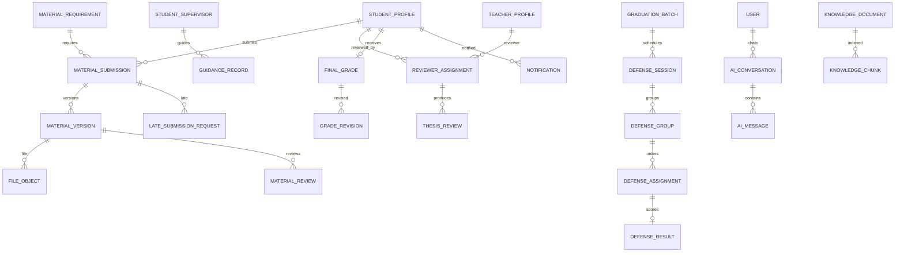
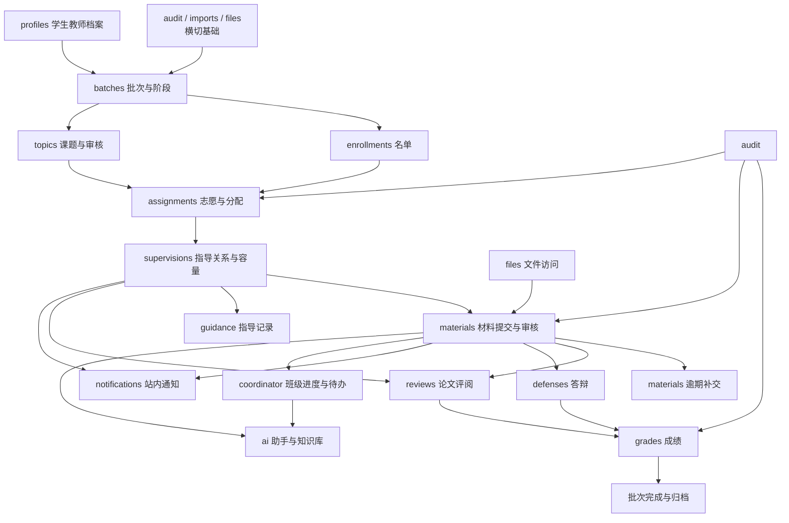

# 毕业设计管理系统 现状审计与需求差距分析报告

| 项目         | 内容                                                                                |
| ------------ | ----------------------------------------------------------------------------------- |
| 需求基线     | `docs/毕业设计管理系统_项目规格需求书_v1.0.md`（已确认的 101 项需求决策）           |
| 审计对象     | `d:/graduation-system`（`frontend` + `backend` + `packages/shared`）                |
| 审计日期     | 2026-11-15                                                                          |
| 审计方式     | 只读代码阅读 + Prisma Schema/迁移/Seed 核对 + 实际运行单元测试与 E2E                |
| 本阶段性质   | 现状审计、差距分析、方案建议；**未修改任何代码、未改 Schema、未建迁移、未提交 Git** |
| 报告结论口径 | 已有且可复用 / 部分已有 / 尚未开发 / 存在冲突 / 需进一步确认                        |

> 重要前提：本规格是**目标需求**，不是现有代码清单。选题、师生分配、任务书、开题、论文、审核、答辩、成绩、查重等业务模块当前未开发，属于**待开发范围**，不构成本阶段代码缺陷。下文所有"尚未开发"均按待规划模块处理。

---

## 0. 可复现验证记录

本次审计实际执行了以下命令，结果为本报告"已完成"结论的现场证据，而非历史转述：

| 命令                              | 结果                                             | 说明                                                           |
| --------------------------------- | ------------------------------------------------ | -------------------------------------------------------------- |
| `pnpm --filter backend test`      | **31 个测试文件 / 301 个用例全部通过**（7.44s）  | 含权限内核、角色分配、协管资格、菜单缓存、Redis、限流、认证    |
| `pnpm --filter backend test:e2e`  | **11 个测试文件 / 127 个用例全部通过**（16.41s） | 真实 MySQL + Redis + HTTP，含越权、数据范围、403/409、资格失效 |
| `pnpm --filter frontend test:run` | **15 个测试文件 / 125 个用例全部通过**（4.82s）  | 动态路由、认证守卫、菜单 Store、API 客户端、表单校验           |

未能在本阶段验证的部分（应列入后续验收）：

- 前端业务工作台的**界面级**验证（19 个业务页面目前是骨架页，无可验证交互）；
- 文件上传/下载、Excel 导入、AI 工具调用（对应能力与依赖尚不存在）；
- 数据库从零重建 + 全量迁移重放（本次仅读取 `prisma/migrations` 目录，未执行 `migrate reset`）。

后端测试可复现的前提：`backend/.env` 中 `DATABASE_URL`、`SHADOW_DATABASE_URL`、Redis 连接可用（E2E 会写真实库并自建自清临时数据）。

---

## 1. 执行摘要

### 1.1 一句话结论

**工程底座（认证、七角色平级 RBAC、组织树与数据范围、人员档案、协管资格、动态菜单与动态路由、测试体系）已经可用且经过真实越权验证，可以直接复用；毕业设计业务域（批次、课题、选题分配、材料、评阅、答辩、成绩、通知、AI）整体尚未开发，需要按依赖顺序从"批次隔离 + 审计 + 文件访问"三个横切能力开始新增，而不是改造现有底座。**

### 1.2 需求追踪矩阵的量化结果（共 102 条）

| 结论类型        | 数量 |  占比 | 含义                                                                           |
| --------------- | ---: | ----: | ------------------------------------------------------------------------------ |
| 已有且可复用    |   14 | 13.7% | 有代码 + 接口 + 测试证据，可直接作为后续模块的基础                             |
| 部分已有        |   14 | 13.7% | 底座或局部实现存在，但未满足规格完整要求（多为缺少业务档案/审计字段/批量能力） |
| 尚未开发        |   70 | 68.6% | 目标需求明确，当前无对应业务模块，属待新增                                     |
| 存在冲突/需决策 |    1 |  1.0% | 现有实现与规格口径不一致（协管员资格口径）                                     |
| 需进一步确认    |    3 |  2.9% | 规格本身未锁定（存储选型、AI 供应商、既有班级加入流程）                        |

### 1.3 十个核心问题的直接回答

1. **哪些工程底座可靠可直接复用？** 认证会话体系、`PermissionService` + `OrganizationScopeService` 权限内核、七角色预置与提权矩阵、组织树、学生/教师档案、协管资格与生命周期、动态菜单 + Redis generation 缓存、动态路由组件注册表、统一响应/异常/校验/限流。证据见 §3。
2. **RBAC / 组织 / 用户模型能否支撑多角色、协管与批次隔离？** 多角色与协管基本可支撑（角色平级、可并存、按分配分别计算范围）；**批次隔离完全缺失**（Schema 中无任何 `batchId`）；协管资格口径需与规格 §8.1 对齐；非教师工作人员的通用人员组织归属缺失。
3. **需要新增哪些业务模块？** 18 个（见 §5）：批次与阶段、批次名单、课题、选题分配、指导关系、课题变更、材料与要求、文件、材料审核、逾期补交、指导记录、论文评阅、答辩、成绩、查重登记、站内通知、协管工作台与待办、AI 与知识库，另加审计与 Excel 导入两项横切能力。
4. **哪些既有模块需要改？** 6 项（见 §6）：`ApiResponse` 字段口径与文档漂移、`AuthUser` 缺权限编码、协管资格与 `UserRole` 审计字段、教师院系调整缺历史、菜单树缺业务入口、`README` 技术描述过期。
5. **哪些设计会影响多个模块、必须提前统一？** 审计模型、批次隔离约定、文件访问授权模型、Excel 导入框架、服务端时间/时区规则、`ASSIGNED`/`SELF` 数据范围的业务关系解析器。
6. **推荐的 Schema 演进顺序？** 见 §7.6：审计与批次 → 名单 → 课题 → 分配/指导 → 材料/文件/审核 → 评阅/答辩/成绩 → 通知/待办 → 查重/归档 → AI。
7. **推荐的后端模块与前端结构？** 见 §8、§9：后端按 `modules/graduation/*` 领域切分并复用三个 Guard 与两个范围服务；前端新增"工作台"路由层 + 角色化导航，业务菜单补齐 15 个入口。
8. **哪些可并行、哪些必须串行？** 审计/批次/文件/导入是汇入点必须串行先定；课题、名单、通知、查重登记之间可并行；材料与审核、评阅与成绩、答辩与成绩存在强串行（见 §8.3）。
9. **第一批做什么？** 见 §14：审计模型 + 批次与阶段 + 批次学生名单 + Excel 导入框架 + 文件对象与私有下载骨架。
10. **需要用户决策什么？** 见 §15，共 10 项，均为规格确实未锁定或与现有代码不一致的点。

---

## 2. 当前架构与目录结构

### 2.1 仓库形态

pnpm workspace monorepo，根 `package.json` 统一编排脚本与 git hooks，`pnpm-workspace.yaml` 使用 catalog 统一工具版本。

```
graduation-system/
├─ package.json / pnpm-lock.yaml / pnpm-workspace.yaml / compose.yaml
├─ frontend/                 Vue 3.5 + Vite 8 + shadcn-vue + Tailwind 4
│  ├─ src/pages/             文件路由（unplugin-vue-router）：仅 auth / errors / index
│  ├─ src/views/             业务页面 24 个 .vue（19 个业务页 + 3 个 dashboard 组件 + 2 个共享骨架）
│  ├─ src/router/            index / guard / dynamic（菜单驱动注册）
│  ├─ src/stores/            auth / menu / sidebar-config / theme
│  ├─ src/services/api/      auth.api / menus.api / example-*.api
│  └─ src/lib/               api-client（ofetch + 自动刷新 + 会话过期事件）
├─ backend/                  NestJS 12（Express 适配）
│  ├─ src/common/            redis / rate-limit / interceptors / filters / schemas / openapi
│  ├─ src/modules/           auth(37) menus(12) profiles(26) rbac(27) users(4)
│  ├─ src/prisma/            PrismaService（driver adapter: mariadb）
│  ├─ prisma/schema.prisma   15 个模型
│  ├─ prisma/migrations/     8 个迁移
│  ├─ prisma/seed.ts         角色/权限/菜单/学校根组织/管理员
│  ├─ test/                  11 个 E2E 套件
│  └─ generated/prisma/      Prisma Client 生成目录（schema generator output）
└─ packages/shared/          @graduation/shared（tsc 编译到 dist）
   ├─ constants/             rbac.ts（角色/权限/菜单矩阵）、default-menu-tree.ts、api.ts、menu-cache.ts
   ├─ types/                 auth / menu / pagination / response / user
   └─ enums/                 menu-type、sort-order
```

### 2.2 技术栈核验（以 `package.json` 为准）

| 层             | 现状                                                                      | 与规格一致性                                  |
| -------------- | ------------------------------------------------------------------------- | --------------------------------------------- |
| 前端框架       | Vue 3.5.44、TypeScript 6、Vite 8.3.4                                      | 一致                                          |
| UI             | shadcn-vue（reka-ui 2.11）、Tailwind 4.3、lucide                          | 一致                                          |
| 状态/路由/数据 | Pinia 4、vue-router 5、TanStack Query 5 / Table 9、ofetch                 | 一致                                          |
| 表单校验       | TanStack Vue Form + Zod 4；后端 Zod Standard Schema                       | 一致                                          |
| 后端框架       | NestJS 12 + `@nestjs/platform-express`、Swagger 12                        | 一致（"原生 HTTP 适配体系"）                  |
| ORM / DB       | Prisma 7.10.1 + `@prisma/adapter-mariadb`，schema provider `mysql`        | 一致（需注意 driver adapter 影响事务/锁写法） |
| 缓存           | `redis` 6.3.1，`RedisService` 失败关闭（503），用于验证码、限流、菜单缓存 | 一致                                          |
| 邮件           | `nodemailer`（仅注册验证码）                                              | 与"暂不接外部通知渠道"不冲突（属认证能力）    |
| AI             | **无** langchain / langgraph / chroma 依赖，无 AI 模块                    | 未开始                                        |
| 文件/对象存储  | **无** multer / S3 / MinIO / OSS 依赖，无上传接口                         | 未开始                                        |
| 队列/异步任务  | **无** bullmq 等                                                          | 未开始（规格仅要求"可重试"，未锁定产品）      |

### 2.3 应用装配现状

`backend/src/app.module.ts` 仅挂载 8 个模块：`PrismaModule`、`RedisModule`、`RolesModule`、`OrganizationModule`、`RoleAssignmentsModule`、`ProfilesModule`、`UsersModule`、`AuthModule`、`MenusModule`。

`backend/src/main.ts`：`/api` 全局前缀（来自共享常量）、CORS 白名单、Swagger 挂载在 `/api/docs`。

`backend/src/common/configure-global-enhancers.ts`：全局 `StandardSchemaValidationPipe`（错误码 40001）、`ResponseInterceptor`、`GlobalExceptionFilter`。

---

## 3. 当前已实现能力及证据

### 3.1 认证与会话（可复用，质量高）

| 能力                                                                                                  | 证据                                                            | 现场验证                                              |
| ----------------------------------------------------------------------------------------------------- | --------------------------------------------------------------- | ----------------------------------------------------- |
| 学生注册（邮箱验证码，默认 STUDENT 角色，不接受客户端指定角色）                                       | `modules/auth/auth.controller.ts:127`、`auth.service.ts`        | `auth.e2e-spec.ts`、`register-email-code.e2e-spec.ts` |
| 邮箱验证码：6 位、120s、60s 冷却、单邮箱 5 次/时、单 IP 20 次/时、防枚举、Redis 不可用返回 503 不降级 | `modules/auth/email-code/*`、`common/redis/redis.service.ts:14` | `email-code.service.integration.spec.ts`（18 例）     |
| 登录（限流 key = IP + 邮箱，5 次/分）                                                                 | `auth.controller.ts:171`                                        | `auth.service.spec.ts`（19 例）、`auth.e2e-spec.ts`   |
| Refresh Token 轮换 + HttpOnly Cookie + Origin 校验                                                    | `auth.controller.ts:201`、`guards/origin.guard.ts`              | `cookie.util.spec.ts`、`origin.guard.spec.ts`         |
| Access Token 守卫同时校验会话撤销与用户状态（登出即时失效）                                           | `guards/access-token.guard.ts:30-70`                            | E2E 覆盖                                              |
| 登出幂等（有 Cookie 无 Cookie 都安全）                                                                | `auth.controller.ts:243`                                        | `auth.e2e-spec.ts`                                    |
| `/auth/me` 身份只取自 Token                                                                           | `auth.controller.ts:228`                                        | E2E                                                   |

### 3.2 RBAC 权限内核（可复用，规格 §38 的核心要求已满足）

- **七个平级角色**（无继承）：`packages/shared/src/constants/rbac.ts:12-20`，含 `PLATFORM_SUPER_ADMIN`、`SCHOOL_ADMIN`、`DEPARTMENT_ADMIN`、`MAJOR_ADMIN`、`CLASS_COORDINATOR`、`TEACHER`、`STUDENT`；旧 `SUPER_ADMIN` 仅保留编码用于迁移审计（`LEGACY_SUPER_ADMIN_ROLE_CODE`）。
- **权限与数据范围成对返回**，不做扁平合并：`permission.service.ts:111-131`（`findPermissionAssignments`）、`organization-scope.service.ts:59-93`（`resolve` 按"授予该权限的分配"逐条求并集）。
- **有效分配判定**：未撤销 + `validFrom` 已到 + 未过期 + 角色 ACTIVE + 用户 ACTIVE 且未删除（`permission.service.ts:64-104`）。
- **不做进程内权限缓存**，因此授权撤销即时生效（`permission.service.ts:45` 注释 + 实现）。
- **失败关闭**：无范围即 403（`organization-scope.service.ts:96-106`）；组织授权根及祖先链必须 ACTIVE 才向下遍历。
- **提权矩阵**：`rbac/assignments/role-assignment.policy.ts` + `role-assignment.policy.spec.ts`（10 例）。
- **接口级守卫**：`RequirePermissions` + `PermissionsGuard`（`rbac/authorization/permissions.guard.ts`），49 个后端路由中管理类接口均带权限声明。
- **E2E 越权验证**：`rbac-authorization.e2e-spec.ts`、`users.e2e-spec.ts`、`student-profiles.e2e-spec.ts`、`teacher-profiles.e2e-spec.ts` 共 40+ 用例覆盖跨院系 403、停用范围、过期角色不扩权。

### 3.3 组织与人员档案（可复用，局部需补）

| 能力                                                                                          | 证据                                                                                  |
| --------------------------------------------------------------------------------------------- | ------------------------------------------------------------------------------------- |
| 四级组织树（SCHOOL / DEPARTMENT / MAJOR / CLASS，邻接表，`onDelete: Restrict`）               | `schema.prisma:231-263`                                                               |
| 组织树按数据范围裁剪 + 断链修复（`allowMissingParent`）                                       | `rbac/organizations/organization.service.ts`                                          |
| 组织 CRUD（4 个接口）+ 状态变更触发缓存失效                                                   | `organizations/organization.controller.ts:56-160`                                     |
| 学生档案（`userId` 可空、只存 `classId`、学籍状态、`createdById/updatedById`）                | `schema.prisma:377-401`；`profiles/student-profile.controller.ts` 6 个接口            |
| 转班历史（前后班级、原因必填、操作人、并发 `expectedClassId` 冲突 409）                       | `schema.prisma:543-562`；`student-profile.service.ts`；`student-profiles.e2e-spec.ts` |
| 教师档案（`departmentId`、在职状态、院系调整 409 校验）                                       | `schema.prisma:410-432`；`teacher-profile.controller.ts` 5 个接口                     |
| 班主任任职 `TeacherClassDuty`（半开区间、行锁、软撤销）                                       | `schema.prisma:441-466`；`teacher-class-duty.service.ts`                              |
| 辅导员分配 `CounselorClassAssignment`（直接关联 User，不要求 TeacherProfile）                 | `schema.prisma:475-499`                                                               |
| 协管资格五种来源 + 实时复核                                                                   | `profiles/coordinator-eligibility.service.ts:8-58`                                    |
| 转班/离职/撤职后自动终止失去依据的 `CLASS_COORDINATOR`，`revocationReason=QUALIFICATION_LOST` | `coordinator-lifecycle.service.ts`；`schema.prisma:80-83`                             |
| 用户账号查询（按授权范围合并学生班级、教师院系、管理角色、辅导员分配）                        | `modules/users/users.controller.ts:83-121`；`users.e2e-spec.ts`                       |

### 3.4 动态菜单与动态路由（可复用）

- `GET /api/menus/current`：唯一入参为 Token 内 `userId`，角色与菜单全部服务端解析（`menus.controller.ts:25`、`menus.service.ts:227`）。
- 多角色菜单按 `RoleMenu` 合并去重，目录仅补齐"有合法 PAGE 后代"的祖先，祖先停用则整枝丢弃（`menus.service.ts:58-207`）。
- Redis 缓存 `cache:rbac:menus:v1:g{generation}:user:{userId}`，全局 generation 版本号，TTL ≤ 最近资格到期时间，进程内 singleflight（`menu-cache.service.ts`、`menu-cache-generation.ts`）。
- 写操作统一 `commitThenInvalidate(reason, tx)`，事务提交后才 INCR（`menu-cache-invalidator.service.ts`）。
- 前端动态路由只按 `componentKey` 在本地注册表查找组件，绝不按后端路径动态 import（`frontend/src/router/dynamic/routes.ts:33-86`）。
- 会话过期统一收尾：清 Store → 清动态路由 → 提示 → 跳登录（`frontend/src/router/index.ts:38-60`）。

### 3.5 前端认证与体验基础（可复用）

- Access Token 只存内存，刷新页面通过 `/auth/refresh` 恢复（`stores/auth.ts:8-14`）。
- 初始化 Promise 去重、静默刷新事件同步、401 单点处理（`lib/api-client.ts`、`lib/auth-events.ts`）。
- 登录/注册页 + 邮箱验证码倒计时 composable（`composables/use-email-code.ts`）。
- 19 个业务页面**均为骨架页**（`views/_shared/page-scaffold.vue` + 各 `index.vue`，单文件 600~860 字节），只声明"规划功能/访问角色/业务内容区域占位"，**无任何业务逻辑**。

### 3.6 数据模型现状（15 个模型，全部属底座）

`User`、`Role`、`Permission`、`Menu`、`OrganizationUnit`、`UserRole`、`RolePermission`、`RoleMenu`、`AuthSession`、`StudentProfile`、`TeacherProfile`、`TeacherClassDuty`、`CounselorClassAssignment`、`CoordinatorQualificationOverride`、`StudentClassTransfer`。

8 个迁移：`init_rbac` → `add_menu_component_key` → `phase1_organization_and_user_role_scope` → `repair_organization_unit_foreign_keys` → `phase_c_profiles_and_class_duties` → `coordinator_qualification_overrides` → `user_role_revocation_reason` → `phase_e_profile_audit_and_transfer_history`。

**没有任何毕业设计业务表**：无批次、课题、选题、指导关系、材料、文件、审核、评阅、答辩、成绩、通知、AI、审计表。

### 3.7 明确不存在的能力（避免误判）

| 能力                               | 状态                                                |
| ---------------------------------- | --------------------------------------------------- |
| 文件上传/下载、对象存储、私有直链  | 不存在（无依赖、无接口、无表）                      |
| AI 对话、LangGraph Agent、向量检索 | 不存在                                              |
| 站内通知、待办                     | 不存在                                              |
| 通用审计日志 / 变更前后值          | 不存在（仅零散 `createdBy/updatedBy` 与软撤销字段） |
| Excel 导入（任何场景）             | 不存在                                              |
| 批次、阶段、流程节点               | 不存在                                              |
| 工作台切换（多角色 UI 层）         | 不存在                                              |
| 前端权限编码（按钮级）             | 不存在（`AuthUser` 只有 `roles`）                   |

---

## 4. 需求追踪矩阵

说明：

- "代码证据"列给出可核验位置；未实现统一写"暂无"。
- "尚未开发"表示需新增模块，不是缺陷。
- 优先级按规格 §45 口径：P0 阻塞性基础、P1 第一阶段核心业务、P2 辅助业务、P3 暂缓/增强。

### 4.1 组织与人员档案（ORG）

| 需求编号 | 需求摘要                                    | 当前状态     | 代码证据                                                                           | 差距说明                                                                                         | 建议动作                                               | 优先级 | 依赖项 |
| -------- | ------------------------------------------- | ------------ | ---------------------------------------------------------------------------------- | ------------------------------------------------------------------------------------------------ | ------------------------------------------------------ | ------ | ------ |
| ORG-01   | 学校→院系→专业→班级四级组织树               | 已有且可复用 | `schema.prisma:231-263`、`organization.service.ts`                                 | 无（已支持父子、状态、排序、RESTRICT）                                                           | 复用                                                   | —      | —      |
| ORG-02   | 按组织过滤与授权（子树解析、失败关闭）      | 已有且可复用 | `organization-scope.service.ts:59-122`                                             | 无                                                                                               | 复用                                                   | —      | —      |
| ORG-03   | 用户当前组织归属（学生/教师/工作人员）      | 部分已有     | `StudentProfile.classId`、`TeacherProfile.departmentId`、`UserRole.scopeOrgUnitId` | 非教师工作人员无统一组织归属字段，只能用角色范围间接表达；无"当前归属"单一查询入口               | 修改（新增 `StaffProfile` 或通用 `UserOrgMembership`） | P1     | ORG-06 |
| ORG-04   | 学生学籍档案（学号、班级、学籍状态）        | 已有且可复用 | `schema.prisma:377-401`、`student-profile.controller.ts`                           | 缺入学年份/培养层次等可选字段（规格未强制）                                                      | 复用                                                   | —      | —      |
| ORG-05   | 教师档案与院系归属                          | 已有且可复用 | `schema.prisma:410-432`、`teacher-profile.controller.ts`                           | 无                                                                                               | 复用                                                   | —      | —      |
| ORG-06   | 非学生工作人员建模（不强制 TeacherProfile） | 部分已有     | `schema.prisma:475-499`（辅导员直接关联 User）                                     | 仅有辅导员分配关系，缺少"工作人员所属院系/部门"的正式归属；协管资格校验依赖此归属                | 新增通用人员组织归属                                   | P1     | ORG-03 |
| ORG-07   | 学生转班/转专业/转院系且保留历史            | 部分已有     | `schema.prisma:543-562`、`student-profile.service.ts`                              | 转班已实现；"转专业"只能通过转到目标专业班级实现，无转专业/转院系的独立业务语义与审批            | 修改（扩展 transfer 的类型或新增变更单）               | P2     | ORG-08 |
| ORG-08   | 组织归属变更留痕（前后值、操作人、时间）    | 部分已有     | `StudentClassTransfer`；`TeacherProfile.updatedById`                               | 教师院系调整只有 `updatedById`，没有变更历史表；学生休学/毕业状态变更无历史                      | 新增历史表（教师院系/学籍状态变更）                    | P1     | —      |
| ORG-09   | 学生注册后学号验证并绑定档案                | 尚未开发     | 暂无（`StudentProfile.userId` 可空是预留）                                         | 注册只创建 User + STUDENT 角色，无学号验证与档案绑定接口                                         | 新增                                                   | P1     | ORG-04 |
| ORG-10   | 学生加入班级既有流程                        | 需进一步确认 | 暂无                                                                               | 规格明确"不授权本阶段改动该流程"，但当前系统不存在该流程，需确认是"保留现状（不存在）"还是"新增" | 暂缓（待确认）                                         | P2     | ORG-09 |
| ORG-11   | 按班级/专业列出学生名单                     | 已有且可复用 | `student-profile.controller.ts:59`（`classId` 过滤 + 范围下推）                    | 无                                                                                               | 复用                                                   | —      | —      |
| ORG-12   | 组织节点停用后不越权、不丢历史              | 已有且可复用 | 外键 `onDelete: Restrict`；`menus.service.ts:281-291` 过滤失效路径                 | 无                                                                                               | 复用                                                   | —      | —      |

### 4.2 RBAC 与多角色（RBAC）

| 需求编号 | 需求摘要                                                 | 当前状态     | 代码证据                                                                                                   | 差距说明                                                                                             | 建议动作                                | 优先级 | 依赖项         |
| -------- | -------------------------------------------------------- | ------------ | ---------------------------------------------------------------------------------------------------------- | ---------------------------------------------------------------------------------------------------- | --------------------------------------- | ------ | -------------- |
| RBAC-01  | 系统角色集合稳定、不随意增删改名                         | 已有且可复用 | `constants/rbac.ts:12-20`、`seed.ts`（upsert 幂等）                                                        | 现有 7 角色比规格列举多出 `PLATFORM_SUPER_ADMIN` / `MAJOR_ADMIN`，属"以代码为准"，需在文档登记职责   | 复用 + 文档登记                         | —      | —              |
| RBAC-02  | 多角色共存且权限合并                                     | 已有且可复用 | `permission.service.ts:55-104`；`menus.service.ts:311-318`                                                 | 无                                                                                                   | 复用                                    | —      | —              |
| RBAC-03  | 各角色数据范围分别校验，不因合并扩权                     | 已有且可复用 | `organization-scope.service.ts:59-93`；`permission.service.spec.ts`                                        | 无                                                                                                   | 复用                                    | —      | —              |
| RBAC-04  | 撤销一个角色不影响其他角色                               | 已有且可复用 | `schema.prisma:269-301`（单条 `revokedAt`）；`rbac-authorization.e2e-spec.ts`                              | 无                                                                                                   | 复用                                    | —      | —              |
| RBAC-05  | 角色分配支持有效期与自动失效                             | 已有且可复用 | `UserRole.validFrom/validUntil`；`permission.service.ts:78-88`                                             | 无                                                                                                   | 复用                                    | —      | —              |
| RBAC-06  | 前端按权限控制入口与按钮                                 | 尚未开发     | `types/auth.type.ts:34-40`（仅 `roles`）                                                                   | `AuthUser` 不下发权限编码，前端无法做按钮级可见性；后端仍是唯一裁决点                                | 修改（`/auth/me` 增加 `permissions[]`） | P1     | —              |
| RBAC-07  | 角色独立工作台（学生/教师/协管/管理）                    | 尚未开发     | `default-menu-tree.ts` 单一菜单树                                                                          | 菜单按角色合并，无"工作台"路由层与默认落地页概念                                                     | 新增                                    | P1     | RBAC-08        |
| RBAC-08  | 工作台切换、记住上次、失效回退                           | 尚未开发     | 暂无                                                                                                       | 无持久化工作台选择，无切换入口                                                                       | 新增                                    | P1     | RBAC-07        |
| RBAC-09  | 角色分配提权矩阵与审计                                   | 部分已有     | `role-assignment.policy.ts`；`UserRole.revokedById/revocationReason`                                       | 提权矩阵已有；缺操作来源、原因说明、变更前后值、独立审计查询                                         | 修改（补审计字段）                      | P1     | AUDIT-01       |
| RBAC-10  | `ASSIGNED`/`SELF` 范围（教师只看自己学生、学生只看本人） | 尚未开发     | `organization-scope.service.ts:25-32`（明确不产生组织范围）；`rbac.ts:490-492`（TEACHER/STUDENT 权限为空） | 无指导/评阅/材料关系表，无法解析"自己的学生/本人材料"；`AuthUser` 也无 `studentProfileId` 等业务身份 | 新增范围解析器 + 业务关系表             | P0     | SUP-01、MAT-03 |

### 4.3 班级协管员（COORD）

| 需求编号 | 需求摘要                                                                      | 当前状态        | 代码证据                                                                                     | 差距说明                                                                                                                                                    | 建议动作                           | 优先级 | 依赖项           |
| -------- | ----------------------------------------------------------------------------- | --------------- | -------------------------------------------------------------------------------------------- | ----------------------------------------------------------------------------------------------------------------------------------------------------------- | ---------------------------------- | ------ | ---------------- |
| COORD-01 | 协管是叠加身份，不覆盖学生/教师身份                                           | 部分已有        | `UserRole` 多角色并存；`rbac-matrix.spec.ts`                                                 | 数据层已支持并存；"学生工作台与协管工作台同时保留"未实现                                                                                                    | 复用数据层 + 新增前端              | P1     | RBAC-07          |
| COORD-02 | 学生只能协管本班且最多一个班；工作人员同院系可多班                            | 存在冲突/需决策 | `coordinator-eligibility.service.ts:8-58`（资格为班长/班助/班主任/辅导员/覆盖五类）          | 现有实现要求"班长/班助候选资格"，而规格 §8.1 只要求"本班在籍学生"；且系统无正式班长/班助任免表，当前靠学生身份+转班联动兜底；"学生最多一个班"未在数据层约束 | 重构资格模型或补任免表（见 §15-1） | P0     | ORG-04           |
| COORD-03 | 工作人员可授权同院系多班、逐班独立                                            | 部分已有        | `counselor-class-assignment.service.ts`、`teacher-class-duty.service.ts`                     | 已按班级独立授权与撤权；缺通用工作人员院系归属校验入口                                                                                                      | 修改（依赖 ORG-06）                | P1     | ORG-06           |
| COORD-04 | 单级授权 + 同班批量选择用户                                                   | 部分已有        | `role-assignments.controller.ts:148`（单条 POST）                                            | 无批量授权接口；无"按班级批量选择学生"的候选查询                                                                                                            | 新增                               | P2     | COORD-02         |
| COORD-05 | 默认长期有效、可设截止、到期提醒与到期列表                                    | 部分已有        | `UserRole.validUntil`；`permission.service.ts:78-88`；`menus.service.ts:262-268`（TTL 收敛） | 截止与自动失效已有；无"即将到期/已到期列表"、无提前提醒、无通知渠道                                                                                         | 新增查询 + 提醒（依赖通知）        | P2     | NOTIFY-01        |
| COORD-06 | 协管退出申请（管理员确认后撤权）                                              | 尚未开发        | 暂无                                                                                         | 无申请表、无审批接口、无状态机                                                                                                                              | 新增                               | P2     | COORD-07         |
| COORD-07 | 撤销后立即失效、重新授权新建记录                                              | 已有且可复用    | `role-assignments.service.ts`；`revokedAt` 单条语义；E2E `coordinator-http.e2e-spec.ts`      | 无（撤销即失效，无进程内权限缓存）                                                                                                                          | 复用                               | —      | —                |
| COORD-08 | 授权审计专项字段（目标/班级/授权人/时间/生效/截止/撤销人/原因分类/说明/来源） | 部分已有        | `UserRole` 13 个字段；`UserRoleRevocationReason` 枚举                                        | 缺撤销原因文字说明、操作来源（API/导入/系统）、前后值快照；无按组织范围查询授权历史的专用审计视图                                                           | 修改 + 新增审计表                  | P0     | AUDIT-01         |
| COORD-09 | 协管自查本人当前与历史授权                                                    | 部分已有        | `GET /role-assignments/users/:id`                                                            | 需 `rbac:role-assignment:read` 权限，协管角色无此权限，实际无法自查；且会返回同组织他人记录，需收窄为"仅本人"                                               | 修改（新增 self 接口）             | P2     | RBAC-06          |
| COORD-10 | 协管数据边界（只看状态，不读材料正文，不审核）                                | 尚未开发        | 暂无                                                                                         | 业务表不存在；需在材料/文件模块中强制"协管只读状态投影"                                                                                                     | 新增（随 MAT/FILE）                | P1     | FILE-02、MAT-06  |
| COORD-11 | 协管工作台（我的班级/名单/进度/逾期/通知/待办/授权记录）                      | 尚未开发        | `views/process/monitor.vue` 为骨架                                                           | 无班级进度投影、无待办、无授权记录页                                                                                                                        | 新增                               | P2     | BATCH-01、MAT-06 |
| COORD-12 | 协管 AI 边界（仅班级维度汇总）                                                | 尚未开发        | 暂无                                                                                         | AI 能力整体缺失                                                                                                                                             | 新增（随 AI）                      | P3     | AI-02            |

### 4.4 批次与流程控制（BATCH）

| 需求编号 | 需求摘要                                            | 当前状态 | 代码证据                        | 差距说明                                    | 建议动作        | 优先级 | 依赖项             |
| -------- | --------------------------------------------------- | -------- | ------------------------------- | ------------------------------------------- | --------------- | ------ | ------------------ |
| BATCH-01 | `GraduationBatch` 实体，多批次并行、历史保留        | 尚未开发 | 暂无                            | 无批次表；所有业务表未来都需挂批次          | 新增            | P1     | —                  |
| BATCH-02 | 批次业务隔离（查询默认限定当前批次）                | 尚未开发 | 暂无（Schema 无任何 `batchId`） | 无隔离字段约定、无"当前批次上下文"解析      | 新增 + 统一约定 | P0     | BATCH-01           |
| BATCH-03 | 生命周期 `DRAFT→UPCOMING→ACTIVE→COMPLETED→ARCHIVED` | 尚未开发 | 暂无                            | 无状态机、无完成前校验（答辩/成绩发布）     | 新增            | P1     | BATCH-01、GRADE-03 |
| BATCH-04 | 阶段时间配置 + 开始/截止自动开关                    | 尚未开发 | 暂无                            | 无阶段表、无服务端时间判定、无 admin 调整   | 新增            | P1     | BATCH-01           |
| BATCH-05 | 学院有限配置覆盖（时间/材料/可选环节/逾期规则）     | 尚未开发 | 暂无                            | 无覆盖配置模型与优先级规则                  | 新增            | P2     | BATCH-04           |
| BATCH-06 | 延期/补交（个别学生批准）                           | 尚未开发 | 暂无                            | 无申请/审批实体                             | 新增            | P1     | MAT-05             |
| BATCH-07 | 归档冻结与授权修订                                  | 尚未开发 | 暂无                            | 无归档冻结策略                              | 新增            | P2     | BATCH-03           |
| BATCH-08 | 服务端时区规则（不由客户端时间决定结果）            | 尚未开发 | 暂无（当前无业务时间判断）      | 需确定业务时区常量与服务端统一 `now()` 来源 | 新增约定        | P1     | BATCH-04           |

### 4.5 名单、课题、分配、指导（ENROLL / TOPIC / ASSIGN / SUP / CHANGE）

| 需求编号  | 需求摘要                                       | 当前状态 | 代码证据 | 差距说明                                                            | 建议动作               | 优先级 | 依赖项            |
| --------- | ---------------------------------------------- | -------- | -------- | ------------------------------------------------------------------- | ---------------------- | ------ | ----------------- |
| ENROLL-01 | 批次名单维护（按院系/专业/班级筛选、批量选择） | 尚未开发 | 暂无     | 无批次-学生关系表                                                   | 新增                   | P1     | BATCH-01、ORG-04  |
| ENROLL-02 | Excel 导入名单 + 学号匹配已有账号              | 尚未开发 | 暂无     | 无导入能力                                                          | 新增（复用 IMPORT-01） | P1     | IMPORT-01、ORG-09 |
| ENROLL-03 | 未匹配/错误名单下载                            | 尚未开发 | 暂无     | 无导入结果模型                                                      | 新增                   | P1     | ENROLL-02         |
| ENROLL-04 | 学生不能自改批次                               | 尚未开发 | 暂无     | 无接口即无风险，落地时需显式禁止                                    | 新增时约束             | P1     | ENROLL-01         |
| TOPIC-01  | 教师课题草稿（名称/方向/内容/要求/适用专业）   | 尚未开发 | 暂无     | 无课题表                                                            | 新增                   | P1     | BATCH-01、ORG-05  |
| TOPIC-02  | 课题提交学院审核/退回/发布                     | 尚未开发 | 暂无     | 无审核记录与状态机                                                  | 新增                   | P1     | TOPIC-01          |
| TOPIC-03  | 课题修改/撤销/重新发布保留历史                 | 尚未开发 | 暂无     | 无版本或历史表                                                      | 新增                   | P1     | TOPIC-02          |
| TOPIC-04  | 一题一生唯一约束（防并发重复分配）             | 尚未开发 | 暂无     | 需唯一索引 + 事务/行锁策略                                          | 新增                   | P1     | ASSIGN-05         |
| TOPIC-05  | 跨专业选题规则（默认本专业、学院可开放）       | 尚未开发 | 暂无     | 无规则配置与校验                                                    | 新增                   | P2     | TOPIC-01          |
| ASSIGN-01 | 双向选择（多志愿 + 优先顺序 + 单一有效志愿表） | 尚未开发 | 暂无     | 无志愿表与状态                                                      | 新增                   | P1     | TOPIC-02          |
| ASSIGN-02 | 管理员手动单个/批量分配                        | 尚未开发 | 暂无     | 无分配实体                                                          | 新增                   | P1     | SUP-01            |
| ASSIGN-03 | Excel 分配导入（解析/预览/校验/确认/错误清单） | 尚未开发 | 暂无     | 无导入框架                                                          | 新增                   | P1     | IMPORT-01         |
| ASSIGN-04 | 分配模式配置层级（批次默认 + 学院覆盖）        | 尚未开发 | 暂无     | 无配置模型                                                          | 新增                   | P2     | BATCH-05          |
| ASSIGN-05 | 课题/学生/教师三名额冲突并发防护               | 尚未开发 | 暂无     | 需唯一约束 + `SELECT ... FOR UPDATE` 或乐观锁；现有转班已有行锁示范 | 新增                   | P1     | TOPIC-04、SUP-02  |
| SUP-01    | 指导关系独立建模（生效/结束/原因/操作者）      | 尚未开发 | 暂无     | 无 `StudentSupervisor` 表                                           | 新增                   | P1     | ASSIGN-02         |
| SUP-02    | 同批次唯一主指导（不支持联合指导）             | 尚未开发 | 暂无     | 需部分唯一索引/业务唯一校验                                         | 新增                   | P1     | SUP-01            |
| SUP-03    | 教师指导人数上限（批次/学院/教师可配）         | 尚未开发 | 暂无     | 无容量表与统一校验入口                                              | 新增                   | P1     | SUP-01            |
| SUP-04    | 超额授权（授权人/原因/时间留痕）               | 尚未开发 | 暂无     | 无超额记录                                                          | 新增                   | P2     | SUP-03            |
| CHANGE-01 | 课题变更申请 + 教师审核（必要时学院确认）      | 尚未开发 | 暂无     | 无变更单与审批                                                      | 新增                   | P2     | SUP-01            |

### 4.6 材料、文件、指导过程、评阅（MAT / FILE / GUIDE / REVIEW）

| 需求编号  | 需求摘要                                                | 当前状态     | 代码证据                     | 差距说明                                    | 建议动作         | 优先级 | 依赖项            |
| --------- | ------------------------------------------------------- | ------------ | ---------------------------- | ------------------------------------------- | ---------------- | ------ | ----------------- |
| MAT-01    | 材料类型预置 + 批次材料要求（必交/选交/格式/大小/截止） | 尚未开发     | 暂无                         | 无材料要求表                                | 新增             | P1     | BATCH-04          |
| MAT-02    | 学院/专业差异化材料要求                                 | 尚未开发     | 暂无                         | 无覆盖模型                                  | 新增             | P2     | MAT-01、BATCH-05  |
| MAT-03    | 提交记录与版本分离，新版本不覆盖旧版本                  | 尚未开发     | 暂无                         | 无 `MaterialSubmission` / `MaterialVersion` | 新增             | P1     | MAT-01            |
| MAT-04    | 审核流（教师→学院，审核关联具体版本）                   | 尚未开发     | 暂无                         | 无 `MaterialReview` 与状态机                | 新增             | P1     | MAT-03            |
| MAT-05    | 逾期补交申请与审批，真实提交时间                        | 尚未开发     | 暂无                         | 无 `LateSubmissionRequest`；无逾期天数计算  | 新增             | P1     | BATCH-06          |
| MAT-06    | 材料状态只读投影（供协管与学生查看）                    | 尚未开发     | 暂无                         | 无投影视图/DTO 分层                         | 新增             | P1     | MAT-03、COORD-10  |
| FILE-01   | 文件元数据与正文分离，私有存储                          | 尚未开发     | 暂无（无依赖、无表、无接口） | 无 `FileObject`、无存储适配层、无上传入口   | 新增（先定方案） | P0     | §15-2             |
| FILE-02   | 下载经身份+业务关系+数据范围校验，短时授权              | 尚未开发     | 暂无                         | 无下载令牌/流式响应；不能使用公开直链       | 新增             | P0     | FILE-01、MAT-03   |
| FILE-03   | 上传限制（格式白名单、大小、病毒/类型校验）             | 尚未开发     | 暂无                         | 无上传管道                                  | 新增             | P1     | FILE-01           |
| FILE-04   | 存储产品/本地方案选型                                   | 需进一步确认 | 暂无                         | 规格明确未锁定                              | 暂缓（待确认）   | P1     | §15-2             |
| GUIDE-01  | 结构化指导记录（时间/方式/内容/问题/下阶段/建议）       | 尚未开发     | 暂无                         | 无 `GuidanceRecord`                         | 新增             | P2     | SUP-01            |
| GUIDE-02  | 学生确认已读（不等于认可）                              | 尚未开发     | 暂无                         | 无确认字段与语义区分                        | 新增             | P2     | GUIDE-01          |
| REVIEW-01 | 评阅教师分配（单个/批量/导入），不可为本人指导老师      | 尚未开发     | 暂无                         | 无 `ReviewerAssignment`                     | 新增             | P1     | SUP-01            |
| REVIEW-02 | 评阅意见与评分                                          | 尚未开发     | 暂无                         | 无 `ThesisReview`                           | 新增             | P1     | REVIEW-01、MAT-03 |
| REVIEW-03 | 更换评阅教师保留历史                                    | 尚未开发     | 暂无                         | 需软撤销/有效期模型                         | 新增             | P1     | REVIEW-01         |

### 4.7 答辩、成绩、查重（DEF / GRADE / PLAG）

| 需求编号 | 需求摘要                                            | 当前状态 | 代码证据 | 差距说明                             | 建议动作 | 优先级 | 依赖项             |
| -------- | --------------------------------------------------- | -------- | -------- | ------------------------------------ | -------- | ------ | ------------------ |
| DEF-01   | 答辩场次/分组/时间地点/顺序/评委/秘书               | 尚未开发 | 暂无     | 无 `DefenseSession/Group/Assignment` | 新增     | P1     | BATCH-04           |
| DEF-02   | 小组统一成绩录入 + Excel 导入（不覆盖既有成绩）     | 尚未开发 | 暂无     | 无 `DefenseResult`、无导入与冲突策略 | 新增     | P1     | DEF-01、IMPORT-01  |
| DEF-03   | 二次答辩独立记录，不覆盖第一次                      | 尚未开发 | 暂无     | 无轮次字段/独立表                    | 新增     | P1     | DEF-02             |
| GRADE-01 | 权重可配（默认 30/30/40，总和 100% 校验）           | 尚未开发 | 暂无     | 无 `GradeComponent` 配置             | 新增     | P1     | DEF-02、REVIEW-02  |
| GRADE-02 | 综合成绩自动计算并保留原始分                        | 尚未开发 | 暂无     | 无 `FinalGrade` 与计算服务           | 新增     | P1     | GRADE-01           |
| GRADE-03 | 院系检查完整性 → 管理员发布；学生仅见已发布         | 尚未开发 | 暂无     | 无 `GradePublication` 与状态         | 新增     | P1     | GRADE-02           |
| GRADE-04 | 发布后修订留痕（人/时间/原因/前后值）               | 尚未开发 | 暂无     | 无修订历史                           | 新增     | P1     | GRADE-03、AUDIT-01 |
| PLAG-01  | 查重与 AIGC 检测人工登记（平台/时间/说明/报告附件） | 尚未开发 | 暂无     | 无 `PlagiarismCheck`                 | 新增     | P2     | FILE-01            |

### 4.8 通知、AI、导入、审计、安全与测试（NOTIFY / AI / IMPORT / AUDIT / SEC / TEST）

| 需求编号  | 需求摘要                                                 | 当前状态     | 代码证据                                                                      | 差距说明                                                       | 建议动作        | 优先级 | 依赖项              |
| --------- | -------------------------------------------------------- | ------------ | ----------------------------------------------------------------------------- | -------------------------------------------------------------- | --------------- | ------ | ------------------- |
| NOTIFY-01 | 站内通知（列表/详情/已读/未读）                          | 尚未开发     | 暂无                                                                          | 无 `InAppNotification`                                         | 新增            | P2     | —                   |
| NOTIFY-02 | 通知与授权/业务操作解耦，失败不回滚                      | 尚未开发     | 暂无                                                                          | 无发送记录与重试策略                                           | 新增            | P2     | NOTIFY-01           |
| NOTIFY-03 | 协管在授权班级范围内发送 + 发送记录                      | 尚未开发     | 暂无                                                                          | 无范围发送校验                                                 | 新增            | P2     | NOTIFY-01、COORD-10 |
| AI-01     | 个人会话/消息持久化与严格隔离                            | 尚未开发     | 暂无                                                                          | 无 `AiConversation/AiMessage`                                  | 新增            | P2     | RBAC-10             |
| AI-02     | 工具调用在 NestJS 后端做真实身份+范围校验                | 尚未开发     | 暂无                                                                          | 无工具注册与统一鉴权入口；需禁止无边界超管凭据                 | 新增            | P2     | AI-01               |
| AI-03     | 学生材料分析（只访问本人有权内容，不自动改材料）         | 尚未开发     | 暂无                                                                          | 无材料/文件模块支撑                                            | 新增            | P3     | MAT-03、FILE-02     |
| AI-04     | 班级管理助手（只读汇总 + 草稿，人工确认后发送）          | 尚未开发     | 暂无                                                                          | 无班级投影与草稿态                                             | 新增            | P3     | COORD-11            |
| AI-05     | 双层知识库 + 检索权限校验 + Chroma                       | 尚未开发     | 暂无                                                                          | 无知识文档/索引/授权映射                                       | 新增            | P3     | AI-02、FILE-02      |
| AI-06     | AI 供应商与向量库选型                                    | 需进一步确认 | 暂无                                                                          | 规格明确未锁定                                                 | 暂缓（待确认）  | P3     | §15-3               |
| IMPORT-01 | 通用 Excel 导入框架（模板/解析/预览/校验/确认/批次留痕） | 尚未开发     | 暂无                                                                          | 无任何导入基础设施                                             | 新增            | P1     | AUDIT-01            |
| AUDIT-01  | 通用操作审计（操作者/对象/时间/类型/前后值/原因/来源）   | 尚未开发     | 仅 `createdById`/`updatedById`/软撤销字段                                     | 无法满足规格 §39 的变更前后值与来源要求；后续 10+ 模块都依赖它 | 新增            | P0     | —                   |
| AUDIT-02  | 审计不可经普通接口修改/删除                              | 尚未开发     | 暂无                                                                          | 无审计表即无保护；保留期/脱敏未定                              | 新增            | P0     | AUDIT-01            |
| SEC-01    | 后端是最终裁决点                                         | 已有且可复用 | `PermissionsGuard` + `OrganizationScopeService`；E2E 覆盖直接调 API 越权      | 无                                                             | 复用            | —      | —                   |
| SEC-02    | 权限撤销即时生效（无缓存残留）                           | 已有且可复用 | `permission.service.ts:45`（不做进程内缓存）；菜单 generation 缓存 + TTL 收敛 | 无（菜单最长陈旧受 TTL 与 generation 控制）                    | 复用            | —      | —                   |
| SEC-03    | 超管系统维护权与业务正文访问权分离                       | 部分已有     | `rbac.ts:412-421`（平台超管无业务权限）                                       | 已有良好基础；材料正文访问需在 FILE-02 中显式排除              | 复用 + 扩展     | P1     | FILE-02             |
| SEC-04    | 越权测试（API/猜测 ID/改 URL/下载/AI 工具）              | 部分已有     | `test/*.e2e-spec.ts` 127 例（组织/角色/档案范围）                             | 业务模块与下载、导入、AI 工具越权测试缺失                      | 新增（随模块）  | P1     | TEST-01             |
| TEST-01   | 每模块领域规则/服务/接口/E2E/导入/批次隔离测试           | 部分已有     | `vitest.config.ts` + `vitest.config.e2e.ts`；单测 301、E2E 127                | 业务模块无测试；无批次隔离与文件权限测试范式                   | 复用范式 + 新增 | P1     | —                   |
| CONC-01   | 并发一致性（课题唯一分配/容量/审批/成绩导入/撤权）       | 尚未开发     | 现有仅转班与协管资格有行锁与 409 示范                                         | 需为 6 类冲突定义锁/唯一约束策略                               | 新增约定        | P1     | ASSIGN-05           |

---

## 5. 业务模块新增清单

按"领域 + 核心实体 + 复用底座 + 优先级"给出 18 个业务模块与 3 项横切能力。所有模块均需复用现有三层校验：`AccessTokenGuard` → `PermissionsGuard(RequirePermissions)` → `OrganizationScopeService`（或业务关系范围）。

| #   | 模块                                | 核心实体（建议名）                                                                                     | 复用现有能力           | 优先级  |
| --- | ----------------------------------- | ------------------------------------------------------------------------------------------------------ | ---------------------- | ------- |
| 1   | 批次与阶段                          | `GraduationBatch`、`BatchStage`、`BatchConfig`                                                         | 组织范围、菜单失效     | P1      |
| 2   | 批次学生名单                        | `BatchStudent`、`BatchImportBatch`                                                                     | 学生档案、Excel 导入   | P1      |
| 3   | 课题管理                            | `Topic`、`TopicReview`、`TopicHistory`                                                                 | 教师档案、组织范围     | P1      |
| 4   | 选题与分配                          | `StudentTopicSelection`、`StudentTopicAssignment`                                                      | 批次、课题、容量       | P1      |
| 5   | 指导关系                            | `StudentSupervisor`、`SupervisionCapacity`、`CapacityOverride`                                         | 教师档案、学生档案     | P1      |
| 6   | 课题变更                            | `TopicChangeRequest`                                                                                   | 指导关系               | P2      |
| 7   | 材料要求与提交                      | `MaterialRequirement`、`MaterialSubmission`、`MaterialVersion`                                         | 批次阶段、文件对象     | P1      |
| 8   | 文件与访问控制                      | `FileObject`、`FileAccessGrant`、`DownloadToken`（或签名）                                             | 认证、业务关系         | P0      |
| 9   | 材料审核                            | `MaterialReview`                                                                                       | 材料版本、权限内核     | P1      |
| 10  | 逾期补交                            | `LateSubmissionRequest`                                                                                | 批次阶段、材料         | P1      |
| 11  | 指导过程记录                        | `GuidanceRecord`、`GuidanceReadReceipt`                                                                | 指导关系               | P2      |
| 12  | 论文评阅                            | `ReviewerAssignment`、`ThesisReview`                                                                   | 指导关系（禁自评校验） | P1      |
| 13  | 答辩管理                            | `DefenseSession`、`DefenseGroup`、`DefenseAssignment`、`DefenseResult`                                 | 批次、材料终稿         | P1      |
| 14  | 成绩管理                            | `GradeComponent`、`FinalGrade`、`GradePublication`、`GradeRevision`                                    | 评阅、答辩             | P1      |
| 15  | 查重/AIGC 登记                      | `PlagiarismCheck`                                                                                      | 文件对象               | P2      |
| 16  | 站内通知                            | `InAppNotification`、`NotificationDelivery`                                                            | 组织范围、业务关系     | P2      |
| 17  | 协管工作台与待办                    | `CoordinatorTodo`、`ClassProgressProjection`（视图/汇总）                                              | 协管资格、材料状态     | P2      |
| 18  | AI 与知识库                         | `AiConversation`、`AiMessage`、`AiUsageDaily`、`KnowledgeDocument`、`KnowledgeChunk`、`KnowledgeGrant` | 权限内核、文件权限     | P2 / P3 |
| A   | 通用审计（横切）                    | `AuditLog`（+ 领域历史表）                                                                             | 现有操作人字段         | P0      |
| B   | Excel 导入（横切）                  | `ImportJob`、`ImportRowError`                                                                          | 统一模板/预览/确认     | P1      |
| C   | 统计与归档（横切，并入 #1/#14/#16） | 汇总查询、归档快照                                                                                     | 批次                   | P2      |

---

## 6. 现有功能需要修改/重构清单

以下 6 项是本阶段**唯一**建议触及既有代码的部分，均属"扩展优先"，不涉及大规模重写。

### R-01 `AuthUser` 缺少权限编码（前端体验层）

- **现状**：`packages/shared/src/types/auth.type.ts:34-40` 只返回 `roles: RoleSummary[]`；`/auth/me`、登录、刷新三个响应对应同一结构（`auth.service.ts:120-127`）。
- **与规格冲突**：§38 要求"前端菜单、按钮只是体验层"，隐含需要按权限渲染；当前前端只能按角色猜测入口，无法做按钮级控制，容易出现"看得到点不了"或"看不到但能点"。
- **影响**：所有新增业务页面的操作按钮（提交、审核、发布、导入）。
- **建议方案**：`/auth/me` 与登录/刷新响应增加 `permissions: string[]`（来自 `PermissionService.getPermissionCodes`，该方法已存在）。JWT 仍不携带权限，避免撤销后残留。
- **数据迁移**：无。
- **回归范围**：`auth.service.spec.ts`、前端 `stores` 与 `auth-guard` 测试。
- **不改风险**：前端无法正确隐藏按钮，用户误操作后收到 403，体验与可访问性下降。

### R-02 协管员资格口径与规格 §8.1 对齐

- **现状**：`CoordinatorEligibilityService` 的资格为"本班在籍学生（STUDENT_MONITOR）/ 同专业在籍学生（CLASS_ASSISTANT）/ 班主任 / 辅导员 / 学校覆盖"五种（`coordinator-eligibility.service.ts:8-58`），且注释明确"符合资格不等于自动成为班长"。
- **与规格冲突**：规格只要求"学生只能担任自己**当前所在班级**的协管员；最多一个班"，未要求必须是班长/班助；现有实现更严格，但**缺少正式班长/班助任免表**，当前用"转班即终止仅由学生身份获得的旧角色"作为安全兜底（`coordinator-lifecycle.service.ts`）。
- **建议方案（二选一，需决策）**：
  - A. 保持现有更严格口径，新增 `StudentClassDuty`（班长/班助任命，含任期与操作人）作为资格证据表；
  - B. 放宽为学生身份 + 本班即合格，取消 `STUDENT_MONITOR/CLASS_ASSISTANT` 判断，仅保留工作人员资格校验。
- **数据迁移**：A 需新增表并回填（无历史数据，可直接空表上线）；B 无需迁移但会扩大可授权人群。
- **回归范围**：`coordinator-*` 全部单测与 3 个 E2E 套件（约 27 例）。
- **不改风险**：若无任免表又保持现状，管理员无法解释"为什么这个学生有资格、那个没有"；若放宽则与既有已通过的安全模型不一致。

### R-03 协管授权审计字段不足

- **现状**：`UserRole` 有 `assignedById`、`validFrom/validUntil`、`revokedAt/revokedById/revocationReason`（`schema.prisma:269-301`），枚举只有 `MANUAL` / `QUALIFICATION_LOST`。
- **与规格冲突**：§8.3 要求审计"撤销原因分类 + 说明 + 操作来源"，且历史只读、按组织范围查询。
- **建议方案**：不改 `UserRole` 语义，新增 `AuditLog`（或专用 `CoordinatorAuthorizationAudit`）记录 `before/after/source/reasonNote`，写操作与 `UserRole` 同事务提交。
- **数据迁移**：新增表，无回填。
- **回归范围**：角色分配 E2E。
- **不改风险**：撤销原因无法解释，事故追溯困难；后期补审计会缺失既有历史。

### R-04 教师院系调整缺少历史表

- **现状**：`TeacherProfile` 仅 `updatedById`（`schema.prisma:410-432`），`TeacherProfileService` 事务内校验有效班级职责跨院系返回 409（`teacher-profiles.e2e-spec.ts`）。
- **与规格冲突**：§36 要求"学生组织归属变更"必须留历史，教师组织归属同理；规格 §11 只显式提到学生，但 §39 要求关键变更留痕。
- **建议方案**：新增 `TeacherDepartmentTransfer`（from/to/reason/操作人/时间），与更新同事务写入。
- **数据迁移**：新增表，无回填（存量变更无历史可补，需在报告中说明基线时间点）。
- **回归范围**：教师档案 E2E 7 例。
- **不改风险**：跨院系职责冲突排查只能靠日志。

### R-05 菜单树缺少业务入口

- **现状**：`packages/shared/src/constants/default-menu-tree.ts` 共 25 个节点，业务入口为：课题中心、我的选题、选题审核、我的毕设、指导学生、过程材料审核、进度监控、论文提交、论文评阅、答辩管理、成绩管理、成果归档。
- **与规格冲突**：缺少批次管理、材料要求配置、逾期补交、查重登记、通知中心、我的班级（协管）、我的授权、审计日志、导入中心、知识库管理。
- **建议方案**：在 `default-menu-tree.ts` 增补 PAGE 节点，同步 `ROLE_MENU_CODES`（`rbac.ts:344-404`）与前端 `component-registry.ts`，并保证 `assertRoleMenuAssignments` 校验通过。
- **数据迁移**：Seed 幂等 upsert 自动补齐；已有 `RoleMenu` 只会新增，不删除。
- **回归范围**：`menus.e2e-spec.ts`、`menus.service.spec.ts`（22 例）、前端 `routes.test.ts`（16 例）。
- **不改风险**：新模块无入口，或只能手写路由绕过菜单授权。

### R-06 响应结构与文档漂移

- **现状**：`packages/shared/src/types/response.type.ts` 为 `{ code, data, message }`（成功 `code: 0`），`ResponseInterceptor` 与前端 `api-client` 均已按此实现。
- **与规格冲突**：规格 §10-7 描述为 `ApiResponse<T> { code, result, message }`；根 `README.md:148-158` 仍写 `{ data, extra, code, message, success }` 旧结构（已过期）。
- **建议方案**：**保留 `data`**（代码与 E2E 已一致，改动收益为零），把规格描述与 README 修正为 `{ code, data, message }`；分页保持 `{ list, total }`（已一致）。
- **数据迁移**：无。
- **回归范围**：无（不改代码）。
- **不改风险**：后续 Agent 依据旧文档实现 `result` 字段，导致前后端契约分裂。

### R-07 `ASSIGNED` / `SELF` 数据范围无解析实现

- **现状**：`OrganizationScopeService` 只为 SCHOOL/DEPARTMENT/MAJOR/CLASS 生成组织子树（`organization-scope.service.ts:25-32`），`ASSIGNED`/`SELF` 明确"由业务关系确定"；`TEACHER`/`STUDENT` 权限为空（`rbac.ts:490-492`）。
- **与规格冲突**：规格 §22 文件访问、§31 AI 工具、§30 AI 会话隔离均要求"本人/本人的学生"这一层范围。
- **建议方案**：新增 `BusinessScopeService`（建议与 `OrganizationScopeService` 平级），提供 `resolveSupervisedStudentIds()`、`resolveReviewedStudentIds()`、`resolveSelfStudentProfileId()` 等，全部走 Prisma `where` 下推，失败关闭。
- **数据迁移**：依赖 `StudentSupervisor` / `ReviewerAssignment` 落地后才有数据。
- **回归范围**：新模块 E2E 必须覆盖"教师 A 猜教师 B 的学生 ID"。
- **不改风险**：教师/学生角色一旦开放接口，极易写成"只校验已登录"的越权实现。

---

## 7. Prisma 数据模型差距与建议

### 7.1 规格领域概念 → 现有实体映射

| 规格概念（§35）                              | 现有实体                                   | 结论                         |
| -------------------------------------------- | ------------------------------------------ | ---------------------------- |
| User、用户身份/档案                          | `User`、`StudentProfile`、`TeacherProfile` | 部分（缺通用工作人员归属）   |
| Role/Permission/Menu/RoleMenu/RolePermission | 同名 5 张表                                | 已有                         |
| UserRole / 角色授权范围                      | `UserRole`（含范围、有效期、撤销）         | 已有                         |
| OrgUnit / 学校/院系/专业/班级                | `OrganizationUnit`                         | 已有                         |
| 组织归属历史                                 | `StudentClassTransfer`                     | 部分（缺教师、学籍状态历史） |
| GraduationBatch 及后续全部业务实体           | —                                          | 全部缺失（共 45+ 概念）      |

### 7.2 缺失实体分组

- **批次域**：`GraduationBatch`、`BatchStage`、`BatchStageConfig`、`BatchStudent`。
- **选题域**：`Topic`、`TopicReview`、`StudentTopicSelection`、`StudentTopicAssignment`、`StudentSupervisor`、`SupervisionCapacity`、`CapacityOverride`、`TopicChangeRequest`。
- **材料域**：`MaterialRequirement`、`MaterialSubmission`、`MaterialVersion`、`FileObject`、`MaterialReview`、`LateSubmissionRequest`。
- **过程域**：`GuidanceRecord`、`GuidanceReadReceipt`。
- **评阅域**：`ReviewerAssignment`、`ThesisReview`。
- **答辩域**：`DefenseSession`、`DefenseGroup`、`DefenseAssignment`、`DefenseResult`。
- **成绩域**：`GradeComponent`、`FinalGrade`、`GradePublication`、`GradeRevision`。
- **检测域**：`PlagiarismCheck`。
- **通知域**：`InAppNotification`、`NotificationDelivery`。
- **协管域**：`CoordinatorTodo`、`StudentClassDuty`（若采纳 R-02 方案 A）。
- **AI 域**：`AiConversation`、`AiMessage`、`AiUsageDaily`、`KnowledgeDocument`、`KnowledgeChunk`、`KnowledgeGrant`。
- **横切**：`AuditLog`、`ImportJob`、`ImportRowError`。

### 7.3 字段/约束缺口

| 类别      | 缺口                        | 建议                                                                                                                               |
| --------- | --------------------------- | ---------------------------------------------------------------------------------------------------------------------------------- |
| 批次隔离  | 所有业务表无 `batchId`      | 除 `User/Role/Permission/Menu/OrganizationUnit/Profile` 外，业务表一律带 `batchId` + `@@index([batchId, ...])`，查询必须显式传批次 |
| 唯一约束  | 无"课题唯一在效学生"        | `StudentTopicAssignment` 对 `topicId` 建"仅有效行唯一"约束（MySQL 可用 `activeFlag` 生成列或独立 `activeTopicId` 唯一表方案）      |
| 唯一约束  | 无"学生同批次唯一主指导"    | `StudentSupervisor` 用 `(batchId, studentProfileId, activeFlag)` 唯一                                                              |
| 唯一约束  | 无"同批次学生唯一当前课题"  | `StudentTopicAssignment` 同上                                                                                                      |
| 容量      | 无教师容量表                | `SupervisionCapacity(batchId, teacherId?, departmentId?, maxStudents)`，按"教师 > 学院 > 批次默认"优先级解析                       |
| 版本      | 无材料版本号                | `MaterialVersion.versionNo` + `(submissionId, versionNo)` 唯一                                                                     |
| 轮次      | 无答辩轮次                  | `DefenseResult.round`（1/2）+ `(batchId, studentProfileId, round)` 唯一                                                            |
| 状态      | 无批次/课题/材料/成绩状态机 | 使用 Prisma enum，状态迁移集中在一个领域服务，禁止控制器直接改状态                                                                 |
| 历史      | 无审计                      | `AuditLog(actorId, action, targetType, targetId, before, after, reason, source, requestId, createdAt)`，只追加                     |
| 金额/分数 | 无精度约定                  | 分数统一 `Decimal(5,2)`，权重 `Decimal(5,2)`，计算用服务层 `Decimal` 避免浮点误差                                                  |
| 时间      | 无业务时区                  | 统一 `Asia/Shanghai`，服务端 `now()` 唯一来源，禁止信任客户端时间                                                                  |

### 7.4 批次隔离字段落点

必须带 `batchId`：`BatchStage`、`BatchStudent`、`Topic`、`TopicReview`、`StudentTopicSelection`、`StudentTopicAssignment`、`StudentSupervisor`、`TopicChangeRequest`、`MaterialRequirement`、`MaterialSubmission`、`MaterialVersion`、`MaterialReview`、`LateSubmissionRequest`、`GuidanceRecord`、`ReviewerAssignment`、`ThesisReview`、`DefenseSession`、`DefenseGroup`、`DefenseAssignment`、`DefenseResult`、`GradeComponent`、`FinalGrade`、`GradePublication`、`PlagiarismCheck`。

不应带 `batchId`：`User`、`Role`、`Permission`、`Menu`、`OrganizationUnit`、`StudentProfile`、`TeacherProfile`、`FileObject`（文件可跨批次复用 → 用业务关联表绑定批次，并保留 `batchId` 冗余列以便过滤）、`AuditLog`（用 `targetType/targetId` + 可空 `batchId` 冗余）。

### 7.5 目标 ERD（核心关系，非最终表名）

```mermaid
erDiagram
  ORGANIZATION_UNIT ||--o{ ORGANIZATION_UNIT : parent
  ORGANIZATION_UNIT ||--o{ STUDENT_PROFILE : class
  ORGANIZATION_UNIT ||--o{ TEACHER_PROFILE : department
  USER ||--o| STUDENT_PROFILE : owns
  USER ||--o| TEACHER_PROFILE : owns
  USER ||--o{ USER_ROLE : holds
  ROLE ||--o{ USER_ROLE : granted
  USER_ROLE }o--o| ORGANIZATION_UNIT : scope

  GRADUATION_BATCH ||--o{ BATCH_STAGE : has
  GRADUATION_BATCH ||--o{ BATCH_STUDENT : enrolls
  STUDENT_PROFILE ||--o{ BATCH_STUDENT : joins
  GRADUATION_BATCH ||--o{ TOPIC : contains
  TEACHER_PROFILE ||--o{ TOPIC : proposes
  TOPIC ||--o{ TOPIC_REVIEW : reviewed
  TOPIC ||--o{ STUDENT_TOPIC_SELECTION : selected
  STUDENT_PROFILE ||--o{ STUDENT_TOPIC_SELECTION : applies
  TOPIC ||--o{ STUDENT_TOPIC_ASSIGNMENT : assigned
  STUDENT_PROFILE ||--o| STUDENT_TOPIC_ASSIGNMENT : owns
  STUDENT_PROFILE ||--o{ STUDENT_SUPERVISOR : supervised
  TEACHER_PROFILE ||--o{ STUDENT_SUPERVISOR : supervises
  STUDENT_PROFILE ||--o{ TOPIC_CHANGE_REQUEST : requests
```



### 7.6 Schema 演进顺序（每步单独迁移、先备份、影子库重放）

| 步骤 | 迁移内容                                                                                                                 | 影响                                       | 可否与前一步合并                             |
| ---- | ------------------------------------------------------------------------------------------------------------------------ | ------------------------------------------ | -------------------------------------------- |
| S1   | `AuditLog` + `ImportJob/ImportRowError`                                                                                  | 无业务依赖，纯新增                         | 不建议合并（审计表是后续所有写入的公共依赖） |
| S2   | `GraduationBatch`、`BatchStage`、`BatchStudent`                                                                          | 新增 3 表，无现有表变更                    | 否                                           |
| S3   | `Topic`、`TopicReview`、`StudentTopicSelection`                                                                          | 新增                                       | 否                                           |
| S4   | `StudentTopicAssignment`、`StudentSupervisor`、`SupervisionCapacity`、`CapacityOverride`                                 | 新增 + 唯一约束（需验证 MySQL 生成列方案） | 否                                           |
| S5   | `FileObject` + `MaterialRequirement`、`MaterialSubmission`、`MaterialVersion`、`MaterialReview`、`LateSubmissionRequest` | 新增                                       | 否                                           |
| S6   | `GuidanceRecord`、`ReviewerAssignment`、`ThesisReview`                                                                   | 新增                                       | 可与 S5 并行评审但迁移分开                   |
| S7   | `DefenseSession/Group/Assignment/Result`、`GradeComponent/FinalGrade/GradePublication/GradeRevision`                     | 新增                                       | 否（成绩依赖答辩与评阅）                     |
| S8   | `InAppNotification`、`CoordinatorTodo`、`PlagiarismCheck`                                                                | 新增                                       | 可合并                                       |
| S9   | `AiConversation/AiMessage/AiUsageDaily/Knowledge*`                                                                       | 新增 + 向量索引外部存储                    | 可合并                                       |
| S10  | `StudentClassDuty`（若采纳 R-02 方案 A）、`TeacherDepartmentTransfer`                                                    | 新增                                       | 可合并                                       |

---

## 8. 后端模块划分与依赖关系

### 8.1 建议目录结构

```
backend/src/modules/
├─ auth/                 现有（复用）
├─ menus/                现有（复用）
├─ rbac/                 现有（授权内核）
├─ profiles/             现有（学生/教师/协管）
├─ users/                现有
├─ audit/                新增：AuditService（唯一写入口）+ 查询接口
├─ imports/              新增：模板注册表、解析、校验、确认、错误清单
├─ files/                新增：StorageAdapter（本地/对象存储）、私有下载令牌
└─ graduation/
   ├─ batches/           GraduationBatch + BatchStage + 生命周期
   ├─ enrollments/       BatchStudent（名单 + 导入）
   ├─ topics/            Topic + 审核 + 历史
   ├─ assignments/       志愿、分配、容量、并发
   ├─ supervisions/      指导关系 + 变更
   ├─ materials/         要求、提交、版本、审核、逾期
   ├─ guidance/          指导记录
   ├─ reviews/           评阅分配与评阅
   ├─ defenses/          场次、分组、成绩录入
   ├─ grades/            权重、计算、发布、修订
   ├─ plagiarism/        查重登记
   ├─ notifications/     站内通知
   ├─ coordinator/       班级进度投影、私人待办
   └─ ai/                对话、工具注册表、RAG
```

### 8.2 依赖图



### 8.3 并行与串行

- **必须串行（汇入点）**：`audit` → `files` → `batches` → `assignments/supervisions` → `materials` → `grades`。
- **可并行**：
  - 名单导入（enrollments）与课题管理（topics）在 batches 落地后可并行；
  - 指导记录（guidance）与评阅分配（reviews）在 supervisions 落地后可并行；
  - 通知（notifications）与查重登记（plagiarism）在 files 落地后可独立并行；
  - 协管工作台与待办在 materials + batches 落地后可独立开发。
- **不允许并行**：`grades` 与 `defenses`（成绩依赖答辩结果）、`assignments` 与 `supervisions`（容量校验与唯一约束必须在同一事务语义下设计）。

---

## 9. 前端工作台、菜单与页面规划

### 9.1 工作台路由与切换

现状：`pages/` 只有 `index.vue`（落地后按菜单跳转）、`auth/`、`errors/`；业务页面全部挂在 default 布局下，由菜单驱动注册（`router/dynamic/routes.ts`）。**没有工作台概念**。

建议结构（不新增独立前端应用，仍是一个 Vue 应用）：

| 工作台     | 入口路由                 | 默认落地                | 说明                                         |
| ---------- | ------------------------ | ----------------------- | -------------------------------------------- |
| 学生工作台 | `/workbench/student`     | 我的毕设概览            | 选题、材料提交、论文、答辩安排、成绩查询     |
| 教师工作台 | `/workbench/teacher`     | 待办（待审材料/待评阅） | 课题、指导学生、审核、评阅                   |
| 协管工作台 | `/workbench/coordinator` | 我的班级进度            | 名单、进度、逾期、通知、私人待办、我的授权   |
| 管理工作台 | `/workbench/admin`       | 全校/院系概览           | 批次、名单、课题审核、分配、成绩发布、通知   |
| 平台工作台 | `/workbench/platform`    | 系统维护                | 组织、角色分配、审计、知识库（不含业务正文） |

实现要点：

1. 工作台归属由**后端**返回的 `AuthUser.roles` 计算（前端只做映射，不做授权）；建议后端在 `/auth/me` 增补 `workbenches: { code, default: boolean }[]`，避免两端各写一份规则。
2. 记忆上次工作台用 `localStorage`（仅体验），并在角色失效时回退到后端给出的默认工作台，不重新登录。
3. 工作台切换只改变导航与落地页，**不改变真实角色与后端权限**；`/workbench/*` 路由仍需守卫校验。

### 9.2 菜单补充清单（`default-menu-tree.ts` 新增 PAGE）

| code                 | 标题         | 建议 path                | componentKey           | 主要角色           |
| -------------------- | ------------ | ------------------------ | ---------------------- | ------------------ |
| BATCH_MANAGEMENT     | 批次管理     | `/batches`               | `BATCH_MANAGEMENT`     | 学校/院系管理      |
| BATCH_ENROLLMENT     | 学生名单     | `/batch-students`        | `BATCH_ENROLLMENT`     | 学校/院系/专业管理 |
| MATERIAL_REQUIREMENT | 材料要求配置 | `/material-requirements` | `MATERIAL_REQUIREMENT` | 学校/院系管理      |
| LATE_SUBMISSION      | 逾期补交     | `/late-submissions`      | `LATE_SUBMISSION`      | 教师/管理          |
| PLAGIARISM_CHECK     | 查重登记     | `/plagiarism-checks`     | `PLAGIARISM_CHECK`     | 管理/教师          |
| NOTIFICATION_CENTER  | 通知中心     | `/notifications`         | `NOTIFICATION_CENTER`  | 全体               |
| MY_CLASSES           | 我的班级     | `/my-classes`            | `MY_CLASSES`           | 协管               |
| MY_AUTHORIZATIONS    | 我的授权     | `/my-authorizations`     | `MY_AUTHORIZATIONS`    | 协管               |
| COORDINATOR_TODO     | 我的待办     | `/coordinator-todos`     | `COORDINATOR_TODO`     | 协管               |
| AUDIT_LOG            | 审计日志     | `/audit-logs`            | `AUDIT_LOG`            | 学校/平台          |
| IMPORT_CENTER        | 导入中心     | `/imports`               | `IMPORT_CENTER`        | 学校/院系管理      |
| KNOWLEDGE_BASE       | 知识库管理   | `/knowledge`             | `KNOWLEDGE_BASE`       | 学校/平台          |

同步修改：`rbac.ts` 的 `ROLE_MENU_CODES`（协管仅加 MY_CLASSES / COORDINATOR_TODO / MY_AUTHORIZATIONS / NOTIFICATION_CENTER）、前端 `router/dynamic/component-registry.ts`、`views/` 下新建对应页面。Seed 会幂等补齐菜单与 RoleMenu（`assertRoleMenuAssignments` 会阻止漏配）。

### 9.3 页面清单与复用

- 19 个现有骨架页（`views/*/index.vue`）保留文件与 `componentKey`，直接替换内容，**不要删除重建**，否则动态路由与菜单对不上。
- 列表页统一复用 `@tanstack/vue-table` + `components/ui/table`，表单统一 `TanStack Form + Zod`（与现有 `validators/` 一致），请求统一 `services/api/*.api.ts` + `useQuery/useMutation`。
- 新增统一组件（建议放 `components/business/`）：`batch-selector`、`org-cascader`、`material-status-badge`、`import-dialog`（模板下载/上传/预览/错误下载）、`file-download-button`（调用后端短时令牌）、`role-scope-hint`（提示当前数据范围）。
- 骨架页中的"访问角色"说明文案可保留，但**不得**作为权限判断依据。

### 9.4 前端权限边界

- 菜单来自 `/menus/current`（已实现），不得在前端硬编码菜单树（当前 `DEFAULT_MENU_TREE` 仅 Seed/测试使用，符合约定）。
- 按钮可见性使用后端下发的 `permissions`（R-01）；**所有按钮最终仍由后端 403 兜底**。
- 文件下载不得拼公开 URL，必须请求后端令牌接口。

---

## 10. API 设计边界建议

### 10.1 统一约定（沿用现有，补充扩展）

| 项         | 约定                                                                                                   |
| ---------- | ------------------------------------------------------------------------------------------------------ |
| 前缀       | `/api`（`API_PREFIX`）                                                                                 |
| 成功结构   | `{ code: 0, data, message }`；分页 `data = { list, total }`                                            |
| 校验       | Zod 由 `StandardSchemaValidationPipe` 全局执行，错误 `40001` + `data[]` 明细                           |
| 鉴权       | `AccessTokenGuard`（会话级）+ `RequirePermissions`（功能级）+ 服务层范围解析（数据级）                 |
| 错误码     | 40001 参数、40100/40101/40102 认证、40300 越权、40400 不存在、40900 冲突、42900 限流、50300 依赖不可用 |
| 批次上下文 | 业务接口显式传 `batchId`（不做隐式"当前批次"猜测）；`/batches/current` 仅供 UI 默认值                  |
| 幂等       | 导入与发布类命令接收 `Idempotency-Key` 头，落 `AuditLog`/`ImportJob` 去重                              |
| 审计       | 所有写命令在服务层调用 `AuditService.record()`，与业务事务同提交                                       |
| 时间       | 服务端 `now()`；请求不接受"提交时间"字段                                                               |
| 分页上限   | `pageSize ≤ 100`（建议在共享 schema 中统一约束）                                                       |

### 10.2 资源与命令边界（核心）

| 资源                    | 查询               | 普通写入                 | 审批/发布类命令                                                       | 导入                                       | 备注                   |
| ----------------------- | ------------------ | ------------------------ | --------------------------------------------------------------------- | ------------------------------------------ | ---------------------- |
| `/batches`              | 列表/详情/当前     | 创建/改时间              | `POST /:id/activate` `POST /:id/complete` `POST /:id/archive`         | 无                                         | 状态迁移独立端点       |
| `/batches/:id/stages`   | 阶段               | 配置时间                 | —                                                                     | 无                                         | 时间变更写审计         |
| `/batches/:id/students` | 名单/错误行        | 添加/移除                | —                                                                     | `POST /imports`（类型 `BATCH_STUDENT`）    | 导入先预览后确认       |
| `/topics`               | 列表/详情/我的     | 草稿/编辑                | `POST /:id/submit` `POST /:id/review`（通过/退回）`POST /:id/publish` | 无                                         | 发布后核心字段锁定     |
| `/topic-selections`     | 我的志愿/课题报名  | 提交/撤回志愿            | —                                                                     | 无                                         | 单一有效志愿表         |
| `/topic-assignments`    | 列表/详情          | 手动分配/解除            | —                                                                     | `POST /imports`（类型 `TOPIC_ASSIGNMENT`） | 冲突返回 409           |
| `/supervisions`         | 指导关系/容量      | 变更（终止+新建）        | `POST /:id/override-capacity`                                         | 无                                         | 结束旧关系不覆盖       |
| `/materials`            | 要求/我的提交/状态 | 提交（生成版本）         | `POST /versions/:id/review`（教师/学院）                              | 无                                         | 审核绑定版本           |
| `/files`                | 元数据             | 上传（预签名或后端中转） | `POST /:id/download-token`                                            | 无                                         | 禁止公开 URL           |
| `/late-submissions`     | 申请列表           | 学生申请                 | `POST /:id/approve` `POST /:id/reject`                                | 无                                         | 真实提交时间           |
| `/reviewers`            | 评阅分配           | 单个/批量分配            | —                                                                     | `POST /imports`                            | 禁自评校验             |
| `/thesis-reviews`       | 我的评阅           | 评分/意见                | —                                                                     | 无                                         | 一人一评阅             |
| `/defenses`             | 场次/分组/学生顺序 | 创建/调整                | `POST /results`（小组统一成绩）                                       | `POST /imports`（类型 `DEFENSE_RESULT`）   | 已存在成绩不得覆盖     |
| `/grades`               | 我的成绩/待发布    | 权重配置                 | `POST /calculate` `POST /publish` `POST /:id/revision`                | 无                                         | 发布与修订分离         |
| `/plagiarism-checks`    | 登记记录           | 登记 + 附件              | —                                                                     | 无                                         | 不自动认定学术不端     |
| `/notifications`        | 我的通知/发送记录  | 标记已读                 | `POST /send`（协管范围校验）                                          | 无                                         | 与业务解耦             |
| `/coordinator-todos`    | 我的待办           | CRUD                     | —                                                                     | 无                                         | 私人数据，不进正式任务 |
| `/ai/conversations`     | 我的会话           | 新建/删除                | —                                                                     | 无                                         | 严格隔离               |
| `/ai/tools/*`           | 只读查询           | 生成草稿                 | 需用户确认后才写入业务                                                | 无                                         | 每次调用后端鉴权       |
| `/audit-logs`           | 按范围查询         | —                        | —                                                                     | 无                                         | 只读，不可编辑         |
| `/imports`              | 导入批次/结果      | —                        | `POST /:id/confirm`                                                   | 模板下载                                   | 错误清单可下载         |

---

## 11. 安全、数据权限、文件、AI 与并发风险

| #   | 风险                                     | 等级 | 说明与建议                                                                                              |
| --- | ---------------------------------------- | ---- | ------------------------------------------------------------------------------------------------------- |
| 1   | 业务接口越权（`ASSIGNED`/`SELF` 未实现） | 高   | 现有范围服务只管组织树；教师/学生接口一旦开放，必须新增业务关系范围解析（R-07），并在 E2E 中覆盖"猜 ID" |
| 2   | 文件正文泄漏（公开直链/协管越界）        | 高   | 一律后端校验 + 短时令牌；协管端点必须走"状态投影 DTO"，禁止复用材料详情 DTO                             |
| 3   | AI 工具越权（无边界凭据/提示词绕过）     | 高   | 工具注册表统一注入当前用户上下文，禁止 `PrismaService` 直连；LangGraph 节点不得持有超管凭据             |
| 4   | 审计缺失导致无法追溯                     | 高   | 先落 `AuditLog`（P0），否则后续 10+ 模块的变更历史永久丢失                                              |
| 5   | 批次隔离缺失（跨批次串数据）             | 高   | 所有查询强制 `batchId`；索引 `(batchId, ...)`；E2E 必须验证"批次 A 管理员看不到批次 B"                  |
| 6   | 并发重复分配（课题/容量/唯一主指导）     | 中高 | 唯一约束 + 事务行锁；参考现有转班 `expectedClassId` 409 模式                                            |
| 7   | 成绩导入覆盖/成绩发布后覆盖              | 中高 | 导入默认"冲突即失败并列出错误行"；发布后只能走修订接口                                                  |
| 8   | 审批并发（多人审核同一版本）             | 中   | 版本号 + 条件更新（`updateMany where status=PENDING`），失败返回 409                                    |
| 9   | 权限缓存撤销延迟                         | 低   | 权限本身无缓存（已满足）；菜单缓存有 generation + TTL 双保险，新增写接口必须 `commitThenInvalidate`     |
| 10  | Excel 导入绕过业务约束                   | 中高 | 导入只做"解析 + 预校验"，写入必须复用领域服务，不得直写 Prisma                                          |
| 11  | 协管资格与规格口径不一致                 | 中   | 见 R-02 与 §15-1，需尽早决策，越晚改影响越大                                                            |
| 12  | 附件/导入文件存储不可用或未备份          | 中   | 存储方案（§15-2）需在实现前定；本地盘必须明确备份与容量上限                                             |
| 13  | 时区/客户端时间导致阶段误判              | 中   | 服务端 `Asia/Shanghai` + 单一 `now()`；E2E 用可控时钟                                                   |
| 14  | 前端隐藏按钮被当作安全边界               | 中   | 所有写接口独立鉴权；前端 `permissions` 仅体验层                                                         |

---

## 12. 优先级与理由

### P0（阻塞性基础，必须先定/先建）

| 编号        | 事项                       | 为什么是 P0                                                                   |
| ----------- | -------------------------- | ----------------------------------------------------------------------------- |
| AUDIT-01/02 | 审计模型与只追加约束       | 后续每个业务写入都要落审计，晚建等于永久缺历史；规格 §39 明确要求前后值与来源 |
| BATCH-02    | 批次隔离约定               | 45+ 业务实体都需 `batchId`，Schema 一旦铺开再改成本极高                       |
| FILE-01/02  | 文件存储与私有访问模型     | 材料、论文、检测报告、AI 材料分析全部依赖；方案未定无法开工材料域             |
| RBAC-10     | `ASSIGNED`/`SELF` 范围解析 | 教师/学生角色一旦开口，越权风险最高，必须与关系表同步设计                     |
| COORD-02    | 协管资格口径决策           | 影响 `UserRole` 授权入口、资格服务与已有 27 个测试用例，越晚改越痛            |
| COORD-08    | 协管授权审计字段           | 与 AUDIT-01 同批落地，否则丢失可追溯性                                        |

### P1（第一阶段核心业务）

批次与阶段、批次名单与导入、课题与审核、选题分配与指导关系、材料要求/提交/版本/审核、逾期补交、文件上传下载、评阅分配与评阅、答辩与成绩、通用导入框架、`AuthUser.permissions`、工作台路由、菜单补充、测试范式（批次隔离 + 文件权限 + 越权）。

### P2（核心流程稳定后的辅助业务）

通知中心、协管工作台与私人待办、协管退出申请与到期提醒、课题变更、跨专业选题、超额授权、学院配置覆盖、指导记录、查重登记、统计与归档、AI 对话与班级助手（基础）。

### P3（暂缓/增强）

AI 知识库与 RAG 深度能力、AI 材料深度分析、多学期统计报表、模板化导出、审计保留期与脱敏策略落地、`PLATFORM_SUPER_ADMIN` 运维工具。

---

## 13. 分阶段开发路线图

| 阶段    | 目标                     | 主要交付                                                                                                         | 出口条件                                          |
| ------- | ------------------------ | ---------------------------------------------------------------------------------------------------------------- | ------------------------------------------------- |
| Phase 0 | 设计与决策锁定（无代码） | 本报告确认版、§15 决策清单结论、审计字段与批次字段规范、文件存储方案                                             | 用户确认 §15 全部条目                             |
| Phase 1 | 横切基础                 | `AuditLog` + `AuditService`、`ImportJob` 框架骨架、`FileObject` 与存储适配、私有下载令牌、`AuthUser.permissions` | 单测 + E2E：审计写入、令牌过期 401、格式拒绝      |
| Phase 2 | 批次与学生名单           | `GraduationBatch`/`BatchStage`/`BatchStudent`、阶段时间开关、名单导入与错误清单、12 个菜单入口第一批             | E2E：批次隔离、阶段截止拒绝提交、导入重复学号 409 |
| Phase 3 | 课题与分配               | `Topic`/审核/历史、志愿、手动与导入分配、`StudentSupervisor`、容量与并发、课题变更                               | E2E：一题一生唯一、容量超限 409、跨学院 403       |
| Phase 4 | 材料与文件               | 材料要求、提交与版本、审核流、逾期补交、协管状态投影、下载鉴权                                                   | E2E：版本不复写、协管读正文 403、审核绑定版本     |
| Phase 5 | 评阅、答辩、成绩         | 评阅分配与评阅、答辩场次/分组/成绩、成绩计算与发布、发布后修订                                                   | E2E：禁自评、成绩导入不覆盖、学生只见已发布       |
| Phase 6 | 通知与协管工作台         | 站内通知、协管班级进度、私人待办、到期提醒、退出申请                                                             | E2E：通知失败不回滚业务、协管越界 403             |
| Phase 7 | 查重、归档与 AI          | 查重登记、批次归档与统计、AI 对话与只读工具、RAG 与知识库授权                                                    | E2E：AI 工具越权、知识检索不绕过文件权限          |

---

## 14. 第一阶段（Phase 0 + Phase 1 + Phase 2 起点）推荐内容与验收标准

### 14.1 推荐范围

1. 锁定 §15 的 10 项决策（尤其协管资格口径、存储方案、批次上下文约定）。
2. `AuditLog` + `AuditService`（唯一写入口，事务内写，只追加）。
3. `ImportJob` / `ImportRowError` + 通用导入管道骨架（模板 → 解析 → 预览 → 校验 → 确认 → 错误清单），首个使用方是名单导入。
4. `FileObject` + `StorageAdapter`（本地私目录为默认实现，预留对象存储实现）+ 上传校验 + 下载令牌。
5. `GraduationBatch` / `BatchStage` / `BatchStudent` + 批次隔离基类查询工具。
6. `AuthUser.permissions` 与工作台路由骨架（含 5 个工作台空壳）。

### 14.2 前置条件

- §15-1、§15-2、§15-5、§15-9 有明确结论；
- 迁移前执行 `mysqldump` 备份，并在影子库重放 `prisma migrate diff --from-migrations` 校验 diff 为空；
- 新增依赖（如有对象存储 SDK / Excel 解析库）统一走 `pnpm install --frozen-lockfile` 更新 lockfile 后评审；
- 新增写接口必须使用 `MenuCacheInvalidatorService.commitThenInvalidate`。

### 14.3 验收标准（可执行）

| 验收项   | 判定方式                                                                                                   |
| -------- | ---------------------------------------------------------------------------------------------------------- |
| 审计可用 | 任意写接口成功后 `audit_logs` 有记录，含 actor/target/before/after/source；审计表无 UPDATE/DELETE 接口     |
| 批次隔离 | 批次 A 的管理员查询批次 B 的名单返回 403；列表接口默认必须带 `batchId`，缺失返回 400                       |
| 阶段时间 | 截止后学生提交返回 409/403，管理员延期后可提交；服务端时间与客户端无关                                     |
| 名单导入 | 重复学号、未匹配学号、跨批次重复分别进入错误清单并可下载；确认前不写业务表；二次确认幂等                   |
| 文件私有 | 未登录直链 401；无业务关系 403；令牌 60s 后失效；协管访问材料正文 403                                      |
| 权限下发 | `/auth/me` 返回 `permissions[]`；角色撤销后重新请求即消失                                                  |
| 回归     | `pnpm test`、`pnpm --filter backend test:e2e`、`pnpm --filter frontend test:run` 全绿；lint/typecheck 通过 |

---

## 15. 待确认事项（仅列规格确实未锁定或与代码不一致者）

| #   | 问题                                                                                                                                 | 背景                                                                   | 建议默认值                                                     |
| --- | ------------------------------------------------------------------------------------------------------------------------------------ | ---------------------------------------------------------------------- | -------------------------------------------------------------- |
| 1   | 协管员资格口径：按规格"本班在籍学生即可"还是保留现有"班长/班助/班主任/辅导员/覆盖"五种？若保留，是否新建 `StudentClassDuty` 任免表？ | 规格 §8.1 与 `coordinator-eligibility.service.ts` 不一致；当前无任免表 | 保留严格口径 + 新增 `StudentClassDuty`（方案 A），安全性更高   |
| 2   | 文件存储方案：本地磁盘 / MinIO / 云对象存储？是否允许前端直传（预签名）？                                                            | 规格 §22.1、§3 明确未锁定                                              | 第一阶段本地私目录 + 后端中转；预留 `StorageAdapter` 接口      |
| 3   | AI 供应商、模型与向量库版本（Chroma 自托管还是托管服务）                                                                             | 规格 §34 未锁定                                                        | LangGraph + Chroma 自托管，模型走可替换 provider 接口          |
| 4   | 响应字段命名是否统一为 `data`（现有代码）并修正规格中的 `result`                                                                     | 规格 §10-7 与 `response.type.ts` 不一致                                | 以代码为准：`{ code, data, message }`                          |
| 5   | 学生"学号验证"通过什么凭据完成（学号+姓名+身份证后四位/邀请码/管理员绑定）                                                           | 规格 §10、§6 提到"完成学号验证"，未定义验证因子                        | 第一阶段由管理员绑定 + 学生申请（学号+姓名），不采集敏感证件号 |
| 6   | 批次/学院/专业配置的优先级细则（哪些字段允许学院覆盖、专业是否可再覆盖）                                                             | 规格 §12、§18、§26 只给原则                                            | 批次默认 → 学院覆盖 → 禁止专业覆盖（减少组合爆炸）             |
| 7   | 成绩权重是否必须总和 100%（规格举例说明"如业务确有其他规则需提出说明"）                                                              | §26                                                                    | 强制 100%，如需特殊规则再扩展配置                              |
| 8   | 阶段开关用定时任务还是请求时实时判断                                                                                                 | 规格 §13 要求"到点自动开放/关闭"，未指定实现                           | 实时判断（无定时任务依赖，天然幂等）                           |
| 9   | 审计保留期限与脱敏范围（学号/姓名/分数是否明文长期保留）                                                                             | §39 明确列为待决                                                       | 长期保留全量业务字段，敏感字段按角色脱敏展示                   |
| 10  | 是否允许存在多个 SCHOOL 节点（当前 Seed 假设单学校单一根节点）                                                                       | `seed.ts:367-386` 取第一个 SCHOOL 节点                                 | 保持单根；多校区用 DEPARTMENT 表达                             |

---

## 附录 A：证据索引（关键文件）

**后端**

- `backend/src/main.ts`（前缀/CORS/Swagger）
- `backend/src/common/configure-global-enhancers.ts`（Zod 管道/响应包装/异常过滤）
- `backend/src/common/redis/redis.service.ts`（失败关闭）
- `backend/src/modules/auth/**`（37 文件：控制器、服务、Token、邮箱验证码、守卫）
- `backend/src/modules/rbac/authorization/permission.service.ts`
- `backend/src/modules/rbac/authorization/organization-scope.service.ts`
- `backend/src/modules/rbac/authorization/permissions.guard.ts`
- `backend/src/modules/rbac/assignments/role-assignment.policy.ts`
- `backend/src/modules/rbac/organizations/organization.service.ts`
- `backend/src/modules/profiles/coordinator-eligibility.service.ts`
- `backend/src/modules/profiles/coordinator-lifecycle.service.ts`
- `backend/src/modules/profiles/student-profile.service.ts`、`teacher-profile.service.ts`
- `backend/src/modules/menus/menus.service.ts`、`menu-cache.service.ts`、`menu-cache-generation.ts`
- `backend/src/modules/users/users.controller.ts`
- `backend/prisma/schema.prisma`、`prisma/migrations/*`、`prisma/seed.ts`、`prisma/seed.dev-org.ts`
- `backend/test/*.e2e-spec.ts`（11 套件 127 例）

**前端**

- `frontend/src/router/index.ts`、`router/dynamic/routes.ts`、`router/guard/auth-guard.ts`
- `frontend/src/stores/auth.ts`、`stores/menu.ts`
- `frontend/src/lib/api-client.ts`、`lib/auth-events.ts`
- `frontend/src/views/_shared/page-scaffold.vue` 与 19 个业务骨架页

**共享**

- `packages/shared/src/constants/rbac.ts`（7 角色 / 27 权限 / 角色菜单矩阵）
- `packages/shared/src/constants/default-menu-tree.ts`（25 菜单节点）
- `packages/shared/src/types/response.type.ts`、`pagination.type.ts`、`auth.type.ts`

## 附录 B：本次审计发现的文档漂移

| 位置                | 漂移                                                   | 建议                                                                 |
| ------------------- | ------------------------------------------------------ | -------------------------------------------------------------------- |
| `README.md:145-162` | 统一响应写成 `{ data, extra, code, message, success }` | 改为 `{ code, data, message }`                                       |
| `README.md:241-249` | "后续计划"仍勾选"需求与用例/数据库设计"未完成          | 需求基线已形成，应按本报告更新                                       |
| 规格 §10-7          | `ApiResponse` 写成 `{ code, result, message }`         | 以代码为准修正为 `data`                                              |
| 规格 §7 角色列举    | 未包含 `PLATFORM_SUPER_ADMIN` / `MAJOR_ADMIN`          | 在需求书补登这两个既有角色职责（规格已允许"其他现有角色以代码为准"） |

---

**报告结束。本阶段未修改任何代码、Schema 或迁移；等待审阅确认后再进入实施阶段。**
