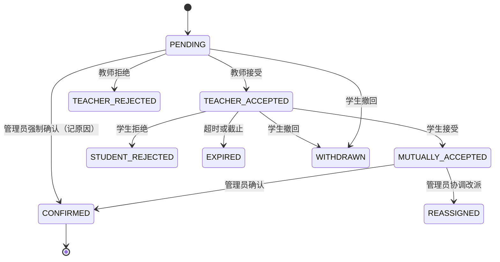
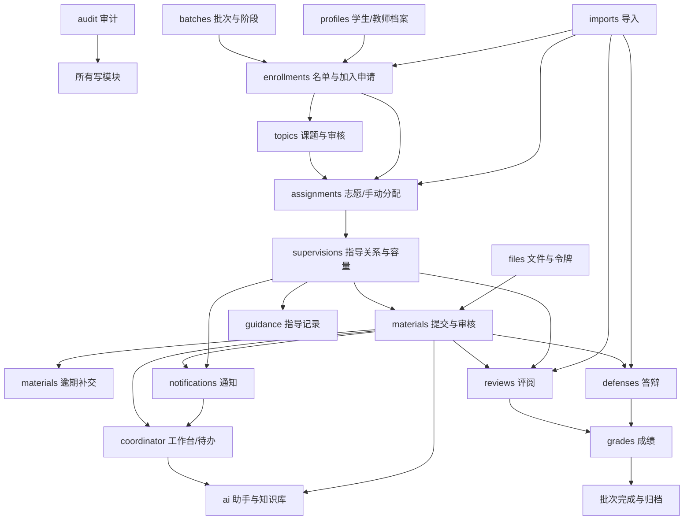

# 毕业设计管理系统 现状审计与需求差距分析报告（v1.1 修订版）

| 项目     | 内容                                                                 |
| -------- | -------------------------------------------------------------------- |
| 需求基线 | `docs/毕业设计管理系统_项目规格需求书_v1.0.md`                       |
| 审计对象 | `d:/graduation-system`（`frontend` + `backend` + `packages/shared`） |
| 版本     | v1.1（在 `PROJECT_GAP_ANALYSIS.md` v1.0 基础上修订）                 |
| 修订日期 | 2026-11-15                                                           |
| 本版范围 | **仅修订分析报告**；未修改代码、Prisma Schema、迁移与 Git            |
| 结论口径 | 已有且可复用 / 部分已有（含需重构）/ 尚未开发 / 需进一步确认         |

---

## 0. 本版修订说明

### 0.1 v1.0 的设计错误与修正（逐条）

| #   | v1.0 的问题                                                                      | 影响                                                                        | v1.1 修正                                                                                                                               |
| --- | -------------------------------------------------------------------------------- | --------------------------------------------------------------------------- | --------------------------------------------------------------------------------------------------------------------------------------- |
| 1   | 用 `(batchId, studentProfileId, activeFlag)` 复合唯一表达"仅一条有效关系"        | 唯一索引把 `activeFlag` 固定为 1，**历史行无法存在第二条**，与规格 §36 冲突 | 改为 `(batchStudentId, endedAt)` 唯一（`endedAt` 可空，MySQL 唯一索引允许多 NULL）；备选"当前表 + 历史表"双表方案。见 §5.3              |
| 2   | 业务表同时保存 `batchId` + `studentProfileId` 两字段                             | 两字段可被写成互不一致的组合，产生跨批次错关联                              | 业务表只引用 `batchStudentId`，并用**复合外键 `(batchId, batchStudentId) → BatchStudent(batchId, id)`** 在数据库层保证一致。见 §5.2     |
| 3   | `FinalGrade` 以"学生"为粒度表述                                                  | 同一学生跨批次会共用一条成绩，历史成绩被覆盖                                | 唯一键改为 `batchStudentId`，并新增 `GradeRevision` 记录发布后修订。见 §5.6                                                             |
| 4   | 双向选择只写"冲突由学院协调"，未给流程与状态                                     | 无法实现，也无法与手动分配区分                                              | 补齐"志愿 → 教师意向 → 学生接受/拒绝 → 学院协调 → 管理员确认"完整状态机。见 §6.2                                                        |
| 5   | 手动分配未区分"课题分配"和"指导教师分配"                                         | 无法支持"人课分离"场景（教师给定、课题后定）                                | 拆成 `StudentTopicAssignment` 与 `StudentSupervisor` 两条独立关系，手动分配支持仅课题/仅导师/同时；批量与导入均覆盖。见 §6.3            |
| 6   | 协管资格沿用现有"班长/班助/班主任/辅导员"五种前置条件                            | **擅自增加规格未要求的条件**，导致部分本班学生无法被授权                    | 资格改为：学生本班在籍 / 工作人员院系一致 / 学校覆盖；班主任、辅导员仅作"院系归属来源"而非门槛。见 §7                                   |
| 7   | `FileObject` 一会儿"带 batchId 便于过滤"，一会儿"不应带 batchId"                 | 自相矛盾，且容易写成"凭 fileId 直接下载"的越权接口                          | 明确 `FileObject` 不带批次与学生字段；批次/学生边界由引用它的业务对象（经 `batchStudentId`）承载；下载一律由业务子资源签发令牌。见 §5.7 |
| 8   | 摘要写"6 项重构"，正文实际 R-01~R-07 共 7 项                                     | 数量不一致，读者无法核对                                                    | 统一为 7 项，并对 R-02 整章重写。见 §9                                                                                                  |
| 9   | 说"无 AI 基础设施"                                                               | 与 `compose.yaml` 已预置 ChromaDB 1.5.9 不符                                | 更正为"基础设施已预置，后端依赖与模块未开始"。见 §1.4                                                                                   |
| 10  | 把"学生加入班级流程"当作"既有能力待核验"                                         | 代码中不存在该流程，v1.0 的 ORG-10 状态"需进一步确认"具有误导性             | 更正为"当前无实现，需新增"，并区分组织归属与批次参与。见 §8                                                                             |
| 11  | 待确认清单包含已确认事项（协管资格口径、响应字段、多 SCHOOL 节点、阶段开关实现） | 重复询问已决策内容                                                          | 精简为 7 项真正未决事项，每项注明原因。见 §16                                                                                           |

### 0.2 已确认需求在本版的落实位置

| 已确认需求                             | 本版处理                                     |
| -------------------------------------- | -------------------------------------------- |
| 响应统一为 `{ code, data, message }`   | 保留现有契约不动代码，仅修正文档描述（§1.2） |
| 单所学校、单一 SCHOOL 根组织           | 全篇按单校设计；组织表不引入多校隔离（§5.1） |
| 保留五类独立工作台，仍是单个 Vue 应用  | §11.1                                        |
| 协管退出申请保留；申诉与自主申请不开发 | §7.3                                         |
| AI 严格按个人数据权限                  | §7.4、§12                                    |
| 学生本班协管、工作人员院系范围授权     | §7.1                                         |
| 双向选择与手动分配严格区分             | §6.1                                         |

---

## 1. 审计基线与现场证据

### 1.1 Git 与工作区状态（本次核实）

| 项               | 实际值                                                                                                                                                                                                                                                                      |
| ---------------- | --------------------------------------------------------------------------------------------------------------------------------------------------------------------------------------------------------------------------------------------------------------------------- |
| 当前分支         | `main`                                                                                                                                                                                                                                                                      |
| HEAD commit      | `cf6e0b28dcff2cfa5ea7611d6b1dfccb63115e48`（2026-11-12 14:08，`refactor(auth): 优化登录注册页视觉效果并移除 OTP 相关冗余代码`）                                                                                                                                             |
| 最近提交链       | `cf6e0b2` ← `4eaf221`（注册邮箱验证码 + Redis 限流）← `d1828c2`（认证页动效/玻璃卡）                                                                                                                                                                                        |
| 工作区改动       | 63 项（32 个已跟踪文件修改 + 31 个未跟踪目录/文件），`git diff --stat` 约 1337 行新增 / 308 行删除                                                                                                                                                                          |
| 未提交的关键内容 | `backend/prisma/migrations/` 下 6 个未跟踪迁移、`backend/src/modules/{menus,profiles,rbac/assignments,rbac/authorization,rbac/organizations,users}`、`packages/shared/src/constants/rbac.ts`、`frontend/src/router/dynamic/*`、`frontend/src/stores/menu.ts`、7 个 E2E 套件 |

**结论**：Phase 1~E5 的成果全部停留在工作区，**尚未形成可回溯的 Git 基线**。这不影响本阶段分析，但必须作为实施前置条件：进入编码前需要用户授权后提交一次基线，否则任何迁移事故都无法回滚（本阶段不提交）。

### 1.2 统一响应契约（以代码为准，不修改）

| 层         | 实际实现                                                                             | 证据                                                            |
| ---------- | ------------------------------------------------------------------------------------ | --------------------------------------------------------------- |
| 共享类型   | `ApiResponse<T> { code: number; data: T \| null; message: string }`，成功 `code = 0` | `packages/shared/src/types/response.type.ts:4-13`               |
| 后端包装   | `ResponseInterceptor` 输出 `{ code: 0, data, message }`                              | `backend/src/common/interceptors/response.interceptor.ts:21-34` |
| 自定义消息 | `ApiSuccessResult(data, message)`                                                    | `backend/src/common/interceptors/api-success-result.ts`         |
| 前端解包   | `unwrapApiResponse` 校验 `code`/`data`，`data === null` 视为异常                     | `frontend/src/lib/api-response.ts:37-53`                        |
| 分页       | `PaginatedData<T> { list: T[]; total: number }`                                      | `packages/shared/src/types/pagination.type.ts:15-21`            |

**结论**：字段是 **`data`**，不是 `result`。规格 §10 第 7 条的 `result` 属文档描述漂移，**v1.1 不再建议改动契约**，也**不再列为待确认事项**；只在需求书侧修正文字。根 `README.md` 的 `{ data, extra, code, message, success }` 同样已过期。

### 1.3 测试基线（本版重跑）

| 命令                              | 结果                                             |
| --------------------------------- | ------------------------------------------------ |
| `pnpm --filter backend test`      | 31 文件 / **301 用例通过**                       |
| `pnpm --filter backend test:e2e`  | 11 套件 / **127 用例通过**（真实 MySQL + Redis） |
| `pnpm --filter frontend test:run` | 15 文件 / **125 用例通过**                       |

### 1.4 基础设施（`compose.yaml` 实测）

| 服务     | 版本                                                | 现状                                                   |
| -------- | --------------------------------------------------- | ------------------------------------------------------ |
| MySQL    | `mysql:8.4.13`（utf8mb4 / utf8mb4_0900_ai_ci）      | 已定义；Prisma 7.10.1 + `@prisma/adapter-mariadb` 连接 |
| Redis    | `redis:7.4.12-alpine`（AOF everysec、`noeviction`） | 已定义；已用于验证码、限流、菜单缓存                   |
| ChromaDB | `chromadb/chroma:1.5.9`（持久化卷 `chroma_data`）   | **基础设施已预置**，但后端无任何 AI 依赖与模块         |

> 修正 v1.0 表述："无 AI 基础设施"不准确，应为"向量库容器已定义，应用侧未接入"。`compose.yaml` 注释提到 BullMQ，但后端未引入队列依赖，属计划而非现状。

### 1.5 v1.0 中保持不变的结论

工程底座（认证、RBAC 内核、组织树、人员档案、协管资格服务、动态菜单与动态路由、统一校验/响应/异常/限流）为**已有且可复用**，业务域整体**尚未开发**。v1.0 §3 的证据与 v1.0 §4 中未被本版修订的条目继续有效。

---

## 2. 执行摘要

### 2.1 需求状态分布（102 条）

| 结论类型             | v1.0 | v1.1 | 说明                                                     |
| -------------------- | ---: | ---: | -------------------------------------------------------- |
| 已有且可复用         |   14 |   14 | 认证、RBAC 内核、组织树、档案、动态菜单、测试范式        |
| 部分已有（含需重构） |   14 |   15 | 协管资格从"冲突"改判为"部分已有但需重构"                 |
| 尚未开发             |   70 |   71 | 全部毕业设计业务域；班级加入申请由"待确认"改判为"需新增" |
| 存在冲突             |    1 |    0 | 已确认规则，不再作为"冲突"，转为 R-02 重构项             |
| 需进一步确认         |    3 |    2 | 仅剩文件存储与 AI 供应商（班级加入流程已明确为新增）     |

### 2.2 本版最重要的六个结论

1. **数据一致性的关键是 `BatchStudent`**：它不是"名单表"，而是"学生在某批次中的业务身份"。所有学生维度业务表只引用 `batchStudentId`（并复合外键带上 `batchId`），即可在数据库层消灭"批次与学生归属不一致"。
2. **有效关系唯一必须用可空结束时间**：`(batchStudentId, endedAt)` 唯一既保证"当前只有一条"，又不限制历史条数，Prisma 原生支持，无需生成列或 partial index。
3. **双向选择必须是有状态机的业务流程**，最终由管理员确认生效；手动分配是"管理员确认即生效"的独立入口，两者共用同一个"关系落地"领域服务，但绝不共用状态机。
4. **协管资格比 v1.0 描述的更简单**：学生本班在籍即可，工作人员院系一致即可；现有"班长/班助"前置是额外门槛，必须移除，教师/辅导员任职只用于**推定工作人员院系**。
5. **文件不携带业务归属**：`FileObject` 是内容对象，批次与学生边界由引用它的业务对象保证；下载令牌只能从业务子资源签发，禁止 `GET /files/:id`。
6. **导入与文件服务必须先由真实场景驱动**：第一个场景就是"批次名单导入（含错误清单）"与"材料 PDF 上传下载（含协管 403）"，通用化留到第二个使用方出现时再抽取。

---

## 3. 现有底座能力（沿用 v1.0 §3，摘要）

| 能力                                                 | 结论                      | 关键证据                                                                    |
| ---------------------------------------------------- | ------------------------- | --------------------------------------------------------------------------- |
| 注册/登录/刷新/登出/邮箱验证码/限流/会话撤销         | 可复用                    | `backend/src/modules/auth/**`（37 文件）                                    |
| 七角色平级 RBAC、权限与范围成对解析、失败关闭        | 可复用                    | `rbac/authorization/permission.service.ts`、`organization-scope.service.ts` |
| 组织树（SCHOOL/DEPARTMENT/MAJOR/CLASS）与范围裁剪    | 可复用                    | `schema.prisma:231-263`、`organizations/organization.service.ts`            |
| 学生档案、转班历史、教师档案、班主任任职、辅导员分配 | 可复用                    | `schema.prisma:377-499`、`modules/profiles/**`                              |
| 协管资格与失效联动（需按 §7 重构口径）               | 部分可复用                | `coordinator-eligibility.service.ts`、`coordinator-lifecycle.service.ts`    |
| 动态菜单 + Redis generation 缓存 + 动态路由          | 可复用                    | `menus.service.ts`、`menu-cache*.ts`、`router/dynamic/routes.ts`            |
| 统一 Zod 校验 / 响应包装 / 异常过滤 / Swagger        | 可复用                    | `common/configure-global-enhancers.ts`、`main.ts`                           |
| 业务页面                                             | 21 个骨架页（无业务逻辑） | `frontend/src/views/**`                                                     |

---

## 4. 需求追踪矩阵

### 4.1 本版修订的需求条目（其余条目状态不变，见 §4.3 索引）

| 编号      | v1.0 状态    | v1.1 状态          | 修订要点                                                                                  |
| --------- | ------------ | ------------------ | ----------------------------------------------------------------------------------------- |
| COORD-02  | 存在冲突     | 部分已有（需重构） | 资格口径按规格改为"学生本班 / 工作人员院系 / 学校覆盖"，移除班长班助前置（R-02）          |
| COORD-03  | 部分已有     | 部分已有           | 明确"工作人员院系归属"需新增通用归属来源，班主任/辅导员可作推定来源                       |
| COORD-04  | 部分已有     | 部分已有           | 批量授权仍需新增；学生候选查询改为"本班在籍学生"                                          |
| COORD-06  | 尚未开发     | 尚未开发           | 保留退出申请（P2）；明确不开发申诉与自主申请                                              |
| RBAC-10   | 尚未开发     | 尚未开发           | 明确 `ASSIGNED/SELF` 解析必须基于 `BatchStudent` 关系，不能用 `studentProfileId` 直接放行 |
| ORG-09    | 尚未开发     | 尚未开发           | 与 §8 班级加入申请合并设计，学号验证与档案绑定分开                                        |
| ORG-10    | 需进一步确认 | 尚未开发（需新增） | 代码中无该流程，改为"新增班级加入申请"（§8）                                              |
| BATCH-02  | 尚未开发     | 尚未开发           | 隔离方式改为"业务表外键 `batchStudentId` + 复合外键"，见 §5.2                             |
| ENROLL-01 | 尚未开发     | 尚未开发           | `BatchStudent` 语义明确为"批次参与关系"（含状态与加入/退出时间）                          |
| ASSIGN-01 | 尚未开发     | 尚未开发           | 补齐完整双向选择状态机（§6.2）                                                            |
| ASSIGN-02 | 尚未开发     | 尚未开发           | 拆分为"课题分配"与"指导教师分配"，支持批量与导入（§6.3）                                  |
| ASSIGN-05 | 尚未开发     | 尚未开发           | 并发保护改为"唯一约束 + 行锁 + 幂等键"三件套（§6.5）                                      |
| SUP-01/02 | 尚未开发     | 尚未开发           | 唯一键改为 `(batchStudentId, endedAt)`，不再使用 activeFlag                               |
| GRADE-02  | 尚未开发     | 尚未开发           | `FinalGrade` 唯一键改为 `batchStudentId`，跨批次独立（§5.6）                              |
| FILE-01   | 尚未开发     | 尚未开发           | `FileObject` 不带 batchId/学生字段，业务侧 1:1 绑定（§5.7）                               |
| AI-02/05  | 尚未开发     | 尚未开发           | 明确工具调用与检索均按"个人可见集合"过滤，见 §7.4、§12                                    |

### 4.2 状态分布（按分组）

| 分组                        | 条目数 | 已有 | 部分已有 | 未开发 | 待确认 |
| --------------------------- | -----: | ---: | -------: | -----: | -----: |
| 组织与人员（ORG）           |     12 |    6 |        4 |      2 |      0 |
| RBAC 与多角色（RBAC）       |     10 |    5 |        1 |      4 |      0 |
| 班级协管（COORD）           |     12 |    1 |        7 |      4 |      0 |
| 批次与流程（BATCH）         |      8 |    0 |        0 |      8 |      0 |
| 名单/课题/分配/指导/变更    |     19 |    0 |        0 |     19 |      0 |
| 材料/文件/指导记录/评阅     |     15 |    0 |        0 |     14 |      1 |
| 答辩/成绩/查重              |      8 |    0 |        0 |      8 |      0 |
| 通知/AI/导入/审计/安全/测试 |     18 |    2 |        3 |     12 |      1 |
| 合计                        |    102 |   14 |       15 |     71 |      2 |

> 与 §2.1 的差异说明：ORG-10 由"待确认"改判为"尚未开发（需新增）"，因此 ORG 组待确认归零；总数保持 102。

### 4.3 全部需求编号索引（状态 / 优先级）

| 编号      | 摘要                       | 状态           | 优先级 |
| --------- | -------------------------- | -------------- | ------ |
| ORG-01    | 四级组织树                 | 已有           | —      |
| ORG-02    | 组织范围子树与失败关闭     | 已有           | —      |
| ORG-03    | 用户当前组织归属           | 部分           | P1     |
| ORG-04    | 学生学籍档案               | 已有           | —      |
| ORG-05    | 教师档案                   | 已有           | —      |
| ORG-06    | 非学生工作人员归属         | 部分           | P1     |
| ORG-07    | 转班/转专业历史            | 部分           | P2     |
| ORG-08    | 归属变更留痕               | 部分           | P1     |
| ORG-09    | 学号验证并绑定档案         | 未开发         | P1     |
| ORG-10    | 班级加入申请               | 未开发         | P1     |
| ORG-11    | 按班级列学生名单           | 已有           | —      |
| ORG-12    | 组织停用不越权             | 已有           | —      |
| RBAC-01   | 七角色稳定                 | 已有           | —      |
| RBAC-02   | 多角色权限合并             | 已有           | —      |
| RBAC-03   | 范围分别校验               | 已有           | —      |
| RBAC-04   | 撤销互不影响               | 已有           | —      |
| RBAC-05   | 分配有效期                 | 已有           | —      |
| RBAC-06   | 前端权限编码               | 未开发         | P1     |
| RBAC-07   | 角色独立工作台             | 未开发         | P1     |
| RBAC-08   | 工作台切换与记忆           | 未开发         | P1     |
| RBAC-09   | 分配提权矩阵与审计         | 部分           | P1     |
| RBAC-10   | ASSIGNED/SELF 范围         | 未开发         | P0     |
| COORD-01  | 协管可叠加                 | 部分           | P1     |
| COORD-02  | 学生本班/工作人员院系资格  | 部分（需重构） | P0     |
| COORD-03  | 工作人员多班独立授权       | 部分           | P1     |
| COORD-04  | 单级授权与批量选择         | 部分           | P2     |
| COORD-05  | 截止时间与到期提醒         | 部分           | P2     |
| COORD-06  | 退出申请                   | 未开发         | P2     |
| COORD-07  | 撤销即时失效、重新授权新建 | 已有           | —      |
| COORD-08  | 授权审计专项字段           | 部分           | P0     |
| COORD-09  | 协管自查授权记录           | 部分           | P2     |
| COORD-10  | 协管数据边界               | 未开发         | P1     |
| COORD-11  | 协管工作台                 | 未开发         | P2     |
| COORD-12  | 协管 AI 边界               | 未开发         | P3     |
| BATCH-01  | 批次实体与多批次并行       | 未开发         | P1     |
| BATCH-02  | 批次隔离                   | 未开发         | P0     |
| BATCH-03  | 生命周期状态机             | 未开发         | P1     |
| BATCH-04  | 阶段时间自动开关           | 未开发         | P1     |
| BATCH-05  | 学院有限配置               | 未开发         | P2     |
| BATCH-06  | 延期/补交                  | 未开发         | P1     |
| BATCH-07  | 归档冻结                   | 未开发         | P2     |
| BATCH-08  | 服务端时区                 | 未开发         | P1     |
| ENROLL-01 | 批次名单维护               | 未开发         | P1     |
| ENROLL-02 | 名单 Excel 导入            | 未开发         | P1     |
| ENROLL-03 | 错误名单下载               | 未开发         | P1     |
| ENROLL-04 | 学生不可自改批次           | 未开发         | P1     |
| TOPIC-01  | 课题草稿                   | 未开发         | P1     |
| TOPIC-02  | 课题审核发布               | 未开发         | P1     |
| TOPIC-03  | 课题变更历史               | 未开发         | P1     |
| TOPIC-04  | 一题一生                   | 未开发         | P1     |
| TOPIC-05  | 跨专业选题                 | 未开发         | P2     |
| ASSIGN-01 | 双向选择流程               | 未开发         | P1     |
| ASSIGN-02 | 手动分配（课题/导师）      | 未开发         | P1     |
| ASSIGN-03 | 分配 Excel 导入            | 未开发         | P1     |
| ASSIGN-04 | 分配模式配置层级           | 未开发         | P2     |
| ASSIGN-05 | 并发冲突防护               | 未开发         | P1     |
| SUP-01    | 指导关系与历史             | 未开发         | P1     |
| SUP-02    | 唯一主指导                 | 未开发         | P1     |
| SUP-03    | 指导容量                   | 未开发         | P1     |
| SUP-04    | 超额授权                   | 未开发         | P2     |
| CHANGE-01 | 课题变更申请               | 未开发         | P2     |
| MAT-01    | 材料要求配置               | 未开发         | P1     |
| MAT-02    | 学院/专业差异              | 未开发         | P2     |
| MAT-03    | 提交与版本分离             | 未开发         | P1     |
| MAT-04    | 审核流与版本关联           | 未开发         | P1     |
| MAT-05    | 逾期补交                   | 未开发         | P1     |
| MAT-06    | 材料状态只读投影           | 未开发         | P1     |
| FILE-01   | 元数据与正文分离           | 未开发         | P0     |
| FILE-02   | 私有下载鉴权               | 未开发         | P0     |
| FILE-03   | 上传限制                   | 未开发         | P1     |
| FILE-04   | 存储选型                   | 待确认         | P1     |
| GUIDE-01  | 指导记录                   | 未开发         | P2     |
| GUIDE-02  | 学生已读确认               | 未开发         | P2     |
| REVIEW-01 | 评阅教师分配               | 未开发         | P1     |
| REVIEW-02 | 评阅意见与评分             | 未开发         | P1     |
| REVIEW-03 | 评阅教师变更历史           | 未开发         | P1     |
| DEF-01    | 答辩场次与分组             | 未开发         | P1     |
| DEF-02    | 小组统一成绩录入/导入      | 未开发         | P1     |
| DEF-03    | 二次答辩                   | 未开发         | P1     |
| GRADE-01  | 权重配置                   | 未开发         | P1     |
| GRADE-02  | 综合成绩计算               | 未开发         | P1     |
| GRADE-03  | 审核与发布                 | 未开发         | P1     |
| GRADE-04  | 发布后修订留痕             | 未开发         | P1     |
| PLAG-01   | 查重/AIGC 登记             | 未开发         | P2     |
| NOTIFY-01 | 站内通知                   | 未开发         | P2     |
| NOTIFY-02 | 通知与业务解耦             | 未开发         | P2     |
| NOTIFY-03 | 协管范围发送               | 未开发         | P2     |
| AI-01     | 会话与消息隔离             | 未开发         | P2     |
| AI-02     | 工具调用后端鉴权           | 未开发         | P2     |
| AI-03     | 学生材料分析               | 未开发         | P3     |
| AI-04     | 班级助手                   | 未开发         | P3     |
| AI-05     | 双层知识库与检索权限       | 未开发         | P3     |
| AI-06     | 供应商与向量库选型         | 待确认         | P3     |
| IMPORT-01 | 导入框架（单场景先行）     | 未开发         | P1     |
| AUDIT-01  | 通用审计                   | 未开发         | P0     |
| AUDIT-02  | 审计不可改删               | 未开发         | P0     |
| SEC-01    | 后端最终裁决               | 已有           | —      |
| SEC-02    | 撤销即时生效               | 已有           | —      |
| SEC-03    | 超管业务正文边界           | 部分           | P1     |
| SEC-04    | 越权测试覆盖               | 部分           | P1     |
| TEST-01   | 模块测试范式               | 部分           | P1     |
| CONC-01   | 并发一致性                 | 未开发         | P1     |

---

## 5. 核心数据库关系设计（交付物 2）

### 5.1 设计原则

1. **单所学校**：只存在一个 `SCHOOL` 类型组织根节点；不引入 `schoolId` 隔离维度。`OrganizationUnit.code` 全局唯一，需约定编码规则（建议 `院系码-专业码-班级序号`，避免班级名"01 班"冲突）。
2. **两种归属严格分离**：
   - **组织归属**：学生当前在哪个班级（`StudentProfile.classId`）；
   - **批次参与**：学生在某个毕业批次中是否参与、以什么状态参与（`BatchStudent`）。
     学生转班不改变批次参与记录；批次参与不等于组织归属。
3. **学生维度业务表只认 `BatchStudent`**，不接受"`batchId` + `studentProfileId`"这种可由调用方自由组合的双字段。
4. **当前关系与历史关系同在**，用可空 `endedAt` 表达失效，历史行永不删除、永不覆盖。
5. **分值统一 `Decimal(5,2)`**，时间统一 `DATETIME(3)`，业务时区 `Asia/Shanghai`，时间来源只有服务端。

### 5.2 `BatchStudent`：批次参与关系（本版核心修正）

```prisma
enum BatchStudentStatus {
  ENROLLED   // 已纳入批次
  WITHDRAWN  // 已退出/退选
  DEFERRED   // 延期至后续批次
  COMPLETED  // 已完成
}

model BatchStudent {
  id               String  @id @default(uuid()) @db.Char(36)
  batchId          String  @map("batch_id") @db.Char(36)
  studentProfileId String  @map("student_profile_id") @db.Char(36)

  status       BatchStudentStatus @default(ENROLLED)
  enrolledAt   DateTime @default(now()) @map("enrolled_at") @db.DateTime(3)
  leftAt       DateTime? @map("left_at") @db.DateTime(3)
  ineligibleReason String? @map("ineligible_reason") @db.VarChar(255)

  batch   GraduationBatch @relation(fields: [batchId], references: [id], onDelete: Restrict)
  student StudentProfile  @relation(fields: [studentProfileId], references: [id], onDelete: Restrict)

  topicAssignments StudentTopicAssignment[]
  supervisions     StudentSupervisor[]
  submissions      MaterialSubmission[]
  defenseResults   DefenseResult[]
  finalGrade       FinalGrade?

  @@unique([batchId, studentProfileId])   // 同一学生同一批次仅一条参与记录
  @@unique([batchId, id])                 // 供业务表复合外键引用
  @@index([studentProfileId, status])
  @@map("batch_students")
}
```

**一致性机制**：业务表同时保存 `batchId`（便于按批次过滤/加索引）与 `batchStudentId`，并用复合外键绑定：

```prisma
model StudentSupervisor {
  id             String @id @default(uuid()) @db.Char(36)
  batchId        String @map("batch_id") @db.Char(36)
  batchStudentId String @map("batch_student_id") @db.Char(36)
  teacherId      String @map("teacher_id") @db.Char(36)

  startedAt DateTime  @default(now()) @map("started_at") @db.DateTime(3)
  endedAt   DateTime? @map("ended_at") @db.DateTime(3)
  endReason String?   @map("end_reason") @db.VarChar(255)
  createdById String  @map("created_by") @db.Char(36)

  batchStudent BatchStudent @relation(fields: [batchId, batchStudentId], references: [batchId, id], onDelete: Restrict)
  teacher      TeacherProfile @relation(fields: [teacherId], references: [id], onDelete: Restrict)

  @@unique([batchStudentId, endedAt])
  @@index([teacherId, endedAt])
  @@map("student_supervisors")
}
```

效果：任何插入/更新都必须满足"`batchStudentId` 确实属于 `batchId`"，数据库层拒绝错关联；应用层即使传错参数也无法写入。

> 注意：Prisma 复合外键要求被引用侧存在 `@@unique([batchId, id])`，上表已声明。MySQL 侧生成 `FOREIGN KEY (batch_id, batch_student_id) REFERENCES batch_students(batch_id, id)`。

引用关系清单（全部只认 `batchStudentId`，并在需要按批次过滤时冗余 `batchId` + 复合外键）：`StudentTopicSelection`、`StudentTopicAssignment`、`StudentSupervisor`、`MaterialSubmission`、`MaterialVersion`（经 Submission）、`MaterialReview`、`LateSubmissionRequest`、`GuidanceRecord`、`ReviewerAssignment`、`ThesisReview`、`DefenseAssignment`、`DefenseResult`、`FinalGrade`、`PlagiarismCheck`。

另有一条业务硬约束（非 DB 约束，因为无法在当前 MySQL 上用部分唯一索引表达）：**同一学生最多只能有一个 `status = ENROLLED` 的 `BatchStudent`**；延期毕业走新批次时，旧批次必须置为 `DEFERRED` 或 `COMPLETED`，由批次服务在事务内校验（行锁 `StudentProfile`）。

### 5.3 有效关系唯一约束（MySQL 8.4 + Prisma 可实现方案）

**方案 A（推荐）：可空结束时间参与唯一键**

```prisma
@@unique([batchStudentId, endedAt])
```

- MySQL 唯一索引中 **NULL 视为互不相等**，同一 `batchStudentId` 可以存在任意多条 `endedAt` 非空的历史行，但 `endedAt IS NULL` 的有效行**只能一条**。
- Prisma 原生支持可空字段的 `@@unique`，无需生成列、无需 partial index、无需 `Unsupported`。
- `endedAt` 精度 `DATETIME(3)`：同一学生同一批次在同一毫秒内结束两条关系不可能发生（有效关系本就只有一条）。
- 约束：**约定 `endedAt = NULL` 表示"当前有效"**，禁止用 `9999-12-31` 之类的哨兵时间；该约定写入模块注释与迁移说明。

**方案 B（备选）：当前表 + 历史表**

```
student_supervisors           // 仅当前有效，@@unique([batchStudentId])
student_supervisor_history    // 历史，无唯一约束
```

- 语义显式，不依赖 NULL 语义；代价是每次变更需要"复制到历史 + 更新当前"，多一张表。
- 适用于团队不接受隐式唯一语义、或未来需要"同一毫秒多次变更"的场景。

**方案 C（不采用）：生成列 + 唯一索引**

```sql
ALTER TABLE student_supervisors
  ADD COLUMN active_student_key CHAR(36)
  GENERATED ALWAYS AS (IF(ended_at IS NULL, batch_student_id, NULL)) STORED,
  ADD UNIQUE KEY uk_active_student (active_student_key);
```

- 数据库层最直观，但 Prisma 无法声明生成列，只能 `@ignore` + 手写迁移 SQL，`prisma migrate diff` 会产生漂移风险，与当前"迁移与 schema 双向可校验"的工作流冲突。

**不采用：`(batchId, studentProfileId, activeFlag)`**

- `activeFlag` 参与唯一键后，历史行的 `activeFlag` 只能取 NULL/0 之一，且 `(1)` 组合被占用；一旦用它区分状态，**历史条数被唯一键间接限制**，违背"历史不覆盖、可多条"的要求。

**适用表（新增）**：`StudentSupervisor`、`StudentTopicAssignment`、`ReviewerAssignment`。
**现有表**：`TeacherClassDuty`、`CounselorClassAssignment` 已用 `validFrom/validUntil + revokedAt` 表达有效期，**本次不迁移**（避免为统一风格动已有数据）；新表若需要"结束时间 + 原因"统一字段，则按方案 A 落地。

### 5.4 关键实体关系说明

| 关系                                      | 基数          | 实现要点                                                                     |
| ----------------------------------------- | ------------- | ---------------------------------------------------------------------------- |
| `OrganizationUnit` 自关联                 | 1:N           | 邻接表 + `onDelete: Restrict`；班级→专业→院系→学校靠祖先链推导               |
| `StudentProfile` ↔ `OrganizationUnit`     | N:1           | 只存 `classId`，专业/院系/学校向上推导，避免冗余不一致                       |
| `StudentProfile` ↔ `BatchStudent`         | 1:N（跨批次） | 一个学生在不同批次各有一条参与记录                                           |
| `BatchStudent` ↔ `StudentTopicAssignment` | 1:N（历史）   | 有效行 `endedAt IS NULL`，唯一键见 §5.3                                      |
| `BatchStudent` ↔ `StudentSupervisor`      | 1:N（历史）   | 同上；一个学生同批次只有一名主指导                                           |
| `Topic` ↔ `StudentTopicAssignment`        | 1:N（历史）   | 有效行唯一：一个课题同时只能被一名学生占用（`@@unique([topicId, endedAt])`） |
| `TeacherProfile` ↔ `StudentSupervisor`    | 1:N           | 容量按"有效关系数"统计，历史不计入                                           |
| `MaterialSubmission` ↔ `MaterialVersion`  | 1:N           | 版本号单调递增，`@@unique([submissionId, versionNo])`                        |
| `MaterialVersion` ↔ `FileObject`          | 1:1           | 版本持有 `fileObjectId`，唯一约束防重复绑定                                  |
| `BatchStudent` ↔ `FinalGrade`             | 1:1           | `@@unique([batchStudentId])`，跨批次独立                                     |
| `DefenseAssignment` ↔ `DefenseResult`     | 1:N（轮次）   | `@@unique([defenseAssignmentId, round])`                                     |
| `FileObject` ↔ 业务对象                   | 1:1（v1）     | 不做多态引用表，避免过度设计                                                 |

### 5.5 目标 ERD

```mermaid
erDiagram
  ORGANIZATION_UNIT ||--o{ ORGANIZATION_UNIT : parent
  ORGANIZATION_UNIT ||--o{ STUDENT_PROFILE : class
  ORGANIZATION_UNIT ||--o{ TEACHER_PROFILE : department
  STUDENT_PROFILE ||--o{ BATCH_STUDENT : participates
  GRADUATION_BATCH ||--o{ BATCH_STUDENT : enrolls
  GRADUATION_BATCH ||--o{ TOPIC : contains
  TEACHER_PROFILE ||--o{ TOPIC : proposes
  BATCH_STUDENT ||--o{ STUDENT_TOPIC_ASSIGNMENT : holds
  TOPIC ||--o{ STUDENT_TOPIC_ASSIGNMENT : assigned
  BATCH_STUDENT ||--o{ STUDENT_SUPERVISOR : holds
  TEACHER_PROFILE ||--o{ STUDENT_SUPERVISOR : supervises
  BATCH_STUDENT ||--o{ MATERIAL_SUBMISSION : submits
  MATERIAL_SUBMISSION ||--o{ MATERIAL_VERSION : versions
  MATERIAL_VERSION ||--o| FILE_OBJECT : references
  MATERIAL_VERSION ||--o{ MATERIAL_REVIEW : reviews
  BATCH_STUDENT ||--o{ REVIEWER_ASSIGNMENT : reviewed
  REVIEWER_ASSIGNMENT ||--o{ THESIS_REVIEW : produces
  BATCH_STUDENT ||--o{ DEFENSE_ASSIGNMENT : scheduled
  DEFENSE_ASSIGNMENT ||--o{ DEFENSE_RESULT : rounds
  BATCH_STUDENT ||--o| FINAL_GRADE : receives
  FINAL_GRADE ||--o{ GRADE_REVISION : revised
  USER ||--o{ AI_CONVERSATION : chats
```

### 5.6 `FinalGrade` 的多批次关系（修正 3）

```prisma
model FinalGrade {
  id             String @id @default(uuid()) @db.Char(36)
  batchId        String @map("batch_id") @db.Char(36)
  batchStudentId String @unique @map("batch_student_id") @db.Char(36)

  supervisorScore Decimal? @map("supervisor_score") @db.Decimal(5, 2)
  reviewerScore   Decimal? @map("reviewer_score") @db.Decimal(5, 2)
  defenseScore    Decimal? @map("defense_score") @db.Decimal(5, 2)
  totalScore      Decimal? @map("total_score") @db.Decimal(5, 2)
  weightSnapshot  Json?    @map("weight_snapshot")
  status          GradeStatus @default(DRAFT)
  publishedAt     DateTime? @map("published_at") @db.DateTime(3)

  batchStudent BatchStudent @relation(fields: [batchId, batchStudentId], references: [batchId, id], onDelete: Restrict)
  revisions    GradeRevision[]

  @@index([batchId, status])
  @@map("final_grades")
}
```

- **唯一性是 `batchStudentId`，不是 `studentProfileId`**：同一学生在 2026 届、2027 届各有一条 `BatchStudent`，因此各有独立 `FinalGrade` 与发布状态，历史成绩互不覆盖。
- 二次答辩不新增 `FinalGrade`，走 `DefenseResult(round=2)` + `GradeRevision`；只有跨批次（延期毕业重新参与）才产生新的 `FinalGrade`。
- `weightSnapshot` 保存计算时的权重，避免批次改权重后回溯计算与历史不一致。

### 5.7 `FileObject` 与批次/学生的关系（修正 7）

```prisma
model FileObject {
  id          String   @id @default(uuid()) @db.Char(36)
  storageKey  String   @unique @map("storage_key") @db.VarChar(255) // 私有时存储路径，不含业务信息
  purpose     FilePurpose                                             // MATERIAL / PLAGIARISM_REPORT / KNOWLEDGE / AVATAR
  mimeType    String   @map("mime_type") @db.VarChar(128)
  sizeBytes   BigInt   @map("size_bytes")
  sha256      String   @db.Char(64)
  uploadedById String  @map("uploaded_by") @db.Char(36)
  createdAt   DateTime @default(now()) @map("created_at") @db.DateTime(3)

  @@index([sha256])
  @@map("file_objects")
}
```

- **不带 `batchId`、不带 `studentProfileId`**：文件是内容对象，可属于材料、检测报告或知识库；带业务字段会同时导致"冗余不一致"与"误用 fileId 直接下载"两类问题。
- **业务侧 1:1 绑定**：`MaterialVersion.fileObjectId @unique`、`PlagiarismCheck.reportFileId? @unique`、`KnowledgeDocument.fileObjectId @unique`。v1 不做多态引用表（避免过度设计），需要复用时再引入 `FileBinding`。
- **下载一律走业务子资源**：
  - `POST /material-versions/:id/download-token` → 校验当前用户对该版本所属 `BatchStudent` 的业务权限 → 签发 60s 令牌（含 `fileId + subjectType + subjectId + userId + jti`）；
  - `GET /files/stream?token=...` 校验令牌与当前会话一致后流式返回；
  - **不存在 `GET /files/:id`**，从接口层面消灭"猜到 fileId 就能下载"。
- **批次/学生边界如何保证**：`MaterialVersion → MaterialSubmission → BatchStudent`，其中 `batchId` 通过复合外键保证；令牌由业务对象签发，且签发时已做业务关系校验，因此不可能出现跨学生、跨批次访问。
- 孤儿文件（上传后未绑定）：上传接口要求先创建业务草稿再上传，或由管理端定时清理未绑定超过 24h 的文件（v1 先做后者，最小实现）。

### 5.8 现有 15 张表的约束审查（本次核对）

| 表                                 | 现有约束                                                                  | 结论                       | 备注                                                                                                                                      |
| ---------------------------------- | ------------------------------------------------------------------------- | -------------------------- | ----------------------------------------------------------------------------------------------------------------------------------------- |
| `User`                             | `email` 唯一；`(status, deletedAt)` 索引                                  | 合理                       | `createdById` 为 `SetNull`，操作人删除不阻塞                                                                                              |
| `Role`                             | `code` 唯一                                                               | 合理                       | `dataScope` 仅描述范围维度                                                                                                                |
| `Permission`                       | `code` 唯一                                                               | 合理                       | 与共享 `rbac.ts` 编码一致                                                                                                                 |
| `Menu`                             | `code`、`path` 唯一；`(parentId, sortOrder)`                              | 合理                       | `path` 唯一意味着两角色不能共用同一路径（符合"一个页面一个入口"）                                                                         |
| `OrganizationUnit`                 | `code` 唯一；`(parentId, sortOrder)`、`(type, status)`；父节点 `Restrict` | 合理，但需编码规范         | 单校场景下 `code` 全局唯一，班级若用"01 班"会跨专业冲突，需约定 `院系码-专业码-班号`                                                      |
| `UserRole`                         | **无唯一约束**；4 个索引；`scopeOrgUnit` `Restrict`                       | 可接受，存在并发窗口       | 因 `scopeOrgUnitId` 可空，MySQL 唯一索引对 NULL 不生效，无法用 DB 约束表达"同用户同角色同范围仅一条有效"；现依赖事务查重 + 班级行锁 + 409 |
| `RolePermission` / `RoleMenu`      | 复合主键                                                                  | 合理                       | 天然去重                                                                                                                                  |
| `AuthSession`                      | `refreshTokenHash` 唯一；`(userId, revokedAt)`                            | 合理                       | 只存哈希                                                                                                                                  |
| `StudentProfile`                   | `studentNo`、`userId` 唯一；`(classId, enrollmentStatus)`                 | 合理                       | `userId` 可空唯一（MySQL 允许多 NULL）支持"先建档后注册"                                                                                  |
| `TeacherProfile`                   | `userId`、`teacherNo` 唯一；`(departmentId, employmentStatus)`            | 合理                       | 单院系归属，跨院系靠业务关系表达                                                                                                          |
| `TeacherClassDuty`                 | 无唯一；3 索引（含 `revokedAt`）                                          | 合理                       | 有效重叠由"班级行锁 + 半开区间检查"保证，可由事务重试兜底                                                                                 |
| `CounselorClassAssignment`         | 无唯一；3 索引                                                            | 合理                       | 同上                                                                                                                                      |
| `CoordinatorQualificationOverride` | 无唯一；3 索引；`grantedBy` 必填 `Restrict`                               | 合理                       | 覆盖必须留授权人                                                                                                                          |
| `StudentClassTransfer`             | 无唯一（历史表）；3 索引                                                  | 合理                       | 只在转班事务内写入                                                                                                                        |
| 角色与组织类型匹配                 | 应用层强校验：`ROLE_SCOPE_TYPE`，类型不符返回 400                         | **已有，无需新增 DB 约束** | `role-assignments.service.ts:411-446`；这条避免了"CLASS_COORDINATOR 绑到院系节点导致范围扩大"的越权                                       |

结论：现有 15 张表的索引与外键策略总体合理，**无需推倒重来**；需要新增的只是"批次参与（`BatchStudent`）"、"审计（`AuditLog`）"与业务域表。`UserRole` 的有效唯一是已知可接受风险（§13-13），不建议为了加唯一索引而引入哨兵组织节点。

### 5.9 约束清单（目标表 / 外键 / 唯一 / 索引）

| 表                       | 唯一约束                                          | 索引                                                        | 外键策略           | 备注                                                          |
| ------------------------ | ------------------------------------------------- | ----------------------------------------------------------- | ------------------ | ------------------------------------------------------------- |
| `OrganizationUnit`       | `code`                                            | `(parentId, sortOrder)`、`(type, status)`                   | `parent` RESTRICT  | 单校单根，`code` 全局唯一需约定规则                           |
| `UserRole`               | 无 DB 唯一（NULL 语义所致）                       | `(userId, revokedAt)`、`(userId, roleId, scopeOrgUnitId)`   | Cascade/Restrict   | 有效唯一靠事务查重 + 班级行锁；已知并发窗口可接受，风险见 §13 |
| `StudentProfile`         | `studentNo`、`userId`                             | `(classId, enrollmentStatus)`                               | RESTRICT           | 只存 `classId`                                                |
| `BatchStudent`           | `(batchId, studentProfileId)`、`(batchId, id)`    | `(studentProfileId, status)`                                | RESTRICT           | 业务表复合外键的被引用侧                                      |
| `StudentSupervisor`      | `(batchStudentId, endedAt)`                       | `(teacherId, endedAt)`                                      | 复合外键 Restrict  | `endedAt NULL` = 有效                                         |
| `StudentTopicAssignment` | `(batchStudentId, endedAt)`、`(topicId, endedAt)` | `(batchId, endedAt)`                                        | 复合外键 Restrict  | 一题一生双向唯一                                              |
| `Topic`                  | `(batchId, code)`                                 | `(batchId, status)`                                         | `batchId` Restrict | 发布后核心字段锁定                                            |
| `MaterialVersion`        | `(submissionId, versionNo)`、`fileObjectId`       | `(submissionId, createdAt)`                                 | Restrict           | 版本不可覆盖                                                  |
| `FinalGrade`             | `batchStudentId`                                  | `(batchId, status)`                                         | 复合外键 Restrict  | 跨批次独立                                                    |
| `DefenseResult`          | `(defenseAssignmentId, round)`                    | `(batchId, round)`                                          | Restrict           | 轮次独立                                                      |
| `FileObject`             | `storageKey`                                      | `sha256`                                                    | —                  | 无业务字段                                                    |
| `AuditLog`               | —                                                 | `(targetType, targetId, createdAt)`、`(actorId, createdAt)` | 无外键（保留历史） | 只追加                                                        |

### 5.10 批次隔离字段落点（修订）

- **必须带 `batchId`**：`BatchStudent`、`Topic`、`StudentTopicAssignment`、`StudentSupervisor`、`MaterialSubmission`、`MaterialRequirement`、`DefenseSession`、`DefenseAssignment`、`FinalGrade`、`PlagiarismCheck`。
- **通过 `batchStudentId` 间接隔离（同时冗余 `batchId` 并用复合外键校验）**：`MaterialVersion`、`MaterialReview`、`LateSubmissionRequest`、`StudentTopicSelection`、`GuidanceRecord`、`ReviewerAssignment`、`ThesisReview`、`DefenseResult`。
- **不带批次**：`FileObject`、`User`、`Role`、`Permission`、`Menu`、`OrganizationUnit`、`StudentProfile`、`TeacherProfile`、`AuditLog`（`targetType/targetId` 定位，可空 `batchId` 仅作查询冗余）。

---

## 6. 双向选择与手动分配（交付物：流程与状态机）

### 6.1 两种模式的严格区分

| 维度     | 双向选择                             | 学校手动分配                              |
| -------- | ------------------------------------ | ----------------------------------------- |
| 发起方   | 学生提交志愿 → 教师表达意向          | 管理员直接操作                            |
| 学生确认 | **必需**（学生可接受或拒绝教师意向） | 不需要                                    |
| 生效条件 | 双方同意后由管理员最终确认           | 管理员确认即生效                          |
| 状态机   | 多状态（§6.2）                       | 单步（§6.3）                              |
| 冲突处理 | 学院管理员人工协调                   | 写入时同步校验并返回 409                  |
| 适用配置 | 批次/学院配置为 `BIDIRECTIONAL`      | 配置为 `MANUAL` 或混合模式兜底            |
| 数据痕迹 | 志愿、意向、决策、协调记录全部保留   | 分配关系 + 审计（来源 `MANUAL`/`IMPORT`） |

两者共用"关系落地"服务（§6.4），但**不共用状态机**；`StudentTopicAssignment.source` 区分 `BIDIRECTIONAL` / `MANUAL` / `IMPORT`，便于统计与追责。

### 6.2 双向选择状态机

**志愿表**（每 `BatchStudent` 一份）

```
DRAFT --学生提交--> SUBMITTED --管理员关闭/批次截止--> CLOSED
SUBMITTED --学生撤回（未锁定前）--> WITHDRAWN
SUBMITTED --管理员锁定--> LOCKED（禁止新增/改序，仍可决策）
```

**志愿项**

| 当前状态                       | 允许动作                       | 目标状态            | 操作者               |
| ------------------------------ | ------------------------------ | ------------------- | -------------------- |
| `PENDING`                      | 教师接受                       | `TEACHER_ACCEPTED`  | 课题所属教师         |
| `PENDING`                      | 教师拒绝                       | `TEACHER_REJECTED`  | 课题所属教师         |
| `TEACHER_ACCEPTED`             | 学生接受                       | `MUTUALLY_ACCEPTED` | 学生本人             |
| `TEACHER_ACCEPTED`             | 学生拒绝                       | `STUDENT_REJECTED`  | 学生本人             |
| `TEACHER_ACCEPTED`             | 学生超时/批次截止              | `EXPIRED`           | 系统                 |
| `MUTUALLY_ACCEPTED`            | 管理员确认                     | `CONFIRMED`         | 学院/学校管理员      |
| `MUTUALLY_ACCEPTED`            | 管理员协调改派                 | `REASSIGNED`        | 学院管理员（记原因） |
| `PENDING` / `TEACHER_ACCEPTED` | 学生撤回志愿                   | `WITHDRAWN`         | 学生本人             |
| 任一非终态                     | 管理员强制确认（跳过学生确认） | `CONFIRMED`         | 管理员（必须记原因） |



约束：

- 同一 `BatchStudent` 同时只能有**一个已确认**的志愿项（`StudentTopicAssignment` 唯一键兜底）；
- 一个 `Topic` 只能被一个学生确认（`(topicId, endedAt)` 唯一兜底）；
- 教师只能对**自己课题**的志愿表达意向（后端用 `Topic.teacherId` 校验，不能只看前端）；
- 学生只有在志愿表 `SUBMITTED` 且未 `LOCKED` 时才能新增/改序；
- 学院协调只处理"冲突与未匹配"，不做自动匹配算法。

### 6.3 手动分配（含课题与导师分离）

**两个独立关系，两条独立入口**：

| 关系         | 表                       | 唯一约束                                          | 说明                                       |
| ------------ | ------------------------ | ------------------------------------------------- | ------------------------------------------ |
| 课题分配     | `StudentTopicAssignment` | `(batchStudentId, endedAt)`、`(topicId, endedAt)` | 一个学生一个有效课题；一个课题一个有效学生 |
| 指导教师分配 | `StudentSupervisor`      | `(batchStudentId, endedAt)`                       | 一个学生一个有效主指导（不支持联合指导）   |

接口设计（均需 `assignment:*` 权限 + 批次范围）：

```
POST /assignments/manual                     # 单条：{ batchStudentId, topicId?, supervisorTeacherId?, reason }
POST /assignments/manual/batch               # 批量：同一批次内多条，逐条校验，部分失败返回明细
POST /imports                                # Excel：type=TOPIC_ASSIGNMENT，先预览后确认
POST /assignments/:id/end                    # 结束关系（课题/导师分别结束），必须给原因
```

关键规则：

1. **允许"只分配课题"或"只分配导师"**：两者互不强制（现实流程中教师先定、课题后定很常见）。
2. **同时给两个字段时在同一事务内落地**：任一失败全部回滚，避免"有课题无导师"的半成品。
3. **容量校验统一在 `StudentSupervisor` 创建时**：统计 `endedAt IS NULL` 的有效关系数，超限返回 409，除非携带 `overrideReason` 且有 `assignment:override` 权限。
4. **更换导师 = 结束旧关系 + 创建新关系**，绝不复用旧行；课题同理。
5. **批量与导入必须逐行校验并在同一批次内处理部分失败**：默认"全部成功或全部不写入"（原子模式），可选"跳过失败行"（需显式参数，并返回失败清单）。
6. **生效后通知学生与教师**（P2，通知模块落地后接入；通知失败不回滚分配）。

### 6.4 共用"关系落地"服务（避免两套写入逻辑）

```
AssignmentService.apply(input: {
  batchStudentId, topicId?, supervisorTeacherId?,
  source: 'BIDIRECTIONAL' | 'MANUAL' | 'IMPORT',
  reason?, actorId, idempotencyKey
}) : { assignmentId?, supervisorId? }
```

事务内部顺序（固定，禁止调整）：

1. `SELECT ... FOR UPDATE` 锁定 `BatchStudent` 行（防同学生并发）；
2. 有 `topicId` 时锁 `Topic` 行并校验同批次、状态已发布、未被占用、专业允许；
3. 有 `supervisorTeacherId` 时锁 `TeacherProfile` 行（或专用容量行），统计有效关系数；
4. 结束冲突旧关系（写 `endedAt` + `endReason`）；
5. 创建新关系；
6. 写 `AuditLog`（含 before/after、source、reason）；
7. 提交后触发菜单/统计缓存失效（如涉及）。

幂等：`idempotencyKey` 落 `AuditLog` 唯一索引或专用 `IdempotencyKey` 表；重复提交返回上次结果，不重复写入。

### 6.5 Excel 导入（先用真实场景验证，不做通用框架）

**v1 只实现一个导入场景：批次学生名单**；随后第二个场景是"课题/导师分配"，此时才把共用部分抽成 `imports` 模块。

第一个场景的最小契约：

| 环节     | 实现                                                                                            |
| -------- | ----------------------------------------------------------------------------------------------- |
| 模板下载 | `GET /batches/:id/students/template` 返回固定的 xlsx（学号、姓名、班级编码）                    |
| 上传解析 | `POST /imports`（multipart）→ 创建 `ImportJob(PENDING)`，逐行解析                               |
| 预览     | 返回前 20 行 + 统计（可导入/警告/错误）                                                         |
| 校验     | 学号存在且已绑定档案、班级存在且属于本批次范围、同批次不重复、跨批次不冲突                      |
| 错误清单 | `GET /imports/:id/errors`（可下载 xlsx/csv），含行号、字段、原因                                |
| 确认写入 | `POST /imports/:id/confirm`，事务内批量写入，二次确认幂等                                       |
| 留痕     | `ImportJob(actorId, batchId, fileName, rowCount, successCount, failedCount, status, createdAt)` |

明确不做（避免过度设计）：通用字段映射器、任意模板 DSL、跨模块统一注册表、导入回滚补偿引擎。等第二个场景落地后再抽公共层。

---

## 7. 协管员资格与授权（按已确认规则重写）

### 7.1 资格判定（严格对齐规格 §8.1）

| 主体               | 资格条件                                                                           | 可协管班级数             |
| ------------------ | ---------------------------------------------------------------------------------- | ------------------------ |
| 学生               | `StudentProfile.classId = 目标班级` 且学籍 `ACTIVE`（在读）                        | **仅本班，最多 1 个**    |
| 非学生工作人员     | 存在人员组织归属，且归属院系 = 目标班级的院系（`CLASS → MAJOR → DEPARTMENT` 推导） | 同院系多班，无数量上限   |
| 学校管理员特殊覆盖 | `CoordinatorQualificationOverride`（仅 `SCHOOL_ADMIN` 可授权，必须填原因）         | 不受上两条限制，逐班独立 |

**院系归属来源（仅用于推定，不作为额外门槛）**：

1. `TeacherProfile.departmentId`（教师）；
2. 新增 `StaffProfile.departmentId`（非教师工作人员，如教务干事）；
3. 有效 `CounselorClassAssignment` 的班级院系（辅导员）；
4. 有效 `TeacherClassDuty` 的班级院系（班主任）。

> 只要上面任一来源能证明"该工作人员属于目标班级的院系"，资格即成立。**不存在"必须是班主任/辅导员/班长/班助"的前置条件。**

资格枚举收敛为：

```ts
type EligibilityBasis = 'STUDENT_SELF_CLASS' | 'STAFF_DEPARTMENT' | 'SCHOOL_OVERRIDE'
```

### 7.2 与现有实现的差异与重构（R-02 具体化）

| 项           | 现状                                                                         | 目标                           | 动作                                                                                 |
| ------------ | ---------------------------------------------------------------------------- | ------------------------------ | ------------------------------------------------------------------------------------ |
| 学生资格     | 必须是"本班在籍学生（STUDENT_MONITOR）"或"同专业在籍学生（CLASS_ASSISTANT）" | 本班在籍学生即可               | 移除 `STUDENT_MONITOR` / `CLASS_ASSISTANT` 判断分支                                  |
| 工作人员资格 | 依赖班主任任职 / 辅导员分配 / 学校覆盖                                       | 院系一致即可，任职仅作院系来源 | 新增 `resolveStaffDepartment()`，把任职降级为来源之一                                |
| 多班上限     | 未在数据层限制学生多班                                                       | 学生最多 1 个班                | 授权服务增加"学生主体只允许 1 条有效 CLASS_COORDINATOR 分配"校验（与班级行锁同事务） |
| 资格枚举     | 5 种                                                                         | 3 种                           | 修改共享类型与资格服务，同步前端展示文案                                             |
| 测试         | 27 例基于旧口径                                                              | 需重写学生资格用例             | 更新 `coordinator-eligibility.service.spec.ts` 与 3 个 E2E                           |

影响面：`coordinator-eligibility.service.ts`、`coordinator-actor-policy.service.ts`、`coordinator-lifecycle.service.ts`、`role-assignments.service.ts`（分配时资格校验）、`/coordinator/eligibility` 接口、前端资格提示。迁移：无 Schema 变更（若新增 `StaffProfile` 则单独迁移）。

### 7.3 退出申请与不开发项

- **保留**：协管员提交退出申请 → 原授权管理员确认 → 撤销授权（`revocationReason = MANUAL`），申请本身不立即撤权。实体 `CoordinatorRevokeRequest(status: PENDING/APPROVED/REJECTED/CANCELLED, reason, handledById, handledAt)`。P2。
- **不开发**：协管员对撤销的异议/申诉；协管员自主申请成为协管员（不开放）。
- 到期提醒：`validUntil` 到期前 N 天（默认 7）生成通知；到期由运行时判定失效（`PermissionService` 已按 `validUntil` 过滤），通知只作提醒，不是状态依据。

### 7.4 协管数据边界与 AI 边界（严格执行）

- **可见**：本班学生名单（姓名、学号）、材料名称/状态/提交时间、逾期统计、班级进度汇总、公共通知与跟进事项。
- **不可见**：材料附件正文、教师审核意见、论文内容、学生私人 AI 对话、AI 对材料的详细分析、其他协管私人待办。
- **不可操作**：审核材料、代交材料、修改成绩/课题/指导关系/学籍状态。
- **技术落点**：协管接口一律使用"只读投影 DTO"（显式字段白名单），不复用材料详情 DTO；下载令牌签发处显式拒绝 `CLASS_COORDINATOR`（除非另有独立授权）。
- **AI**：只允许"班级维度汇总"工具（进度/逾期/名单摘要），工具实现内部按 `scopeOrgUnitIds` 过滤，禁止传入学生个人材料 ID；生成的通知必须人工确认后才发送。

---

## 8. 班级加入申请（组织归属）与批次参与

### 8.1 现状更正

规格 §6 描述"学生加入班级/组织的既有流程（例如基于学号、邀请码或组织搜索提出加入申请）"，本次核实：**代码库中不存在任何加入申请、邀请码或组织搜索的实现**（全仓检索 `邀请码/inviteCode/joinApplication/加入班级` 仅命中需求文档与 v1.0 报告）。因此该流程属**待新增**，不是"既有流程需核验"。

同时，v1.0 把"组织归属"与"批次参与"混在一处讨论，本版明确分离。

### 8.2 两个概念

| 概念     | 承载表                   | 含义                             | 变更路径                                                            |
| -------- | ------------------------ | -------------------------------- | ------------------------------------------------------------------- |
| 组织归属 | `StudentProfile.classId` | 学生当前在哪个班级（学籍归属）   | 管理员直接调整 / 学生申请加入后审批；写 `StudentClassTransfer` 历史 |
| 批次参与 | `BatchStudent`           | 学生是否参与某毕业批次、状态如何 | 管理员导入名单 / 批量加入 / 退出批次                                |

**关键规则**：学生加入班级**不会**自动创建 `BatchStudent`；批次参与由管理员按批次导入或批量添加，避免"转个班就自动进入毕业批次"的错误业务结果。

### 8.3 班级加入申请设计（P1）

```prisma
enum ClassJoinMethod { STUDENT_NO, INVITE_CODE, ORG_SEARCH }
enum ClassJoinStatus { PENDING, APPROVED, REJECTED, CANCELLED }

model ClassJoinRequest {
  id               String @id @default(uuid()) @db.Char(36)
  userId           String @map("user_id") @db.Char(36)
  targetClassId    String @map("target_class_id") @db.Char(36)
  method           ClassJoinMethod
  status           ClassJoinStatus @default(PENDING)
  applicantNote    String? @map("applicant_note") @db.VarChar(255)
  reviewerId       String? @map("reviewer_id") @db.Char(36)
  reviewedAt       DateTime? @map("reviewed_at") @db.DateTime(3)
  rejectReason     String? @map("reject_reason") @db.VarChar(255)
  createdAt        DateTime @default(now()) @map("created_at") @db.DateTime(3)

  // 仅"待审批"时非空，审批结束置 NULL（与 §5.3 同一约定，避免限制历史申请条数）
  pendingKey String? @unique @map("pending_key") @db.VarChar(80)

  @@index([targetClassId, status])
  @@index([userId, status])
  @@map("class_join_requests")
}
```

流程：

1. 学生提交申请（三种方式：填学号+姓名、输入邀请码、按院系/专业/班级搜索选择）；
2. 有班级管理权限的管理员（院系/专业/学校，按组织范围）审批；
3. 通过：事务内更新 `StudentProfile.classId`、写 `StudentClassTransfer`、通知学生；
4. 拒绝：记录原因，学生可重新申请（新的申请行）；
5. **不自动授予任何角色**，也不自动创建 `BatchStudent`。

学号验证（ORG-09）与加入申请分开：

- 学号验证 = 证明"这个账号是学号 X 的学生"（管理员核验或后续接入学校统一认证）；
- 加入申请 = 证明"该学生应属于这个班级"。
  v1 合并为一次审批（管理员同时核验学号与班级），避免两套流程。

邀请码（`ClassInviteCode`）作为 P2 增量：管理员生成一次性/限量码，学生输入后仍需审批（或按配置自动通过）。v1 先做"学号 + 组织搜索"，邀请码留接口字段。

### 8.4 与批次名单的关系

```
班级加入申请（组织归属）──审批──▶ StudentProfile.classId 更新
                                        │
批次名单导入（批次参与）──导入──▶ BatchStudent（不改组织归属）
```

两条链路互不触发；一个学生可以在未加入任何批次的情况下正常属于某班级，也可以在同一班级参与多个批次（延期毕业）。

---

## 9. 现有模块需修改/重构清单（统一为 7 项）

| 编号 | 事项                                                          | 类型 | 优先级 | 是否需迁移                 |
| ---- | ------------------------------------------------------------- | ---- | ------ | -------------------------- |
| R-01 | `/auth/me` 增加 `permissions[]`                               | 扩展 | P1     | 否                         |
| R-02 | 协管资格按规格重构（移除班长/班助前置，新增工作人员院系归属） | 重构 | P0     | 可能需要（`StaffProfile`） |
| R-03 | 协管授权审计字段（原因说明/来源/前后值）                      | 扩展 | P0     | 是（`AuditLog`）           |
| R-04 | 教师院系调整历史表                                            | 扩展 | P1     | 是                         |
| R-05 | 菜单树补齐业务入口（12 个 PAGE）                              | 扩展 | P1     | 否（Seed 幂等）            |
| R-06 | 响应契约文档漂移修正（代码保持 `data`）                       | 文档 | —      | 否                         |
| R-07 | `ASSIGNED`/`SELF` 业务范围解析器（基于 `BatchStudent` 关系）  | 扩展 | P0     | 否（依赖新表落地）         |

> v1.0 摘要写"6 项"与正文 7 项不一致，本版统一为 7 项；R-02 的处理方案由"二选一待决策"改为"按已确认规则重构"，不再是待确认事项。

---

## 10. 后端模块划分与依赖图（交付物 3）

### 10.1 模块清单

```
backend/src/modules/
├─ auth/ menus/ rbac/ profiles/ users/        现有（复用）
├─ audit/           AuditService（唯一写入口）、查询接口（只读）
├─ imports/         模板下载、解析、预览、校验、确认、错误清单
├─ files/           StorageAdapter、令牌签发、流式下载
└─ graduation/
   ├─ batches/      GraduationBatch、BatchStage、生命周期
   ├─ enrollments/  BatchStudent、名单导入、班级加入申请
   ├─ topics/       Topic、TopicReview、TopicHistory
   ├─ assignments/  志愿表、志愿项、决策、手动分配、AssignmentService
   ├─ supervisions/ StudentSupervisor、容量、超额授权
   ├─ materials/    MaterialRequirement、Submission、Version、Review、逾期
   ├─ guidance/     GuidanceRecord、已读确认
   ├─ reviews/      ReviewerAssignment、ThesisReview
   ├─ defenses/     Session、Group、Assignment、Result（round）
   ├─ grades/       GradeComponent、FinalGrade、Publication、Revision
   ├─ plagiarism/   PlagiarismCheck
   ├─ notifications/ InAppNotification、发送记录
   ├─ coordinator/  ClassProgressProjection、CoordinatorTodo、退出申请
   └─ ai/           会话、工具注册表、RAG
```

### 10.2 依赖图



### 10.3 必须串行 / 可以并行

| 类别                   | 模块                                                                      | 原因                                                                                                                 |
| ---------------------- | ------------------------------------------------------------------------- | -------------------------------------------------------------------------------------------------------------------- |
| 必须最先（串行）       | `audit` → `batches` → `enrollments`                                       | 所有写模块依赖审计；批次与学生身份（`BatchStudent`）是业务基础                                                       |
| 同阶段落地（互相依赖） | `files` + `materials` 最小切片（材料要求 1 条 + 提交 + 版本 + 上传/下载） | 文件服务需要真实业务载体才能验证授权，材料最小切片需要文件服务才能存正文；先做这一对最小闭环，不单独造"通用文件服务" |
| 串行主干               | `assignments` → `supervisions` → `materials`（补齐审核/逾期）→ `grades`   | 关系与容量、材料版本、成绩计算逐层依赖                                                                               |
| 可并行（第 2 批）      | `topics` 与 `enrollments`                                                 | 同时依赖 batches，互不依赖                                                                                           |
| 可并行（第 3 批）      | `guidance`、`notifications`、`plagiarism`                                 | 分别依赖 supervisions / 空 / files                                                                                   |
| 必须串行               | `reviews` → `grades`；`defenses` → `grades`                               | 成绩需要评阅与答辩结果                                                                                               |
| 最后并行               | `coordinator` 与 `ai`                                                     | 依赖材料状态投影与通知                                                                                               |
| 不可并行               | `assignments` 与 `supervisions` 的写入服务                                | 共用事务与锁顺序，必须同一服务实现                                                                                   |

---

## 11. 前端工作台与页面（单个 Vue 应用）

### 11.1 五类工作台

| 工作台                 | 路由前缀                 | 默认落地          | 依赖后端                 |
| ---------------------- | ------------------------ | ----------------- | ------------------------ |
| 学生                   | `/workbench/student`     | 我的毕设          | 批次、材料、答辩、成绩   |
| 教师                   | `/workbench/teacher`     | 待办（待审/待评） | 课题、材料审核、评阅     |
| 协管                   | `/workbench/coordinator` | 我的班级          | 班级投影、通知、待办     |
| 管理（院系/专业/学校） | `/workbench/admin`       | 概览与待办        | 批次、分配、成绩发布     |
| 平台                   | `/workbench/platform`    | 系统维护          | 组织、角色、审计、知识库 |

- 仍是**一个 Vue 应用、一套登录**；工作台只是导航与落地页差异。
- 工作台列表与默认值由后端下发（`AuthUser.workbenches`），前端不硬编码规则；切换只改 UI 状态，不重新登录、不改权限。
- 记忆上次选择用 `localStorage`；角色失效时回退到后端默认。
- 学生 + 协管双身份用户同时拥有两个工作台入口，协管身份不覆盖学生业务。

### 11.2 页面增量

| 页面         | componentKey           | 角色      |
| ------------ | ---------------------- | --------- |
| 批次管理     | `BATCH_MANAGEMENT`     | 管理      |
| 学生名单     | `BATCH_ENROLLMENT`     | 管理      |
| 班级加入申请 | `CLASS_JOIN_REVIEW`    | 管理      |
| 材料要求配置 | `MATERIAL_REQUIREMENT` | 管理      |
| 逾期补交     | `LATE_SUBMISSION`      | 教师/管理 |
| 查重登记     | `PLAGIARISM_CHECK`     | 教师/管理 |
| 通知中心     | `NOTIFICATION_CENTER`  | 全体      |
| 我的班级     | `MY_CLASSES`           | 协管      |
| 我的授权     | `MY_AUTHORIZATIONS`    | 协管      |
| 我的待办     | `COORDINATOR_TODO`     | 协管      |
| 审计日志     | `AUDIT_LOG`            | 学校/平台 |
| 导入中心     | `IMPORT_CENTER`        | 管理      |

现有 21 个骨架页保留文件与 `componentKey`，逐页替换内容，不删除重建。

---

## 12. API 契约与关键端点（沿用 `data`）

统一约定：`/api` 前缀、`{ code, data, message }`、分页 `{ list, total }`、错误码沿用现有（40001/40101/40102/40300/40400/40900/42900/50300）。业务接口显式传 `batchId`，不做隐式"当前批次"。

| 资源     | 关键端点（节选）                                                                                                                                                                                | 说明                              |
| -------- | ----------------------------------------------------------------------------------------------------------------------------------------------------------------------------------------------- | --------------------------------- |
| 批次     | `GET/POST /batches`、`POST /batches/:id/{activate,complete,archive}`、`GET/PATCH /batches/:id/stages`                                                                                           | 状态迁移独立端点                  |
| 名单     | `GET /batches/:id/students`、`GET .../template`、`POST /imports`、`POST /imports/:id/confirm`                                                                                                   | 导入两段式                        |
| 加入班级 | `POST /class-join-requests`、`POST /class-join-requests/:id/{approve,reject}`                                                                                                                   | 组织归属变更                      |
| 课题     | `POST /topics`、`POST /topics/:id/{submit,review,publish}`                                                                                                                                      | 发布后锁定核心字段                |
| 志愿     | `POST /selection-sheets`、`POST /selection-sheets/:id/submit`、`POST /topic-selections`、`POST /topic-selections/:id/{teacher-decision,student-decision}`、`POST /topic-selections/:id/confirm` | 双向选择                          |
| 分配     | `POST /assignments/manual`、`POST /assignments/manual/batch`、`POST /assignments/:id/end`                                                                                                       | 课题/导师可分别指定               |
| 指导     | `GET /supervisions`、`POST /supervisions/:id/override-capacity`                                                                                                                                 | 容量超额需原因                    |
| 材料     | `POST /material-submissions`、`POST /material-submissions/:id/versions`、`POST /material-versions/:id/review`、`POST /material-versions/:id/download-token`                                     | 版本不可覆盖                      |
| 文件     | `GET /files/stream?token=`                                                                                                                                                                      | 唯一读取入口，无 `GET /files/:id` |
| 逾期     | `POST /late-submissions`、`POST /late-submissions/:id/{approve,reject}`                                                                                                                         | 真实提交时间                      |
| 评阅     | `POST /reviewer-assignments`、`POST /thesis-reviews`                                                                                                                                            | 禁自评校验                        |
| 答辩     | `POST /defense-sessions`、`POST /defense-groups`、`POST /defense-results`                                                                                                                       | 小组统一成绩 + 轮次               |
| 成绩     | `POST /grades/calculate`、`POST /grades/publish`、`POST /grades/:id/revisions`                                                                                                                  | 计算/发布/修订分离                |
| 通知     | `GET /notifications`、`POST /notifications/send`                                                                                                                                                | 协管发送走范围校验                |
| 协管     | `GET /coordinator/classes`、`GET /coordinator/classes/:id/progress`、`CRUD /coordinator-todos`、`POST /coordinator-revoke-requests`                                                             | 只读投影                          |
| AI       | `POST /ai/conversations`、`POST /ai/conversations/:id/messages`、`POST /ai/tools/:tool`                                                                                                         | 每次调用后端鉴权                  |
| 审计     | `GET /audit-logs`                                                                                                                                                                               | 只读                              |

AI 工具调用统一在 `AiToolRegistry.execute(toolName, args, actor)` 内完成：`actor` 来自当前 Token，工具内部只能调用带 `actor` 的领域查询服务，**禁止注入无边界 Prisma**；检索结果按"用户可见文件/文档集合"二次过滤。

---

## 13. 风险清单

| #   | 风险                                          | 等级 | 缓解                                              |
| --- | --------------------------------------------- | ---- | ------------------------------------------------- |
| 1   | Phase 1~E5 全部未提交，无 Git 基线            | 高   | 实施前提交基线（需用户授权）；迁移前 `mysqldump`  |
| 2   | `ASSIGNED`/`SELF` 未实现，教师/学生接口易越权 | 高   | R-07 与关系表同步落地，E2E 覆盖猜 ID              |
| 3   | 文件若暴露 `GET /files/:id` 即可跨学生下载    | 高   | 只允许业务子资源签发令牌（§5.7）                  |
| 4   | 审计缺失导致业务变更不可追溯                  | 高   | `AuditLog` 作为 P0 与首批写入同事务               |
| 5   | 批次/学生错关联                               | 高   | 复合外键 `(batchId, batchStudentId)`              |
| 6   | 唯一约束设计错误限制历史                      | 高   | §5.3 方案 A，禁止 activeFlag                      |
| 7   | 协管资格仍带旧前置条件                        | 中高 | R-02 重构 + 重写 27 例测试                        |
| 8   | 并发重复分配/超容量                           | 中高 | 唯一约束 + 行锁 + 幂等键                          |
| 9   | 成绩导入覆盖、发布后被覆盖                    | 中高 | 导入默认原子失败；发布后只走修订                  |
| 10  | 通知发送失败回滚业务                          | 中   | 通知独立事务/队列，失败只记日志                   |
| 11  | 导入框架过度抽象导致进度拖延                  | 中   | 单场景先行（§6.5）                                |
| 12  | AI 检索绕过文件权限                           | 中高 | 检索前后两次权限过滤 + 引用来源                   |
| 13  | `UserRole` 有效唯一无 DB 约束                 | 中   | 现有事务查重 + 行锁；在文档中标注为已知可接受窗口 |
| 14  | 时区/客户端时间                               | 中   | 服务端统一 `Asia/Shanghai`                        |

---

## 14. 优先级

| 级别   | 内容                                                                                                                                                                                                   |
| ------ | ------------------------------------------------------------------------------------------------------------------------------------------------------------------------------------------------------ |
| **P0** | `AuditLog`、`BatchStudent` 与复合外键、`FileObject` + 令牌下载、`ASSIGNED/SELF` 解析、协管资格重构（R-02）、协管授权审计字段                                                                           |
| **P1** | 批次与阶段、名单导入、课题与审核、手动分配（课题/导师）、指导关系与容量、材料要求/提交/版本/审核、逾期补交、文件上传下载、评阅、答辩、成绩、`AuthUser.permissions`、工作台路由、菜单补齐、班级加入申请 |
| **P2** | 双向选择状态机、学院配置覆盖、课题变更、跨专业、超额授权、指导记录、通知、协管工作台与待办、退出申请、查重登记、归档                                                                                   |
| **P3** | AI 对话与班级助手、RAG 知识库、AI 材料深度分析、统计报表与导出、审计脱敏与保留策略                                                                                                                     |

> 说明：双向选择放到 P2 而手动分配放 P1，是因为手动分配是"管理员确认即生效"的单步流程，能最快跑通"批次 → 名单 → 课题 → 分配 → 材料"主链路；双向选择依赖完整的志愿/意向/决策状态机，放在主链路稳定后实现，风险更低。

---

## 15. 开发路线图（交付物 4）

| 阶段        | 目标                               | 交付物                                                                                                                                                                                                                                                                          | 验收标准                                                                                                                                                                                               |
| ----------- | ---------------------------------- | ------------------------------------------------------------------------------------------------------------------------------------------------------------------------------------------------------------------------------------------------------------------------------- | ------------------------------------------------------------------------------------------------------------------------------------------------------------------------------------------------------ |
| **Phase 0** | 基线与决策                         | 提交当前工作区基线（授权后）、确认 §16 决策、确认唯一约束与批次隔离约定                                                                                                                                                                                                         | `git status` 干净；`pnpm --filter backend test:e2e` 全绿；决策记录成文                                                                                                                                 |
| **Phase 1** | 最小横切能力（含一个真实业务闭环） | `AuditLog`+`AuditService`；`GraduationBatch`/`BatchStage`/`BatchStudent`（含复合外键）；`FileObject`+上传+令牌下载，**载体是材料最小切片**（`MaterialRequirement` 1 条 + `MaterialSubmission` + `MaterialVersion`）；`ImportJob`+名单导入（仅一个场景）；`AuthUser.permissions` | ① 写接口产生审计记录；② 上传终稿 PDF 后：本人可下、协管 403、无关系 403、过期令牌 401；③ 导入 100 行含 3 类错误，错误清单可下载，确认前不写业务表；④ 批次 A 管理员访问批次 B 返回 403；⑤ 单测/E2E 全绿 |
| **Phase 2** | 名单与课题                         | 名单管理页与导入中心、班级加入申请、课题草稿/审核/发布、课题中心页面                                                                                                                                                                                                            | 一题一生约束生效；课题发布后核心字段不可改；加入申请审批后 `classId` 变更且写转班历史                                                                                                                  |
| **Phase 3** | 手动分配与指导                     | `AssignmentService`、手动单条/批量/导入、`StudentSupervisor`、容量与超额、导师工作台"我的学生"                                                                                                                                                                                  | 并发两请求分配同一课题：一成一 409；超容量 409；更换导师保留旧关系；教师只能看到自己的学生                                                                                                             |
| **Phase 4** | 材料域补齐与审核                   | 多材料要求与学院差异、审核流、逾期补交、协管进度投影、评阅前的终稿通道                                                                                                                                                                                                          | 新版本不覆盖旧版本；审核绑定具体版本；协管只读状态；逾期需批准后可提交且记录真实时间                                                                                                                   |
| **Phase 5** | 评阅、答辩、成绩                   | 评阅分配与评阅、答辩场次/分组/成绩、权重与计算、发布、修订                                                                                                                                                                                                                      | 评阅人不能是指导教师；成绩导入冲突列出错误行；学生仅见已发布；发布后修订留痕                                                                                                                           |
| **Phase 6** | 双向选择（主链路之后）             | 志愿表、教师意向、学生决策、学院协调、管理员确认                                                                                                                                                                                                                                | 一学生仅一个已确认志愿；一课题仅一个确认学生；状态机非法迁移返回 409                                                                                                                                   |
| **Phase 7** | 通知、协管工作台、查重             | 通知中心、协管工作台/待办/退出申请、查重登记                                                                                                                                                                                                                                    | 通知失败不回滚业务；协管越界 403；退出申请需管理员确认才撤权                                                                                                                                           |
| **Phase 8** | AI 与归档                          | AI 会话、只读工具、双层知识库、批次归档与统计                                                                                                                                                                                                                                   | AI 工具越权 403；检索不返回无权文档；归档后普通编辑被拒绝                                                                                                                                              |

**阶段依赖**：0 → 1 → 2 → 3 → 4 → 5 严格串行；6 可在 5 之后与 7 并行；8 最后。

---

## 16. 仍需用户决定的事项（附原因）

| #   | 事项                                                                             | 为什么需要你决定                                                           | 建议默认                                                                                           |
| --- | -------------------------------------------------------------------------------- | -------------------------------------------------------------------------- | -------------------------------------------------------------------------------------------------- |
| 1   | 文件存储方案：本地私有目录 / MinIO / 云对象存储；是否允许前端直传                | 规格明确未锁定；影响部署、备份、容量与上传体验；不同方案的上传接口形态不同 | 第一阶段本地私有目录 + 后端中转，接口层预留 `StorageAdapter`                                       |
| 2   | AI 供应商与模型；Chroma 部署形态（compose 内 1.5.9 是否长期固定）                | 规格未锁定；影响成本、合规与调用链路                                       | 可替换 provider 接口 + 本地 Chroma                                                                 |
| 3   | 学号验证凭据：仅"学号+姓名"还是需要身份证后四位等更强因子                        | 规格未定义验证因子；涉及个人敏感信息采集与合规                             | 学号+姓名+管理员审批，不采集身份证                                                                 |
| 4   | 成绩权重是否允许非 100% 合计                                                     | 规格举例留了例外口子（§26）                                                | 强制 100%，特殊规则另开配置                                                                        |
| 5   | 学院可覆盖的配置字段清单（时间/材料/可选环节/审核人/逾期规则中，哪些允许学院改） | 规格只给原则；不先定会导致实现反复与组合爆炸                               | 仅开放"阶段时间、材料截止、是否需要学院审核"三项                                                   |
| 6   | 审计保留期限与脱敏范围（学号/姓名/分数是否长期明文）                             | 规格 §39 明确列为待决                                                      | 全量长期保留，按角色脱敏展示                                                                       |
| 7   | 学生能否同时在两个批次处于有效状态（延期毕业的边界）                             | 规格说"原则上只能有一个当前有效批次"，"原则上"需明确是否硬约束             | 硬约束：同一学生最多一个 `ENROLLED` 的 `BatchStudent`，延期走新批次且旧批次置 `DEFERRED/COMPLETED` |

已确认、本版不再询问：协管资格口径、响应字段 `data`、单校单根组织、阶段开关实现方式（采用实时判断）、班主任/辅导员是否作为资格门槛（否）、双工作台并存（是）、协管申诉与自主申请（不开发）。

---

## 附录 A：本版核验命令

```
git branch --show-current                 -> main
git log -1 --format='%H %ad %s'           -> cf6e0b2 2026-11-12 refactor(auth): ...
git status --porcelain | Measure-Object   -> 63 项
git diff --stat                           -> 32 files changed, 1337 insertions(+), 308 deletions(-)
pnpm --filter backend test                -> 31 files / 301 tests passed
pnpm --filter backend test:e2e            -> 11 files / 127 tests passed
pnpm --filter frontend test:run           -> 15 files / 125 tests passed
```

## 附录 B：v1.0 → v1.1 关键变化索引

| 章节 | 变化                                                                                              |
| ---- | ------------------------------------------------------------------------------------------------- |
| §0   | 新增：11 项错误修正与已确认需求落实位置                                                           |
| §1   | 新增 Git 状态、响应契约核实、基础设施核实（Chroma 已在 compose）                                  |
| §5   | 重写：`BatchStudent` 一致性、唯一约束三方案对比、`FinalGrade` 多批次、`FileObject` 关系、约束清单 |
| §6   | 新增：双向选择状态机、手动分配（课题/导师分离）、共用落地服务、单场景导入                         |
| §7   | 重写：协管资格（移除班长/班助前置），退出申请保留，不开发项明确                                   |
| §8   | 新增：班级加入申请与批次参与分离（更正"既有流程"表述）                                            |
| §9   | 修正：重构项统一为 7 项，R-02 重写                                                                |
| §10  | 更新：模块依赖图与串并行结论                                                                      |
| §11  | 更新：五类工作台 + 12 个新增页面                                                                  |
| §12  | 新增：关键端点与 AI 工具鉴权约定                                                                  |
| §13  | 更新：14 项风险（新增 Git 基线、唯一约束、文件越权）                                              |
| §14  | 调整：双向选择降为 P2，手动分配升为 P1                                                            |
| §15  | 重写：8 阶段路线图与逐阶段验收                                                                    |
| §16  | 精简：7 项真正未决事项（移除 4 项已确认内容）                                                     |

---

**报告结束。本阶段仅修订分析报告，未修改任何代码、Prisma Schema、迁移与 Git。**
