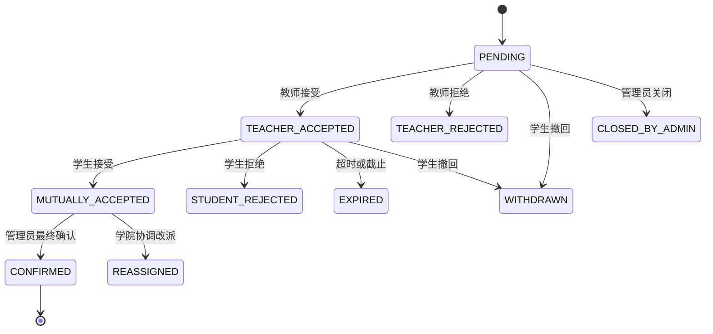

# 毕业设计管理系统 现状审计与需求差距分析报告（v1.2 定稿版）

| 项目     | 内容                                                                                |
| -------- | ----------------------------------------------------------------------------------- |
| 需求基线 | `docs/毕业设计管理系统_项目规格需求书_v1.0.md`                                      |
| 任务来源 | `docs/Agent任务单_现状审计报告v1.2修订与Phase0准备.md`                              |
| 前序版本 | `PROJECT_GAP_ANALYSIS.md`（v1.0）、`PROJECT_GAP_ANALYSIS_v1.1.md`（v1.1）           |
| 修订日期 | 2026-11-15                                                                          |
| 本版性质 | 设计纠错 + 决策收敛 + Phase 0 检查；**未修改代码、Prisma Schema、迁移、依赖与 Git** |
| 结论口径 | 已有且可复用 / 部分已有（含需重构）/ 尚未开发 / 已定默认（延期实现）                |

---

## 0. 本版修正摘要（v1.1 → v1.2）

| #   | v1.1 的问题                                                              | v1.2 修正                                                                                                                         | 章节 |
| --- | ------------------------------------------------------------------------ | --------------------------------------------------------------------------------------------------------------------------------- | ---- |
| 1   | `@@unique([batchStudentId, endedAt])` 被描述为"数据库保证仅一条有效关系" | **该说法错误**：MySQL 唯一索引允许多条 NULL。改为"当前关系表（单列 `@unique`）+ 历史关系表（无唯一约束）"双表模型，并给出实测证据 | §2   |
| 2   | 双向选择允许"管理员强制确认，跳过学生确认"                               | **删除该迁移**。管理员只能确认"双方已达成一致"的志愿；需直接安排时，必须先关闭双向流程，再走独立 MANUAL 命令并记录原因与来源      | §4   |
| 3   | Excel 分配导入未定义字段与模式                                           | 明确三种模式（仅课题/仅导师/同时）、模板列、逐行校验、确认后调用领域服务、原子导入为默认                                          | §5   |
| 4   | 学院可配置范围过窄（仅 3 项）                                            | 扩展为 5 类：阶段时间、可选阶段启用、材料必交/选交与格式/大小/截止、学院审核责任、逾期补交规则                                    | §7   |
| 5   | 邀请码入口被降为 P2，与已确认需求不符                                    | 三种入口（学号 / 邀请码 / 组织搜索）**全部纳入目标需求**，仅允许在开发顺序上分批                                                  | §3.5 |
| 6   | 文件下载使用 `GET /files/stream?token=...`，令牌进入 URL                 | 改为业务子资源下载 `GET /material-versions/:id/download`，服务端实时校验后流式返回；短时凭证只允许走 Header 且一次性              | §6   |
| 7   | 多批次"硬约束"表述过于绝对                                               | "一个当前有效批次"是**服务层默认规则**，不作为数据库唯一约束；例外策略记录为待扩展                                                | §3.4 |
| 8   | 待确认清单仍把已定默认项列为"待你决定"                                   | 区分为"现在必须决定（0 项）"与"实现前再定（7 项，均已给默认值）"                                                                  | §9   |
| 9   | 第一阶段范围过大                                                         | 拆为 M1.0~M1.5 六个可单独验收、可单独回滚的里程碑                                                                                 | §11  |

---

## 1. Phase 0：Git 基线检查（只读）

### 1.1 本次核实的命令与结果

| 命令                        | 结果                                                                                                                            |
| --------------------------- | ------------------------------------------------------------------------------------------------------------------------------- |
| `git branch --show-current` | `main`                                                                                                                          |
| `git rev-parse HEAD`        | `cf6e0b28dcff2cfa5ea7611d6b1dfccb63115e48`（2026-11-12 14:08，`refactor(auth): 优化登录注册页视觉效果并移除 OTP 相关冗余代码`） |
| `git status --short`        | **63 项**：32 项已跟踪文件被修改，31 项未跟踪                                                                                   |
| `git diff --stat`           | `32 files changed, 1337 insertions(+), 308 deletions(-)`（不含未跟踪文件）                                                      |
| `docker compose ps`         | `mysql` 运行中（mysql:8.4.13）、`redis` 运行中（redis:7.4.12-alpine）                                                           |

### 1.2 未提交的迁移（6 个，全部未跟踪）

```
backend/prisma/migrations/20261113120000_phase1_organization_and_user_role_scope/
backend/prisma/migrations/20261114120000_repair_organization_unit_foreign_keys/
backend/prisma/migrations/20261114121000_phase_c_profiles_and_class_duties/
backend/prisma/migrations/20261114140000_coordinator_qualification_overrides/
backend/prisma/migrations/20261114160000_user_role_revocation_reason/
backend/prisma/migrations/20261114180000_phase_e_profile_audit_and_transfer_history/
```

### 1.3 未提交的关键源码（全部未跟踪或已修改）

| 类别               | 内容                                                                                                                                                                                                                            |
| ------------------ | ------------------------------------------------------------------------------------------------------------------------------------------------------------------------------------------------------------------------------- |
| 后端模块（未跟踪） | `src/modules/menus/`、`src/modules/profiles/`、`src/modules/rbac/assignments/`、`src/modules/rbac/authorization/`、`src/modules/rbac/organizations/`、`src/modules/users/`                                                      |
| 后端已修改         | `prisma/schema.prisma`、`prisma/seed.ts`、`src/app.module.ts`、`src/modules/auth/*`、`src/modules/rbac/roles/*`、`test/fixtures/in-memory-prisma.ts`                                                                            |
| 共享包（未跟踪）   | `constants/rbac.ts`（七角色/权限矩阵）、`constants/menu-cache.ts`、`types/user.type.ts`；已修改 `index.ts`、`types/auth.type.ts`、`types/menu.type.ts`                                                                          |
| 前端（未跟踪）     | `router/dynamic/bootstrap.ts`、`stores/menu.ts`、`services/api/menus.api.ts`、`stores/__tests__/menu.store.test.ts`；已修改 `router/dynamic/*`、`router/guard/*`、`router/index.ts`、`app-sidebar/*`、`composables/use-auth.ts` |
| 测试（未跟踪）     | `test/rbac-authorization.e2e-spec.ts`、`users`、`student-profiles`、`teacher-profiles`、`menus`、`coordinator-{concurrency,http,management}` 共 8 个 E2E 套件                                                                   |

### 1.4 判断与风险提示

- 这些内容**很可能就是已完成的 RBAC / 认证 / 组织 / 档案 / 协管 / 动态菜单成果**：对应测试现场为后端单测 301 例、E2E 127 例、前端 125 例全部通过（v1.1 §1.3）。
- **风险**：6 个迁移未入库，一旦工作区被误清理（`git clean -fd`、切换分支、重置），Schema 与迁移将无法复现；且当前 HEAD 不含这些能力，无法回滚到"Phase E5 完成态"。
- **本次未执行任何写操作**：没有 `reset`、`checkout`、`clean`、`stash`、`add`、`commit`、`push`、`restore`，工作区与索引保持原样。
- **建议（等待你确认后由你执行）**：
  1. 先做本地冗余备份：复制整个 `d:/graduation-system`（含 `.git`）到其他目录，或 `git bundle create backup-pre-phase0.bundle --all`；
  2. 数据库备份：`mysqldump` 导出 `graduation_system`（迁移执行前尤其必要）；
  3. 建立本地基线提交（**不推送**）：`git add -A && git commit -m "chore: 建立 RBAC/认证/组织/协管阶段基线"`；
  4. 确认 `pnpm --filter backend test:e2e` 仍全绿后再进入编码。

> 本报告不代替你执行上述任何 Git 操作。

---

## 2. 数据模型：当前关系 + 历史关系（交付物 2）

### 2.1 v1.1 方案为何不可用（实测）

v1.1 主张 `@@unique([batchStudentId, endedAt])`，理由是"MySQL 唯一索引中 NULL 互不相等，所以有效行只能一条"。**这个推论恰好相反**：正因为 NULL 互不相等，多条 `endedAt IS NULL` 的行反而**都能插入**，唯一约束对"当前关系"完全失效。

本次用一次性临时容器（`mysql:8.4.13`，未映射端口、未挂载卷，验证后已删除）实测：

```sql
CREATE TABLE old_scheme (
  id CHAR(36) NOT NULL PRIMARY KEY,
  bs CHAR(36) NOT NULL,
  ended_at DATETIME(3) NULL,
  UNIQUE KEY uk_bs_ended (bs, ended_at)
) ENGINE=InnoDB;

INSERT INTO old_scheme VALUES ('a','bs1',NULL),('b','bs1',NULL);
SELECT COUNT(*) FROM old_scheme WHERE ended_at IS NULL;
```

**结果：`2`** —— 同一学生的两条"当前关系"同时存在，唯一约束没有起到作用。

补充：即便数据库层能被约束，Prisma 的复合唯一键在生成 `WhereUniqueInput` 时**不接受 `null` 作为筛选值**，`upsert` / `connect` / `findUnique` 都无法用该键定位"当前关系"，工程上不可维护。

### 2.2 最终方案：当前关系表 + 历史关系表

**设计原则**

1. 当前关系表只存"此刻有效"的一条记录，用**非空单列唯一**（`batchStudentId`、`topicId`）由数据库保证唯一性。
2. 历史关系表**没有任何唯一约束**，每发生一次变更写入一条不可变快照，条数不受限制。
3. 当前关系与历史快照**在同一事务内**写入，杜绝"一边成功一边失败"。
4. 业务代码只能通过领域服务写这两张表，禁止控制器直接操作。

**统一命名（每条关系一对表）**

| 关系         | 当前表                          | 历史表                          | 当前表唯一键                                 |
| ------------ | ------------------------------- | ------------------------------- | -------------------------------------------- |
| 主指导教师   | `StudentSupervisorCurrent`      | `StudentSupervisorHistory`      | `batchStudentId @unique`                     |
| 课题分配     | `StudentTopicAssignmentCurrent` | `StudentTopicAssignmentHistory` | `batchStudentId @unique` + `topicId @unique` |
| 论文评阅教师 | `ReviewerAssignmentCurrent`     | `ReviewerAssignmentHistory`     | `batchStudentId @unique`                     |

**Prisma 片段（以主指导教师为例）**

```prisma
enum RelationSource {
  BIDIRECTIONAL
  MANUAL
  IMPORT
  CHANGE
}

model StudentSupervisorCurrent {
  id             String  @id @default(uuid()) @db.Char(36)
  batchId        String  @map("batch_id") @db.Char(36)
  batchStudentId String  @unique @map("batch_student_id") @db.Char(36)
  teacherId      String  @map("teacher_id") @db.Char(36)

  startedAt   DateTime       @default(now()) @map("started_at") @db.DateTime(3)
  source      RelationSource @default(MANUAL)
  createdById String         @map("created_by") @db.Char(36)
  updatedById String?        @map("updated_by") @db.Char(36)
  updatedAt   DateTime       @updatedAt @map("updated_at") @db.DateTime(3)

  batchStudent BatchStudent   @relation(fields: [batchId, batchStudentId], references: [batchId, id], onDelete: Restrict)
  teacher      TeacherProfile @relation(fields: [teacherId], references: [id], onDelete: Restrict)

  @@index([teacherId])
  @@index([batchId])
  @@map("student_supervisor_current")
}

model StudentSupervisorHistory {
  id             String         @id @default(uuid()) @db.Char(36)
  relationId     String         @map("relation_id") @db.Char(36) // 对应 current 行的 id
  batchId        String         @map("batch_id") @db.Char(36)
  batchStudentId String         @map("batch_student_id") @db.Char(36)
  teacherId      String         @map("teacher_id") @db.Char(36)

  startedAt DateTime       @map("started_at") @db.DateTime(3)
  endedAt   DateTime       @map("ended_at") @db.DateTime(3) // 非空：历史行一定有结束时间
  endReason String?        @map("end_reason") @db.VarChar(255)
  source    RelationSource
  operatedById String      @map("operated_by") @db.Char(36)
  createdAt DateTime       @default(now()) @map("created_at") @db.DateTime(3)

  @@index([batchStudentId, endedAt])
  @@index([teacherId, endedAt])
  @@index([relationId])
  @@map("student_supervisor_history")
}
```

**课题分配（一题一生的数据库保证）**

```prisma
model StudentTopicAssignmentCurrent {
  id             String @id @default(uuid()) @db.Char(36)
  batchId        String @map("batch_id") @db.Char(36)
  batchStudentId String @unique @map("batch_student_id") @db.Char(36)
  topicId        String @unique @map("topic_id") @db.Char(36)
  startedAt      DateTime @default(now()) @map("started_at") @db.DateTime(3)
  source         RelationSource
  createdById    String @map("created_by") @db.Char(36)

  batchStudent BatchStudent @relation(fields: [batchId, batchStudentId], references: [batchId, id], onDelete: Restrict)
  topic        Topic        @relation(fields: [topicId], references: [id], onDelete: Restrict)

  @@index([batchId])
  @@map("student_topic_assignment_current")
}
```

- `batchStudentId @unique`：一个学生同批次只能有一个当前课题；
- `topicId @unique`：一个课题只能被一名学生占用；
- 两条都由数据库单列唯一约束保证（列均非空，无 NULL 语义问题）。

### 2.3 唯一约束实测证明（可复现）

同一临时容器（mysql:8.4.13）执行：

```sql
-- 当前关系表：同一学生插第二条 → 期望被拒
CREATE TABLE cur_scheme (
  id CHAR(36) NOT NULL PRIMARY KEY,
  bs CHAR(36) NOT NULL,
  UNIQUE KEY uk_bs (bs)
) ENGINE=InnoDB;
INSERT INTO cur_scheme VALUES ('r1','bs1');
INSERT INTO cur_scheme VALUES ('r2','bs1');   -- 这一行必须失败
```

**结果**：`ERROR 1062 (23000): Duplicate entry 'bs1' for key 'cur_scheme.uk_bs'` —— 数据库拒绝第二条当前关系。

```sql
-- 历史关系表：多条、甚至同一时间戳 → 期望全部成功
CREATE TABLE his_scheme (
  id CHAR(36) NOT NULL PRIMARY KEY,
  relation_id CHAR(36) NOT NULL,
  bs CHAR(36) NOT NULL,
  ended_at DATETIME(3) NOT NULL,
  KEY idx_bs (bs)
) ENGINE=InnoDB;
INSERT INTO his_scheme VALUES
  ('h1','r0','bs1','2026-01-01 10:00:00.000'),
  ('h2','r0','bs1','2026-01-01 10:00:00.000'),
  ('h3','r0','bs1','2026-03-01 09:00:00.000');
```

**结果**：`历史关系条数=3`、`当前关系表条数=1`。

结论：**单列唯一 = 当前唯一（数据库强制）；无唯一的历史表 = 历史不限条数**。该结论不依赖 NULL 语义，也不依赖应用层查询后再插入。

> 验证环境说明：临时容器 `gap-probe`（`mysql:8.4.13`，无端口映射、无数据卷），验证后已 `docker rm -f` 删除；未触碰项目数据库，未修改任何项目文件。

### 2.4 变更事务与"部分状态"防范

更换指导教师（课题同理）在**同一事务**内按固定顺序执行：

1. `SELECT ... FROM student_supervisor_current WHERE batch_student_id = ? FOR UPDATE`（行锁，防并发更换）；
2. 若已存在且 `teacherId` 不同：
   - ① `INSERT student_supervisor_history`（`relationId` = 当前行 id，写入**旧** `teacherId` / **旧** `startedAt` / `endedAt = 事务时间` / `endReason` / `operatedById` / `source`）；
   - ② `UPDATE student_supervisor_current SET teacher_id = ?, started_at = ?, source = ?, updated_by = ?`（**id 不变**，历史通过 `relationId` 稳定回溯）；
3. 若不存在：`INSERT student_supervisor_current`；并发下第二个插入触发 `uk_batch_student` 冲突（Prisma `P2002`）→ 映射 `409`；
4. `INSERT audit_log`（before/after、reason、source、actor）；
5. 提交。

**为什么不会出现部分状态**

- ① 与 ② 同属一个 `$transaction`：任一语句失败（含唯一约束、外键、审计写入失败）整体回滚，不会留下"历史已写但当前未改"或"当前已改但历史缺失"。
- 顺序固定为"先历史后当前"：即使隔离级别较低，也不会出现"当前已指向新教师，而历史里找不到旧教师的终止记录"的窗口。
- 创建路径只写 current + audit（没有历史），不存在"创建也写历史"的歧义。
- 所有外部输入先校验（章节 §2.5），避免把业务校验放在事务里长时间持锁。

### 2.5 查询职责划分

| 场景                 | 数据源                                                        | 接口                                             | 说明                                       |
| -------------------- | ------------------------------------------------------------- | ------------------------------------------------ | ------------------------------------------ |
| 教师工作台"我的学生" | `StudentSupervisorCurrent`（`teacherId` 索引）                | `GET /supervisions/my-students`                  | 天然只含有效关系，无需过滤 `endedAt`       |
| 学生"我的指导教师"   | `StudentSupervisorCurrent`（`batchStudentId` 唯一查询）       | `GET /supervisions/current?batchStudentId=`      | 单行返回                                   |
| 容量统计             | `COUNT(*) FROM StudentSupervisorCurrent WHERE teacher_id = ?` | 内部服务                                         | 有效关系即全表，历史不参与，统计口径无歧义 |
| 指导关系历史         | `StudentSupervisorHistory`（按学生/教师分页）                 | `GET /supervisions/:batchStudentId/history`      | 只读；管理端与学生可见范围不同             |
| 课题当前归属         | `StudentTopicAssignmentCurrent`                               | `GET /topic-assignments/current?batchStudentId=` | 一题一生查询用 `topicId` 唯一键            |
| 课题分配历史         | `StudentTopicAssignmentHistory`                               | `GET /topic-assignments/:batchStudentId/history` | 只读                                       |

写入口唯一：`SupervisionService.replaceSupervisor()`、`AssignmentService.applyTopic()/applySupervisor()`。控制器不得直接调用 `prisma.studentSupervisorHistory.create()`。

### 2.6 其他关系表沿用与例外

- `TeacherClassDuty`、`CounselorClassAssignment`（现有）已用 `validFrom/validUntil/revokedAt`，**本版不迁移**；它们的唯一性由"班级行锁 + 半开区间重叠检查"保证，属已实现且经 E2E 验证的既有能力。
- `FinalGrade` 保持 `batchStudentId @unique`（单列非空），它不是"可变更关系"，发布后修订走 `GradeRevision`，无需历史表。
- `BatchStudent` 的 `@@unique([batchId, studentProfileId])` 保持（参与记录本身不重复）。

---

## 3. 批次、BatchStudent 与学生业务表一致性（交付物 5）

### 3.1 `BatchStudent` 的语义

`BatchStudent` = **学生在某个毕业批次中的参与关系**（业务身份），不是"名单缓存"：

- 组织归属（`StudentProfile.classId`）回答"学生现在属于哪个班级"；
- 批次参与（`BatchStudent`）回答"学生是否参与该批次、以什么状态参与"。

两者独立：转班不改变批次参与；加入批次不改变组织归属。

```prisma
model BatchStudent {
  id               String  @id @default(uuid()) @db.Char(36)
  batchId          String  @map("batch_id") @db.Char(36)
  studentProfileId String  @map("student_profile_id") @db.Char(36)

  status     BatchStudentStatus @default(ENROLLED) // ENROLLED / DEFERRED / COMPLETED / WITHDRAWN
  enrolledAt DateTime @default(now()) @map("enrolled_at") @db.DateTime(3)
  leftAt     DateTime? @map("left_at") @db.DateTime(3)
  note       String?   @db.VarChar(255)

  @@unique([batchId, studentProfileId])
  @@unique([batchId, id])   // 供业务表复合外键引用
  @@index([studentProfileId, status])
  @@map("batch_students")
}
```

### 3.2 一致性的数据库保证：复合外键

所有学生维度业务表同时带 `batchId` 与 `batchStudentId`，并用**复合外键**绑定：

```prisma
batchStudent BatchStudent @relation(fields: [batchId, batchStudentId], references: [batchId, id], onDelete: Restrict)
```

- 只带 `batchStudentId`：批次过滤要回表连接，索引不友好；
- 只带两个独立字段：可能被写成"学生 A 的 `batchStudentId` + 批次 B 的 `batchId`"这类错误组合；
- 复合外键：**插入/更新时数据库校验 `(batchId, batchStudentId)` 必须真实存在于 `BatchStudent`**，错误组合直接失败。

### 3.3 学生业务表引用清单

| 表                                      | 引用方式                                     | 备注                                                                   |
| --------------------------------------- | -------------------------------------------- | ---------------------------------------------------------------------- |
| `StudentTopicSelection`                 | `(batchId, batchStudentId)` + `topicId`      | 志愿表按 `BatchStudent` 一人一份                                       |
| `StudentTopicAssignmentCurrent/History` | `(batchId, batchStudentId)` + `topicId`      | 一题一生                                                               |
| `StudentSupervisorCurrent/History`      | `(batchId, batchStudentId)` + `teacherId`    | 唯一主指导                                                             |
| `MaterialSubmission`                    | `(batchId, batchStudentId)`                  | 材料归属                                                               |
| `MaterialVersion`                       | 经 `submissionId` 关联                       | 批次与学生通过 submission 推导，不冗余 `batchId`（避免多一层复合外键） |
| `MaterialReview`                        | 经 `versionId` 间接                          | 审核绑定版本                                                           |
| `LateSubmissionRequest`                 | `(batchId, batchStudentId)`                  | 逾期申请                                                               |
| `GuidanceRecord`                        | `(batchId, batchStudentId)`                  | 指导记录归属学生                                                       |
| `ReviewerAssignmentCurrent/History`     | `(batchId, batchStudentId)` + `reviewerId`   | 评阅分配                                                               |
| `ThesisReview`                          | `(batchId, batchStudentId)`                  | 评阅结果                                                               |
| `DefenseAssignment`                     | `(batchId, batchStudentId)` + `groupId`      | 答辩安排                                                               |
| `DefenseResult`                         | 经 `defenseAssignmentId` 关联 + `round` 唯一 | 学生与批次由答辩安排推导                                               |
| `FinalGrade`                            | `batchStudentId @unique` + `batchId`         | 跨批次独立成绩                                                         |
| `PlagiarismCheck`                       | `(batchId, batchStudentId)`                  | 查重登记                                                               |

**不引用 `BatchStudent` 的表**：`Topic`（只带 `batchId`）、`DefenseSession`/`DefenseGroup`（只带 `batchId`）、`GraduationBatch`、`BatchStage`、`FileObject`、`AuditLog`。

### 3.4 "一个当前有效批次"的执行位置

- 规格原文是"**原则上**只能有一个当前有效批次"，因此**不建数据库唯一约束**（否则延期毕业、特殊例外一律无法表达）。
- 默认规则在服务层执行：`BatchEnrollmentService.enroll()` 事务内锁 `StudentProfile` 行，校验该学生不存在 `status = ENROLLED` 的 `BatchStudent`；存在则返回 `409` 并要求先办理延期。
- 延期流程：旧参与记录置 `DEFERRED` 或 `COMPLETED` → 在新批次创建 `ENROLLED` 记录；**旧记录保留**。
- 例外（同一学生两批次并行）v1.2 **不开放**，仅在数据模型上不封死（去掉 DB 唯一即可支持），后续如需要再放开并由学校规则约束。

### 3.5 班级加入申请：三种入口全部保留

**目标需求**（不是可选能力）：学生可通过以下任一方式提交加入班级申请，三者都要实现。

| 入口     | `method`      | 学生输入                       | 服务端校验                                                  |
| -------- | ------------- | ------------------------------ | ----------------------------------------------------------- |
| 学号信息 | `STUDENT_NO`  | 学号 + 姓名 + 目标班级         | 学号与姓名匹配 `StudentProfile`（或由管理员核验后建档绑定） |
| 邀请码   | `INVITE_CODE` | 邀请码                         | 码存在、未过期、未超次数、未撤销；码绑定的班级即目标班级    |
| 组织搜索 | `ORG_SEARCH`  | 院系 → 专业 → 班级（级联选择） | 组织节点存在且 ACTIVE；仅允许选择班级类型                   |

```prisma
enum ClassJoinMethod { STUDENT_NO, INVITE_CODE, ORG_SEARCH }
enum ClassJoinStatus { PENDING, APPROVED, REJECTED, CANCELLED }

model ClassJoinRequest {
  id            String  @id @default(uuid()) @db.Char(36)
  userId        String  @map("user_id") @db.Char(36)
  targetClassId String  @map("target_class_id") @db.Char(36)
  method        ClassJoinMethod
  status        ClassJoinStatus @default(PENDING)
  note          String? @db.VarChar(255)
  reviewerId    String? @map("reviewer_id") @db.Char(36)
  reviewedAt    DateTime? @map("reviewed_at") @db.DateTime(3)
  rejectReason  String? @map("reject_reason") @db.VarChar(255)
  createdAt     DateTime @default(now()) @map("created_at") @db.DateTime(3)

  // 同一学生对同一班级只保留一条申请记录；被拒后可重新提交（状态回到 PENDING）
  @@unique([userId, targetClassId])
  @@index([targetClassId, status])
  @@map("class_join_requests")
}

model ClassInviteCode {
  id        String    @id @default(uuid()) @db.Char(36)
  classId   String    @map("class_id") @db.Char(36)
  code      String    @unique @db.VarChar(16)   // 8 位随机，字母数字
  expiresAt DateTime? @map("expires_at") @db.DateTime(3)
  maxUses   Int       @default(1) @map("max_uses")
  usedCount Int       @default(0) @map("used_count")
  revokedAt DateTime? @map("revoked_at") @db.DateTime(3)
  createdById String  @map("created_by") @db.Char(36)
  createdAt DateTime  @default(now()) @map("created_at") @db.DateTime(3)

  @@index([classId, revokedAt])
  @@map("class_invite_codes")
}
```

**审批规则**

1. 审批人需具备该班级的组织管理范围（院系/专业/学校管理员）；
2. 通过后**只做三件事**：更新 `StudentProfile.classId`、写 `StudentClassTransfer`（from/to/原因/操作人/时间）、通知学生；
3. **不自动创建 `BatchStudent`**；
4. **不自动授予任何角色**（包括 STUDENT 之外的任何角色）；
5. 拒绝必须填原因；学生可重新提交，申请记录保留最后状态，历史通过 `AuditLog` 追溯。

**开发顺序说明**：三种入口都属于目标需求，不降级、不删除。M1.3 里程碑内先实现"学号 + 组织搜索"（覆盖绝大多数场景），邀请码在同一里程碑内跟进，不跨阶段；邀请码的具体规则（长度/有效期/次数）按 §9.2 默认值执行。

---

## 4. 双向选择与手动分配：两套独立流程（交付物 3）

### 4.1 对比

| 维度                   | 双向选择                                     | 学校手动分配                                     |
| ---------------------- | -------------------------------------------- | ------------------------------------------------ |
| 触发                   | 学生提交志愿                                 | 管理员直接命令                                   |
| 学生确认               | **必需**（接受/拒绝教师意向）                | **不需要**                                       |
| 教师确认               | 必需（表达意向）                             | 不需要                                           |
| 生效                   | 双方一致 → 学院处理冲突 → **管理员最终确认** | 管理员确认即生效                                 |
| 状态机                 | 多状态（§4.2）                               | 单步（§4.3）                                     |
| 管理员能否跳过学生确认 | **不能**                                     | 不适用（本来就不需要学生确认）                   |
| 数据痕迹               | 志愿、意向、学生决策、协调记录全留           | 关系 + 审计（`source = MANUAL / IMPORT` + 原因） |

### 4.2 双向选择状态机（已删除"强制确认"）

**志愿表**（每个 `BatchStudent` 一份）

```
DRAFT --学生提交--> SUBMITTED --批次截止/管理员关闭--> CLOSED
SUBMITTED --学生撤回（未锁定）--> WITHDRAWN
SUBMITTED --管理员锁定--> LOCKED（禁止增改序，仍可决策）
```

**志愿项**

| 当前状态                       | 允许动作                   | 目标状态            | 操作者          |
| ------------------------------ | -------------------------- | ------------------- | --------------- |
| `PENDING`                      | 教师接受                   | `TEACHER_ACCEPTED`  | 该课题的教师    |
| `PENDING`                      | 教师拒绝                   | `TEACHER_REJECTED`  | 该课题的教师    |
| `TEACHER_ACCEPTED`             | 学生接受                   | `MUTUALLY_ACCEPTED` | 学生本人        |
| `TEACHER_ACCEPTED`             | 学生拒绝                   | `STUDENT_REJECTED`  | 学生本人        |
| `TEACHER_ACCEPTED`             | 超时 / 批次截止            | `EXPIRED`           | 系统            |
| `MUTUALLY_ACCEPTED`            | **管理员最终确认**         | `CONFIRMED`         | 学院/学校管理员 |
| `MUTUALLY_ACCEPTED`            | 学院协调改派（记录原因）   | `REASSIGNED`        | 学院管理员      |
| `PENDING` / `TEACHER_ACCEPTED` | 学生撤回                   | `WITHDRAWN`         | 学生本人        |
| `PENDING` / `TEACHER_ACCEPTED` | 管理员关闭流程（记录原因） | `CLOSED_BY_ADMIN`   | 学院管理员      |



**关键规则**

1. 只有 `MUTUALLY_ACCEPTED` 能进入 `CONFIRMED`；不存在"管理员从 `PENDING` 直接确认"的迁移。
2. `CONFIRMED` 的落地动作 = 事务内创建 `StudentTopicAssignmentCurrent` + `StudentSupervisorCurrent`，写入来源 `BIDIRECTIONAL`。
3. 学院协调只处理"冲突/未匹配"：把冲突志愿置 `REASSIGNED` 并记录原因，或关闭流程后转手动分配。
4. 一个课题只能被一名学生确认；一个学生同批次只能有一个已确认志愿 —— 由 §2.2 的单列唯一键兜底，状态机只是流程约束。
5. 学生撤回不会删除已产生的历史，志愿项保留终态。

### 4.3 手动分配：单步、立即生效

```
命令：POST /assignments/manual
输入：{ batchStudentId, topicId?, supervisorTeacherId?, reason, idempotencyKey }
```

- 至少给 `topicId` 或 `supervisorTeacherId` 之一；两者都给则在**同一事务**内一起落地。
- 校验通过后直接写 `StudentTopicAssignmentCurrent` / `StudentSupervisorCurrent`（来源 `MANUAL`），**不产生学生决策记录**。
- 若有旧关系：事务内按 §2.4 写历史 + 更新当前。
- 幂等：`idempotencyKey` 命中直接返回上次结果，不重复写入。
- 通知：事务提交后异步通知学生与教师；通知失败不回滚分配。

**批量**：`POST /assignments/manual/batch`，同一批次内多条，逐条调用 `AssignmentService`；默认原子（全部成功或全部回滚）。

### 4.4 双向选择失败后如何转手动（正式路径）

管理员如判断"学生选不上/教师不收"，**不能**在双向流程里"替学生接受"，而应：

1. `POST /selection-sheets/:id/close`（关闭该学生志愿表，`reason` 必填）→ 未决志愿置 `CLOSED_BY_ADMIN`；
2. `POST /assignments/manual`（`source = MANUAL`，`reason` 必填）→ 直接落地课题/导师；
3. 审计记录两条：关闭流程 + 手动分配，`actor`、`reason`、`source` 完整。

统计与追责时：`source = BIDIRECTIONAL` 表示"双方同意后确认"，`MANUAL` 表示"管理员直接安排"，两者不可混淆，也不会出现"学生已接受"的虚假记录。

### 4.5 不可破坏的约束（汇总）

- 一个课题同一时刻只能有一名学生（`topicId @unique`）；
- 一个学生同批次只能有一个当前课题、一名当前主指导教师（`batchStudentId @unique`）；
- 历史关系可无限多，且不可覆盖、不可删除；
- 并发下第二个写入触发 `P2002` → `409`；
- 更换教师/课题必须"先历史后当前"，同一事务。

---

## 5. 课题与导师独立分配 + Excel 导入（交付物 4）

### 5.1 两条独立关系

| 关系         | 当前表                          | 独立性                 |
| ------------ | ------------------------------- | ---------------------- |
| 课题分配     | `StudentTopicAssignmentCurrent` | 只决定"学生做哪个课题" |
| 指导教师分配 | `StudentSupervisorCurrent`      | 只决定"谁指导学生"     |

现实场景允许"课题已定、导师未定"或"导师已定、课题未定"，因此两条关系**互不强制**；只在"同时给出两者"时要求同事务。

### 5.2 导入模式（三种，模板固定）

| 模式           | 导入类型          | 必填列                                   | 允许空列              |
| -------------- | ----------------- | ---------------------------------------- | --------------------- |
| 仅分配课题     | `TOPIC_ONLY`      | `student_no`、`topic_code`               | `teacher_no` 必须为空 |
| 仅分配指导教师 | `SUPERVISOR_ONLY` | `student_no`、`teacher_no`               | `topic_code` 必须为空 |
| 同时分配       | `BOTH`            | `student_no`、`topic_code`、`teacher_no` | —                     |

模板列（xlsx 第一行表头，固定顺序）：

| 列  | 字段                  | 校验                                                 |
| --- | --------------------- | ---------------------------------------------------- |
| A   | `student_no` 学号     | 必填；存在 `StudentProfile`；属于本批次且 `ENROLLED` |
| B   | `topic_code` 课题编号 | 模式要求时必填；属于本批次、状态已发布、未被占用     |
| C   | `teacher_no` 教师工号 | 模式要求时必填；教师在职、在本批次可指导             |
| D   | `reason` 变更原因     | 选填；替换既有关系时必填                             |

> 导入类型由用户在上传时选择（或由模板文件名前缀区分），**不允许学生在表格里填写模式字段**，避免"同一文件混合三种语义"。

### 5.3 流程（先预览、再逐行校验、确认后调领域服务）

```
① GET  /imports/templates/topic-assignments?mode=TOPIC_ONLY|SUPERVISOR_ONLY|BOTH
② POST /imports                        （multipart：file + mode + batchId）
   → 解析 → 创建 ImportJob(PENDING) → 逐行校验 → 返回前 20 行 + 统计
③ GET  /imports/:id/preview             （分页预览 + 每行 expectedAction）
④ GET  /imports/:id/errors              （错误清单可下载 xlsx）
⑤ POST /imports/:id/confirm             （逐行调用 AssignmentService，事务处理）
```

- **禁止直接批量写 Prisma**：确认阶段每一行都必须走 `AssignmentService.apply()`，从而复用唯一约束、容量校验、事务与审计。
- 预览阶段只读校验，不产生任何写入。
- 错误清单字段：行号、学号、课题编号、教师工号、错误码、错误说明。

### 5.4 原子 vs 部分成功

| 策略             | 行为                                                                                 | 默认 |
| ---------------- | ------------------------------------------------------------------------------------ | ---- |
| **原子（默认）** | 任一行失败 → 整个导入回滚，`ImportJob.status = FAILED`，错误清单可用                 | ✅   |
| 跳过失败行       | 仅在用户显式勾选"忽略错误行并继续"后启用；成功行提交、失败行列清单；需二次确认对话框 | 可选 |

不允许"静默部分成功"：任何部分写入必须在响应里明确 `successCount / failedCount / errors`，并写入 `ImportJob`。

### 5.5 统一校验规则（预览与确认共用同一校验器）

1. 学生：档案存在、批次参与 `ENROLLED`、学籍 `ACTIVE`；
2. 课题：同批次、已发布、当前未被占用、专业允许（跨专业按配置）；
3. 教师：在职、属于允许范围、当前有效指导数 < 容量（历史关系不计）；
4. 关系：学生当前无冲突关系，或已提供 `reason` 允许替换；
5. 文件内重复：同一学号出现两次 → 整行报错；
6. 权限：导入者对该批次与目标班级有管理范围；
7. 幂等：同一文件重复上传 → 提示"疑似重复导入"，需重新确认。

---

## 6. 文件下载鉴权最终方案（交付物 6）

### 6.1 明确禁止

- ❌ 公开 URL、静态目录直读、对象存储公共读；
- ❌ `GET /files/:id`（仅凭 fileId 下载）；
- ❌ 令牌放在 URL 查询参数（`?token=`）—— 会进入代理日志、浏览器历史、Referer、监控系统；
- ❌ 用前端隐藏、菜单权限代替后端校验；
- ❌ 协管员下载材料正文。

### 6.2 最终方案：业务子资源 + 实时校验 + 流式返回

```
GET /material-versions/:id/download
Authorization: Bearer <accessToken>
```

服务端顺序（全部通过才返回流）：

1. `AccessTokenGuard`：会话未撤销、用户 ACTIVE；
2. 查 `MaterialVersion` → `MaterialSubmission` → `BatchStudent`（含 `batchId`）；
3. 业务关系校验（分支）：
   - 学生：`sessions.userId` 对应的 `StudentProfile` 就是该 `BatchStudent.studentProfileId`；
   - 指导教师：`StudentSupervisorCurrent` 命中 `(batchStudentId, teacherId = 当前用户教师档案)`；
   - 评阅教师：`ReviewerAssignmentCurrent` 命中，且材料类型为论文；
   - 院系/专业/学校管理员：组织数据范围覆盖该学生班级，且具备 `material:download` 权限；
   - **协管员：显式拒绝（403）**，即使同时拥有其他角色也只按其他角色的独立授权判定；
4. 校验版本状态（如"已归档"仍可下载，`DRAFT` 只有本人可下）；
5. 返回 `Content-Disposition: attachment` + `Content-Type` + 流式 body（`StorageAdapter.createReadStream`），并写一条 `file.download` 审计。

其他业务同理：`GET /plagiarism-checks/:id/report`、`GET /knowledge-documents/:id/download`，各自走自己的业务对象，**不存在通用 `/files/:id`**。

### 6.3 若将来确需短时凭证（Header 方案）

仅当出现大文件断点续传、CDN 回源等真实需求时启用：

1. `POST /material-versions/:id/download-ticket` → 返回 `{ ticket, expiresIn: 60 }`；
2. 客户端请求：`GET /files/stream` + `Authorization: Bearer <accessToken>` + `X-Download-Ticket: <ticket>`（**Header，不进 URL**）；
3. ticket 存 Redis：`key = 随机 32 字节`，value 含 `userId + sessionId + subjectType + subjectId + 一次性标记`，TTL 60s，`GETDEL` 保证一次性；
4. 校验 ticket 归属与当前 Access Token 的 `userId` 一致，防止转发重放；不匹配 → 403；
5. 仍禁止把 ticket 拼进 URL。

### 6.4 文件对象与存储（配套约定）

- `FileObject` 不带 `batchId`/`studentProfileId`，只存 `storageKey`、`purpose`、`mime`、`size`、`sha256`、`uploadedById`；
- 业务侧 1:1 绑定：`MaterialVersion.fileObjectId @unique`、`PlagiarismCheck.reportFileId @unique`、`KnowledgeDocument.fileObjectId @unique`；
- 存储默认：**本地私有目录 + Docker volume**（`/data/uploads`，不通过 Nginx 静态暴露），`StorageAdapter` 预留 MinIO/OSS 实现；
- 上传：后端中转（`multipart`），校验 MIME + 扩展名白名单 + 大小上限 + `sha256`；**不做浏览器直传**；
- 孤儿文件：上传后 24h 未绑定 → 清理任务处理（M1.4 先用管理命令，不做定时框架）。

---

## 7. 学院配置范围（交付物 7）

### 7.1 允许学院配置的 5 类

| 类别     | 可配置内容                                                          | 约束                               |
| -------- | ------------------------------------------------------------------- | ---------------------------------- |
| 阶段时间 | 各阶段开始/截止时间、是否开放                                       | 不得改变阶段顺序；不得早于批次开始 |
| 可选阶段 | 学校定义的"可选阶段"是否启用（如中期检查）                          | 只能启用/停用，不能新增自定义阶段  |
| 材料要求 | 学校材料类型在本批次/学院：必交或选交、允许格式、大小上限、截止时间 | 材料类型必须来自学校预置清单       |
| 审核责任 | 该材料是否需要学院审核、审核责任角色（院系管理员 / 专业管理员）     | 不能跳过指导教师审核这一前置       |
| 逾期补交 | 是否允许补交、最大逾期天数、审批人角色（指导教师 / 学院管理员）     | 不得开启"自动通过"                 |

### 7.2 明确不允许

- 任意拖拽节点、任意脚本、通用工作流引擎；
- 新增学校未定义的阶段或材料类型；
- 改变学校主流程的核心顺序（选题 → 任务书 → 开题 → 中期 → 论文 → 评阅 → 答辩 → 成绩）；
- **专业级全量覆盖**（未确认，本阶段不实现；数据模型预留 `scopeType` 字段但不开放专业配置入口）。

### 7.3 解析优先级

```
学校默认（批次模板）
  → 学院覆盖（仅上述 5 类）
    → 专业/教师级：本阶段不开放
```

实现方式：`BatchStageConfig`、`MaterialRequirementConfig` 带 `scopeType`（`SCHOOL` / `DEPARTMENT`）与 `scopeOrgUnitId`；查询时按"最具体优先"合并，缺失则回落到学校默认。

---

## 8. 已确认需求核对表（10 项）

| #   | 已确认需求                                                              | v1.2 落实位置                                                                                   | 结论 |
| --- | ----------------------------------------------------------------------- | ----------------------------------------------------------------------------------------------- | ---- |
| 1   | 单一 Vue Web 应用，不做 Flutter / 小程序                                | §10：单应用、五工作台，不引入多端                                                               | 一致 |
| 2   | 五类工作台在同一 Vue 应用内，切换不改后端权限                           | §10：后端下发 `workbenches`，切换仅改导航                                                       | 一致 |
| 3   | 成绩默认 30/30/40，可配置，总和必须 100%                                | 沿用 v1.0 §26 与 v1.1 §5.6 的 `GradeComponent`/`FinalGrade`；权重总和校验在成绩服务层（服务端） | 一致 |
| 4   | 学生原则上只有一个当前有效批次，延期保留旧记录                          | §3.4：服务层规则，不做 DB 唯一；旧记录置 `DEFERRED/COMPLETED`                                   | 一致 |
| 5   | 第一阶段只做站内通知                                                    | 通知模块仅 `InAppNotification` + 发送记录，不接短信/邮件/微信                                   | 一致 |
| 6   | AI 私人对话隔离；协管仅班级汇总与草稿；写操作人工确认；工具调用后端鉴权 | 沿用 v1.1 §7.4 / §12 的约定：`AiToolRegistry` 注入当前用户上下文，禁止无边界 Prisma             | 一致 |
| 7   | 公共知识库与个人材料知识库分层；Chroma 已预置、应用集成延后             | 知识库实体按 `scope` 分层；Chroma 沿用 `compose.yaml` 的 1.5.9，不在 M1 接入                    | 一致 |
| 8   | 协管资格：学生本班在籍 / 工作人员院系一致 / 学校覆盖                    | 沿用 v1.1 §7.1（本版无变更）：不要求班长/班助任职                                               | 一致 |
| 9   | 协管退出申请保留；申诉与自主申请不开发                                  | 沿用 v1.1 §7.3；实体 `CoordinatorRevokeRequest`                                                 | 一致 |
| 10  | 线下答辩，小组统一评分，支持手工与 Excel 导入，不要求评委逐人登录打分   | 评阅/答辩/成绩阶段（v1.1 §15 Phase 5）落地；本版 §5 的导入范式可复用                            | 一致 |

---

## 9. 决策清单（交付物 8）

### 9.1 现在必须决定：**0 项**

本版已按任务单给出的默认方案收敛全部设计，无阻塞决策。

### 9.2 实现对应模块前再定（均有默认值）

| 事项                                                   | 已采用默认                                                                                  | 最晚决定时点                        | 为什么可以延后                                        |
| ------------------------------------------------------ | ------------------------------------------------------------------------------------------- | ----------------------------------- | ----------------------------------------------------- |
| 存储实现细节（目录结构、容量上限、备份脚本、清理策略） | 本地私有目录 + Docker volume，后端中转，不做直传                                            | M1.4 开工前                         | 接口已抽象为 `StorageAdapter`，替换实现不影响业务代码 |
| 是否引入对象存储 / 浏览器直传                          | 不引入                                                                                      | 单文件 > 100MB 或并发上传成为瓶颈时 | 当前材料以 PDF/Word 为主，中转足够                    |
| AI 供应商与模型                                        | 可替换 provider；本阶段不接 Agent                                                           | AI 里程碑前                         | 不影响业务数据模型                                    |
| 学号验证因子                                           | 学号 + 姓名 + 管理员核验，不采集身份证                                                      | M1.3 表单定稿前                     | 只影响申请表单字段，不影响表结构                      |
| 邀请码规则（长度 / 有效期 / 次数）                     | 8 位随机、7 天、单次使用、可撤销                                                            | M1.3 实现邀请码入口前               | 入口已在目标需求内，规则可后配                        |
| 审计保留期限与脱敏细则                                 | 记录操作元数据与业务前后值；不记密码/Token/论文正文/AI 私聊；展示按角色脱敏；期限按学校规则 | 上线前                              | 表结构不随期限变化                                    |
| 延期毕业是否允许多批次并行                             | 不允许自动并行；特殊例外仅保留扩展点                                                        | 出现真实需求时                      | §3.4 已不在 DB 层封死                                 |

> 已确认需求（协管资格、双工作台、响应结构 `data`、单校单根组织、权重 100%、站内通知、AI 边界等）**不再列为待确认**。

---

## 10. 前端工作台与页面（单 Vue 应用，交付物摘要）

| 工作台 | 路由                     | 默认落地   | 依赖                     |
| ------ | ------------------------ | ---------- | ------------------------ |
| 学生   | `/workbench/student`     | 我的毕设   | 批次、材料、答辩、成绩   |
| 教师   | `/workbench/teacher`     | 待审/待评  | 课题、材料审核、评阅     |
| 协管   | `/workbench/coordinator` | 我的班级   | 班级进度投影、通知、待办 |
| 管理   | `/workbench/admin`       | 概览与待办 | 批次、分配、成绩发布     |
| 平台   | `/workbench/platform`    | 系统维护   | 组织、角色、审计、知识库 |

- 仍是**一个应用、一次登录**；工作台切换只改导航与落地页，不重登、不改权限；
- 工作台列表与默认值由后端下发（`AuthUser.workbenches`），前端不硬编码；
- 记忆上次选择（`localStorage`），角色失效时回退后端默认；
- 学生 + 协管双身份：两个工作台入口同时保留，协管不覆盖学生业务。

新增页面（componentKey）：`BATCH_MANAGEMENT`、`BATCH_ENROLLMENT`、`CLASS_JOIN_REVIEW`、`MATERIAL_REQUIREMENT`、`LATE_SUBMISSION`、`PLAGIARISM_CHECK`、`NOTIFICATION_CENTER`、`MY_CLASSES`、`MY_AUTHORIZATIONS`、`COORDINATOR_TODO`、`AUDIT_LOG`、`IMPORT_CENTER`。现有 21 个骨架页保留文件与 key，逐页替换内容。

---

## 11. 第一阶段：可单独验收的小里程碑（交付物 10）

每个里程碑 = 1 个（或 2 个）迁移 + 后端模块 + 前端页面 + 测试，可独立验收、独立回滚。

### M1.0 基线保护（不写代码）

- 交付：用户确认后的本地基线提交（不推送）+ 数据库 `mysqldump` + 目录/bundle 备份；
- 验收：`git status` 干净、`pnpm --filter backend test:e2e` 全绿且 HEAD 可回溯；
- 依赖：无。

### M1.1 审计基础

- 交付：`AuditLog` 表 + `AuditService.record()`（唯一写入口）+ 查询接口（只读）；接入 1 个现有写接口（如转班）作为试点；
- 验收：① 试点接口成功后审计表有记录（actor/target/before/after/source/requestId）；② 审计表无更新/删除接口；③ 单测 + E2E；
- 依赖：M1.0；不依赖任何业务模块。

### M1.2 批次与批次参与

- 交付：`GraduationBatch`（最小三态 `DRAFT/ACTIVE/ARCHIVED` 先落地，后续补 `UPCOMING/COMPLETED`）、`BatchStage`、`BatchStudent`（含复合外键与 `@@unique`）；
- 验收：① 批次 A 管理员访问批次 B 的参与名单返回 403；② 同一学生同批次重复参与返回 409；③ 学生跨批次各有一条 `BatchStudent`；④ 阶段截止后提交入口关闭（用占位接口验证时间判定）；
- 依赖：M1.1。

### M1.3 名单导入 + 班级加入申请（三入口）

- 交付：名单 xlsx 模板、`ImportJob`/`ImportRowError`、预览/错误清单/确认；`ClassJoinRequest`（学号 / 邀请码 / 组织搜索三种入口）+ `ClassInviteCode`；
- 验收：① 导入 100 行含 3 类错误，错误清单可下载，确认前不写业务表；② 重复导入提示"疑似重复"；③ 加入申请审批后 `StudentProfile.classId` 变更并写 `StudentClassTransfer`；④ **不**自动创建 `BatchStudent`、**不**自动授予角色；⑤ 邀请码单次有效、过期失效；
- 依赖：M1.1、M1.2。

### M1.4 文件 + 材料最小切片

- 交付：`FileObject` + `StorageAdapter`（本地私目录）+ 上传校验；`MaterialRequirement`（1 条）+ `MaterialSubmission` + `MaterialVersion`；`GET /material-versions/:id/download`；
- 验收：① 学生上传终稿 PDF 可下载；② 指导教师可下载；③ 协管 403；④ 无业务关系 403；⑤ 未登录 401；⑥ 非法格式/超限 400；⑦ 审计记录 `file.download`；
- 依赖：M1.2；与 M1.3 可并行（不同表）。

### M1.5 权限下发与工作台骨架

- 交付：`AuthUser.permissions[]`、`AuthUser.workbenches[]`、5 个工作台路由与空壳页面、菜单补齐（12 个 key）；
- 验收：① 撤销角色后重新请求 `permissions` 立即减少；② 工作台切换不重新登录；③ 无权限菜单不出现且直接访问返回 404/403；④ 前端 5 个工作台入口可见；
- 依赖：M1.1（审计用于管理员操作）、可与 M1.3/M1.4 并行。

### 里程碑依赖

```
M1.0 → M1.1 → M1.2 → ┬→ M1.3 (导入+加入申请)
                     └→ M1.4 (文件+材料)
M1.1 → M1.5 (权限下发/工作台，可与 M1.3/M1.4 并行)
```

---

## 12. 需求状态总览（102 条，沿用 v1.1 编号）

| 结论类型             | v1.1 | v1.2 | 变化说明                                                |
| -------------------- | ---: | ---: | ------------------------------------------------------- |
| 已有且可复用         |   14 |   14 | 不变                                                    |
| 部分已有（含需重构） |   15 |   15 | 不变                                                    |
| 尚未开发             |   71 |   71 | 邀请码入口不降级，仍属未开发                            |
| 已定默认（延期实现） |    — |    2 | `FILE-04` 存储选型 → 本地目录；`AI-06` 供应商 → AI 阶段 |
| 待确认               |    2 |    0 | 全部转为默认值或已确认需求                              |

本版修订的需求条目：`ORG-10`（三入口全部纳入）、`ASSIGN-02/03`（三种导入模式与字段）、`ASSIGN-01`（删除强制确认）、`SUP-01/02`（当前/历史双表）、`REVIEW-01`（双表）、`FILE-02`（子资源下载）、`BATCH-05`（学院配置 5 类）、`BATCH-02`（复合外键）、`GRADE-02`（保持 `batchStudentId` 唯一）。其余条目状态与优先级沿用 v1.1 §4.3。

---

## 13. 风险与下一步

| 风险                                         | 等级 | 缓解                                              |
| -------------------------------------------- | ---- | ------------------------------------------------- |
| 6 个迁移与大量模块未提交，工作区可能被误清理 | 高   | M1.0 基线保护（用户确认后执行）                   |
| 双表模型下漏写历史                           | 中   | 领域服务唯一写入口 + 单测覆盖"更换/终止/重复终止" |
| 当前表唯一冲突映射为 500                     | 中   | `P2002` 统一映射 409，E2E 覆盖并发                |
| 导入误用部分成功                             | 中   | 默认原子；部分成功需二次确认并返回明细            |
| 下载接口被复制成"通用 `GET /files/:id`"      | 中   | 代码评审检查点 + 路由白名单测试                   |
| 学院配置被扩大成工作流引擎                   | 中   | §7.2 明确禁止项；配置字段枚举固定                 |
| 协管误得材料正文                             | 高   | 下载校验显式拒绝 + 专用投影 DTO + E2E             |

**下一步（等待你验收）**：确认本报告 → 执行 M1.0 基线备份/提交 → 按 M1.1 开始实施。

---

## 附录 A：本版实测记录

| 测试         | SQL 要点                                        | 结果                          |
| ------------ | ----------------------------------------------- | ----------------------------- |
| 旧方案唯一性 | `UNIQUE(bs, ended_at)` + 两条 `ended_at = NULL` | **允许 2 条 → v1.1 方案错误** |
| 当前表唯一性 | `UNIQUE(bs)` + 两条同 `bs`                      | **ERROR 1062 → 拒绝**         |
| 历史表多行   | 无唯一 + 三条同 `bs`（含相同时间戳）            | **成功 3 条**                 |

环境：一次性容器 `mysql:8.4.13`（`--rm`、无端口映射、无数据卷），验证后删除；未连接项目数据库，未修改项目文件。

## 附录 B：v1.1 → v1.2 变更索引

| 章节 | 变化                                                                         |
| ---- | ---------------------------------------------------------------------------- |
| §1   | 新增 Phase 0 Git 基线检查（4 条命令结果、6 个迁移清单、风险与建议）          |
| §2   | 用双表模型替换 `(batchStudentId, endedAt)`；新增实测证明、事务边界、查询职责 |
| §3   | 保留复合外键；明确"一个当前批次"为服务层规则而非 DB 约束                     |
| §4   | 删除管理员强制确认；新增 `CLOSED_BY_ADMIN` 与"转手动分配"正式路径            |
| §5   | 新增三种导入模式、模板列、原子/部分成功策略、统一校验                        |
| §6   | 下载改为业务子资源；短时凭证改为 Header 一次性；明确存储默认                 |
| §7   | 学院配置扩展为 5 类，明确禁止项与优先级                                      |
| §8   | 新增 10 项已确认需求核对表                                                   |
| §9   | 决策清单：现在 0 项、可延期 7 项                                             |
| §11  | 第一阶段拆为 M1.0~M1.5 五个可独立验收里程碑                                  |
| §12  | 新增"已定默认"类别，待确认归零                                               |

---

**报告结束。本次仍未修改任何代码、Prisma Schema、迁移、依赖或 Git；工作区与索引保持原样。等待验收后再进入 M1.0。**
