# 毕业设计管理系统：完整业务架构重构方案与 Agent 实施任务书

> 文档版本：1.0  
> 编制日期：2026-11-15  
> 项目根目录：`D:\graduation-system`  
> 项目形态：单一 Vue Web 平台 + NestJS 模块化单体后端  
> 本文用途：作为 Agent 的总体业务架构、数据库重建、分阶段开发和验收依据。

---

# 0. 本次任务的核心要求

本次不是只做数据库审计，也不是只生成 ER 图或分析报告。目标是：**明确整个毕业设计管理系统的目标业务架构，并按照可执行的阶段真正重建本地数据库、Prisma 模型、后端业务模块、API、Seed 和测试。**

用户已经明确授权：旧的本地开发数据库及其中数据可以全部删除，允许重新设计 Prisma Schema、重新建立 Migration 和 Seed。用户已经完成本地 Git 基线提交及数据库备份。

Agent 必须遵守以下执行原则：

1. 不再提交一份单独的“只读现状审计报告”作为本次主要成果。允许阅读现有代码，是为了复用和安全迁移，不是为了停留在审计阶段。
2. 直接按本文定义的目标业务架构实施，优先建立正确的实体、外键、唯一约束、领域服务和数据权限。
3. 不得一次性把所有未来业务写成一个不可维护的大模块。采用模块化单体、分阶段 Schema Migration、分阶段 API 与测试。
4. 本轮首先落地“核心组织、人员、身份、角色授权、班级关系”基础域。后续阶段严格按照本文的依赖顺序实施。
5. 数据库重建授权仅针对本地开发 MySQL 数据库，不代表授权操作远程/生产数据库，也不代表授权删除 Docker 数据卷。
6. 不得执行 Git `reset`、`clean`、`stash`、`checkout` 覆盖用户修改、`add`、`commit` 或 `push`。
7. 不得擅自把 Flutter App 或微信小程序重新加入项目。本项目只保留 Vue Web 平台。
8. 每个阶段都必须交付真实代码、Schema、Migration、API、测试和实施结果；不能以“已设计”“建议后续实现”冒充完成。

---

# 1. 项目现状与技术边界

## 1.1 项目根目录

```text
D:\graduation-system
├── backend/                 # NestJS + Prisma 后端
├── frontend/                # Vue 3 Web 前端
├── packages/                # pnpm workspace 共享包
├── docs/
│   ├── AgentWork/
│   │   └── architecture/
│   ├── ProjectAudit/
│   │   ├── PROJECT_GAP_ANALYSIS_v1.1.md
│   │   └── PROJECT_GAP_ANALYSIS_v1.2.md
│   ├── images/
│   ├── themes/
│   └── 毕业设计管理系统_项目规格需求书_v1.0.md
├── compose.yaml
├── pnpm-workspace.yaml
└── package.json
```

后端主要目录：

```text
backend/
├── .agents/skills/           # Agent 技能；Prisma CLI 等
├── .claude/skills/
├── .windsurf/skills/
├── prisma/
│   ├── migrations/
│   ├── schema.prisma
│   ├── seed.ts
│   └── seed.dev-org.ts
├── src/
│   ├── common/
│   ├── modules/
│   │   ├── auth/
│   │   ├── menus/
│   │   ├── profiles/
│   │   ├── rbac/
│   │   └── users/
│   ├── prisma/
│   └── app.module.ts
└── test/
```

前端主要目录：

```text
frontend/src/
├── components/
├── composables/
├── lib/
├── pages/
├── plugins/
├── router/
├── services/
├── stores/
├── validators/
└── views/
```

## 1.2 已知技术栈

- Node.js 24.x、pnpm workspace。
- NestJS 12，使用 Express 原生 HTTP Adapter，不切换 Fastify 或其他 Adapter。
- Prisma ORM 7.x，MySQL 8.x。
- Redis 7.x：缓存、限流、短期状态、分布式锁/并发辅助、幂等控制等。
- Vue 3 + TypeScript + Vite + Pinia + Vue Router + shadcn-vue + Tailwind。
- 共享类型与常量放在 `packages/shared/`，避免前后端重复定义。
- ChromaDB 可在后续 AI 阶段接入；不能把 Chroma 当作权限系统或主数据库。

## 1.3 权威业务参考

请阅读并遵守：

- `docs/ProjectAudit/PROJECT_GAP_ANALYSIS_v1.2.md`
- `docs/毕业设计管理系统_项目规格需求书_v1.0.md`
- `backend/AGENTS.md`
- 与本次 Prisma 操作相关的 `backend/.agents/skills/prisma-cli/SKILL.md` 及其安全、迁移、校验参考文档。

如文档与本文明确的最新决策冲突，以本文为准；如本文未覆盖某个细节，先遵守 v1.2 和项目规格书中已确定的业务约束。不要擅自改变既有业务决策。

---

# 2. 总体产品架构

## 2.1 产品形态

系统是**单所大学、多院系、多专业、多班级**使用的毕业设计全流程管理平台。

只有一个 Vue Web 应用、一个 NestJS 后端和一套统一认证/RBAC。不同身份在同一个 Web 应用中看到各自工作台，不建设独立的学生 App、教师 App 或微信小程序。

五种工作台：

1. 学生工作台。
2. 教师工作台。
3. 班级协管工作台。
4. 管理工作台：院系、专业、学校管理人员根据权限使用。
5. 平台工作台：平台超级管理员。

一个用户可以拥有多个身份。例如学生兼任班级协管员时，学生工作台和协管工作台都必须保留；切换工作台只改变前端导航上下文，不会修改后端角色或权限。

后端认证响应应提供当前用户资料、头像、角色摘要、权限标识、可用工作台和必要的组织上下文。工作台只是 UI/导航组织方式，不是安全边界。

## 2.2 推荐架构风格

采用**模块化单体（Modular Monolith）**，暂不拆微服务。

```text
Vue 3 Web
   │ HTTPS / JSON / multipart upload
   ▼
NestJS API（/api）
   ├── Auth & Session
   ├── Organization
   ├── Identity / Profiles
   ├── RBAC / Authorization
   ├── Graduation Batch
   ├── Topic & Selection
   ├── Assignment
   ├── Material & Private File
   ├── Review
   ├── Defense
   ├── Grade
   ├── Guidance
   ├── Notification
   ├── Audit
   └── AI Assistant（后续阶段）
   │
   ├── MySQL：唯一业务事实来源
   ├── Redis：缓存、限流、幂等、锁、短期任务状态
   ├── Private Storage：本地 Docker volume / 后续可替换对象存储
   └── ChromaDB：后续 AI 检索索引，不作为权限判断依据
```

禁止为了“看起来先进”而增加微服务、通用低代码工作流、复杂消息总线或多套重复 Repository 抽象。

## 2.3 架构分层

每个业务模块尽量采用以下边界：

- Controller：HTTP 输入输出、参数校验、Swagger、调用应用服务。
- Application Service：用例编排、事务边界、幂等、授权检查。
- Domain Policy / Domain Service：业务规则、状态转换、关系校验。
- Prisma：持久化访问；复杂事务统一放在领域用例中。
- Schema / DTO：使用项目既有 Zod / Standard Schema 机制。

禁止把核心业务规则只写在 Controller、前端或 Prisma Hook 中。

---

# 3. 核心领域模型总览

整个系统按领域拆分为以下实体域。**本文定义的是目标模型，不要求第一天一次性实现全部业务 API；数据库和业务模块按阶段增量建立。**

| 领域     | 核心模型                                                                               | 主要职责                             |
| -------- | -------------------------------------------------------------------------------------- | ------------------------------------ |
| 组织     | OrganizationUnit                                                                       | 学校、院系、专业、班级树             |
| 账户     | User、AuthSession                                                                      | 统一登录账户、认证会话               |
| 人员档案 | StudentProfile、PersonnelProfile、TeacherProfile                                       | 学生与工作人员身份资料               |
| 授权     | Role、Permission、UserRole、RolePermission、Menu、RoleMenu                             | 角色、权限、菜单及组织范围           |
| 班级关系 | StudentClassTransfer、TeacherClassDuty、CounselorClassAssignment                       | 转班、教师职责、班级协管             |
| 毕业批次 | GraduationBatch、BatchStage、BatchStudent                                              | 多批次及批次参与关系                 |
| 批次配置 | BatchDepartmentConfig、DepartmentBatchStageConfig                                      | 学院配置流程、阶段及审核策略         |
| 选题     | Topic、TopicVersion、TopicReview                                                       | 教师课题、版本、学院审核发布         |
| 双向选择 | SelectionCampaign、StudentTopicPreference、TeacherStudentInterest、SelectionMatch      | 学生志愿、教师意向、双方确认         |
| 指导分配 | StudentTopicAssignment、SupervisorAssignment 及历史表                                  | 课题和导师独立分配及历史             |
| 材料     | MaterialType、MaterialRequirement、MaterialSubmission、MaterialVersion、MaterialReview | 材料要求、提交版本、审核             |
| 文件     | StoredFile                                                                             | 私有文件元数据与存储键               |
| 逾期     | LateSubmissionRequest                                                                  | 补交申请、审批及实际逾期记录         |
| 评阅     | ReviewAssignment、ThesisReviewRecord                                                   | 评阅教师分配与评阅记录               |
| 答辩     | DefenseRound、DefenseGroup、DefenseGroupMember、DefenseSchedule、DefenseResult         | 线下答辩场次、分组、顺序、结果       |
| 成绩     | GradeComponent、GradeComponentScore、FinalGrade、GradeRevision                         | 权重、分项成绩、发布和修订           |
| 指导记录 | GuidanceRecord                                                                         | 指导过程结构化留痕                   |
| 通知     | Notification、NotificationOutbox                                                       | 站内通知与可靠重试                   |
| 审计     | AuditLog                                                                               | 关键写操作追溯                       |
| AI       | AiConversation、AiMessage、AiActionProposal、AiKnowledgeDocument                       | 私人 AI 对话、草稿审批和知识库元数据 |

---

# 4. 组织模型：学校、院系、专业、班级

## 4.1 统一组织树

继续采用 `OrganizationUnit` 表达组织层级，不为学校、院系、专业、班级建立四套重复的组织表。

组织类型：

```text
SCHOOL
  └── DEPARTMENT
        └── MAJOR
              └── CLASS
```

目标字段至少包括：

- `id`
- `type`：SCHOOL / DEPARTMENT / MAJOR / CLASS
- `code`：组织编码
- `name`
- `parentId`：父组织 ID，学校根节点为空
- `status`：ACTIVE / INACTIVE（按项目现有枚举统一）
- `sortOrder`
- `createdAt`
- `updatedAt`

索引建议：

- `code` 全局唯一，除非项目已经确定采用其他稳定编码策略。
- `parentId`、`type`、`status` 建组合索引。
- 组织树路径查询按实际查询模式增加索引；不要为了假想性能增加冗余列。

父子类型必须由后端领域服务验证：

| 子节点     | 允许的父节点 |
| ---------- | ------------ |
| SCHOOL     | 无           |
| DEPARTMENT | SCHOOL       |
| MAJOR      | DEPARTMENT   |
| CLASS      | MAJOR        |

业务约束：

1. 当前学校只有一个学校根节点；Seed 必须保证幂等。
2. 一个院系属于一个学校，一个专业属于一个院系，一个班级属于一个专业。
3. 禁止创建非法父子层级。
4. 禁止把节点移动到自己的后代节点下，防止组织环。
5. 删除有子组织或业务外键引用的组织节点时拒绝硬删除；采用停用/归档。
6. 停用组织不能使历史业务失去组织上下文。
7. 学生的院系、专业、学校通过其当前班级向上遍历取得，不在 StudentProfile 重复保存四份组织外键。
8. 组织变更必须通过 OrganizationService，不能允许通用 CRUD 随意改 parentId。

## 4.2 组织类型校验

Prisma 外键只能保证引用存在，不能单独保证 `classId` 指向的记录一定是 CLASS 类型。因此必须由领域 Service 校验类型；关键写入不能只依赖前端传参。

如采用 MySQL CHECK 或触发器，必须说明迁移、Prisma 兼容性及测试方式；不要为此引入不可维护的隐式数据库逻辑。

---

# 5. 用户、学生、教师、工作人员模型

## 5.1 User：统一登录账户

User 是全系统唯一的认证主体，不为学生、教师、辅导员、学校管理员分别创建不同登录账户。

公共用户资料放在 User 上，至少包括：

- `id`
- `username`：登录名，唯一。
- `passwordHash`：密码哈希，不得存明文。
- `displayName`：公共展示名称。
- `avatarUrl`：可空头像 URL，建议 `VARCHAR(2048)`；只保存 URL，不存 Base64 或图片二进制。
- `email`：按现有邮箱注册/验证设计保留；唯一性和大小写规范须统一。
- `phone`：可空，是否唯一按学校业务规则明确。
- `emailVerifiedAt` 或现有等价字段。
- `status`：ACTIVE / PENDING / DISABLED / LOCKED 等，复用项目已有规范。
- `lastLoginAt`
- `createdAt`、`updatedAt`

头像规则：

1. 学生、教师、协管员和管理员共用 User.avatarUrl。
2. Profile 中不得重复存储 avatarUrl。
3. 本轮只建设 URL 字段和资料更新 API，不要求建设图片上传服务。
4. URL 使用 Zod 校验格式和长度；拒绝 `javascript:` 等非 HTTP(S) scheme。
5. 头像为空时前端使用默认头像。
6. API 返回头像 URL，不返回 passwordHash、refresh token hash 或认证内部字段。

账户安全：密码采用项目已使用的安全哈希算法；登录、刷新、退出、会话撤销继续使用 AuthSession 和现有安全机制，不因数据库重建而退化。

## 5.2 StudentProfile：学生档案

关系：

```text
User 1 ───── 0..1 StudentProfile
StudentProfile * ───── 0..1 当前 Class（OrganizationUnit）
```

字段建议：

- `id`
- `userId`：唯一外键。
- `studentNo`：学号，全局唯一。
- `classId`：当前班级，可空（新注册、待分班等情况）。
- `enrollmentYear`
- `status`
- `createdAt`、`updatedAt`

约束：

1. 一个 User 最多一个 StudentProfile。
2. 一个 StudentProfile 必须关联一个 User。
3. 学号全局唯一，统一 trim 和大小写/格式处理。
4. classId 非空时必须指向 CLASS 类型组织。
5. 学校、院系、专业从班级组织树推导，不存储冗余 departmentId、majorId、schoolId。
6. 学生当前行政班级关系不等于毕业批次参与关系。
7. 学生转班必须调用专门的转班用例，禁止通用 PATCH 绕开历史记录。

## 5.3 PersonnelProfile：工作人员统一档案

工作人员包括：教师、辅导员、院系行政人员、专业管理人员、学校管理人员及其他参与毕业设计工作的人员。

关系：

```text
User 1 ───── 0..1 PersonnelProfile
PersonnelProfile * ───── 1 OrganizationUnit（正式组织归属）
```

字段建议：

- `id`
- `userId`：唯一外键。
- `employeeNo`：可空工号；若提供必须唯一。
- `primaryOrganizationUnitId`：正式组织归属。
- `positionName`：可选岗位名称。
- `status`
- `createdAt`、`updatedAt`

约束：

1. 一个 User 最多一个 PersonnelProfile。
2. 一个 PersonnelProfile 必须对应一个 User。
3. 工作人员不强制拥有 TeacherProfile。
4. 工作人员正式组织归属允许是学校、院系或专业，不能是班级，具体类型由后端校验。
5. 正式组织归属与角色授权范围分开建模。
6. 不得因教师跨院系授课而修改其正式组织归属。
7. 如果未来确实有正式兼职/双重组织任职，再通过独立的 PersonnelAffiliation 历史关系扩展；第一版不把临时教学职责混入正式归属字段。

## 5.4 TeacherProfile：教师专属资料

关系：

```text
PersonnelProfile 1 ───── 0..1 TeacherProfile
```

字段建议：

- `id`
- `personnelProfileId`：唯一外键。
- `teacherNo`：教师编号，全局唯一。
- `title`：职称，可空。
- `professionalInfo`：必要的教师专业资料；避免无业务意义的任意 JSON。
- `status`
- `createdAt`、`updatedAt`

教师所属组织以 PersonnelProfile.primaryOrganizationUnitId 为正式归属。TeacherProfile 不重复保存 departmentId。

一个 User 可以同时拥有 StudentProfile 和 PersonnelProfile（例如特殊的学生兼工作人员），但不得因此创建重复 User。

---

# 6. 角色、权限、菜单与组织数据范围

## 6.1 七种系统角色

保留以下角色编码，禁止擅自重命名：

```text
PLATFORM_SUPER_ADMIN
SCHOOL_ADMIN
DEPARTMENT_ADMIN
MAJOR_ADMIN
CLASS_COORDINATOR
TEACHER
STUDENT
```

角色平级，不做隐式继承。用户可拥有多个角色。

## 6.2 角色与权限

继续使用以下模型或项目中语义等价的现有模型：

- `Role`
- `Permission`
- `RolePermission`
- `UserRole`
- `Menu`
- `RoleMenu`

职责区分：

- Permission：后端真正执行的操作权限。
- RolePermission：角色能执行哪些操作。
- Menu / RoleMenu：前端能看到哪些菜单，不等同于 API 授权。
- UserRole：某用户拥有什么角色，以及该角色的授权上下文。
- 组织数据范围：限制该次请求可以访问哪些组织和业务数据。

严禁仅依靠前端隐藏按钮、菜单或路由控制权限。

## 6.3 组织授权范围

管理角色必须关联适当的组织范围：

| 角色                 | 授权范围                                     |
| -------------------- | -------------------------------------------- |
| PLATFORM_SUPER_ADMIN | 平台全局，不依赖院系组织范围                 |
| SCHOOL_ADMIN         | SCHOOL                                       |
| DEPARTMENT_ADMIN     | DEPARTMENT                                   |
| MAJOR_ADMIN          | MAJOR                                        |
| CLASS_COORDINATOR    | 具体班级范围以 CounselorClassAssignment 为准 |
| TEACHER              | 教师身份及其指导/授课/批次分配关系           |
| STUDENT              | 本人 StudentProfile 和本人 BatchStudent      |

UserRole 可以保存 `scopeOrganizationUnitId`、scope 类型及授权人/授权时间/撤销信息。注意 MySQL 对 UNIQUE 中 NULL 的行为：**不得认为 `@@unique([userId, roleId, nullableScopeId])` 能防止多条 NULL 当前记录。**

需要在 Schema 层采用可正确实施的唯一键方案，或把当前授权与历史授权拆开。不能用 nullable endedAt 组合唯一键保证只有一条当前关系。

推荐实现方式：

- 当前有效授权表有非空、可唯一约束的规范化 `scopeKey`；GLOBAL 使用固定值，组织授权使用组织 ID 派生值。
- 组织外键字段仍保留真实的 `scopeOrganizationUnitId`。
- `scopeKey` 与 scope 类型/组织 ID 的一致性在 RoleAssignmentService 中校验。
- 历史撤销事件进入独立追加式历史表，或使用严格的当前关系表 + 历史表设计。

Agent 可结合现有 UserRole 字段选择最小且清晰的实现，但必须保证：

1. 同一用户、同一角色、同一授权范围不能出现重复有效关系。
2. 一项授权撤销后可以重新授予。
3. 授权、撤销、撤销原因和操作者可追溯。
4. 学校/院系/专业管理员的授权组织类型必须与角色匹配。
5. 平台超级管理员不能被误当成普通学校管理员。

## 6.4 多角色数据范围

用户多角色不表示权限可无条件叠加。

每次业务请求必须同时验证：

1. 用户已认证、账户有效。
2. 至少存在一个满足该操作所需 Permission 的角色授权。
3. 该次授权拥有与该数据匹配的组织范围或业务关系。
4. 资源状态允许执行该操作。

不能从一个角色取得操作权限、再从另一个完全无关的角色取得数据范围，拼接出原本任何单一授权都不允许的访问路径。

推荐提供统一 `AuthorizationService` / `OrganizationScopeService`，并由各业务 Service 传入资源 ID 后在后端构造受限查询条件。不得先无范围查询全部数据再在 Controller 手工过滤。

超级管理员拥有平台配置能力，不自动拥有读取所有论文、任务书正文和私有材料附件的权限。敏感内容访问必须有明确业务授权；如确需平台应急访问，单独记录原因和审计。

---

# 7. 班级职责、协管和学生转班

## 7.1 TeacherClassDuty

表示教师承担班级教学/管理职责，不是教师正式组织归属，也不是管理角色。

字段建议包括：

- teacherProfileId
- classOrganizationUnitId
- dutyType
- validFrom / validUntil
- assignedByUserId
- status / revokedAt / reason（按需要）

教师可以承担跨院系班级教学职责，但这不能自动授予跨院系行政管理权限。

## 7.2 CounselorClassAssignment

保留现有模型名或语义，表示某用户获得具体班级的协管授权。

业务规则必须保留：

1. 协管员是叠加身份，不覆盖学生、教师等身份。
2. 学生只能协管自己当前班级，且最多同时协管一个班级。
3. 工作人员协管班级时，其正式所属院系必须与目标班级的所属院系一致。
4. 跨院系授课不构成跨院系管理授权依据。
5. 学校管理员可做有原因的例外授权。
6. 授权可以设置 validUntil；到期后失效。
7. 管理员撤销立即失效。
8. 协管员可申请退出，管理员确认后撤权。
9. 授权历史只读可查；普通 API 不允许篡改历史。
10. 协管员仅能查看班级名单、材料名称/状态/时间、逾期/进度等公共管理信息；不得查看论文正文或附件，不得审核、代提交或修改成绩。
11. 私人待办和正式业务任务分离；协管员不能读取其他协管员私人备注。

学生“最多一个有效协管班级”必须通过锁定 StudentProfile 的事务服务检查并发，不能使用 `UNIQUE(userId, nullableEndedAt)` 伪造部分唯一约束。

对授权历史，建议采用“当前关系 + 追加历史记录”，或者采用可确保重新授权/撤销历史完整性的明确模型。

`CoordinatorQualificationOverride` 若仍有业务用途必须保留，并记录原因、批准人、目标学生/班级及生效范围；不得让 override 绕过组织范围授权。

## 7.3 StudentClassTransfer

学生转班是唯一允许改变 StudentProfile.classId 的标准业务入口。

事务步骤：

1. 锁定目标 StudentProfile 行，防止并发转班。
2. 读取当前班级。
3. 校验目标组织存在、ACTIVE 且类型为 CLASS。
4. 校验目标班级所属专业、院系和学校层级合法。
5. 检查操作者有权管理该学生。
6. 写入 StudentClassTransfer：学生、fromClass、toClass、actor、reason、effectiveAt。
7. 更新 StudentProfile.classId。
8. 写入必要通知 Outbox / 审计记录（后续相应模块完成后接入）。
9. 同一事务提交。

失败必须全部回滚。历史转班记录只读，禁止普通 API 删除或修改。

转班不自动覆盖 BatchStudent 历史参与关系，不自动改变用户角色，不自动撤销教师指导关系。

---

# 8. 毕业批次领域

多个 GraduationBatch 可以同时存在，每批次拥有独立时间、流程阶段、学生和教师参与关系。历史批次数据必须保留。

## 8.1 GraduationBatch

字段至少包括：

- id、code、name、academicYear
- status：DRAFT / UPCOMING / ACTIVE / COMPLETED / ARCHIVED
- timezone（默认可按学校配置，业务时间必须明确时区）
- startAt、endAt
- createdBy、createdAt、updatedAt

生命周期：

`DRAFT → UPCOMING → ACTIVE → COMPLETED → ARCHIVED`

批次完成需由有权限管理员确认；归档后冻结常规修改，特例修订必须走授权和审计。

## 8.2 BatchStage

一个批次拥有多个明确阶段，例如：选题、开题、任务书、中期检查、论文提交、评阅、答辩、成绩发布等。

字段：batchId、code、name、sortOrder、required、enabled、startAt、endAt、status、config。

阶段代码使用明确枚举或受控代码，不建设任意节点、任意条件、任意脚本的通用工作流引擎。

`@@unique([batchId, code])`。

## 8.3 BatchStudent

BatchStudent 是某学生参加某批次的业务关系，不等于当前行政班级归属。

关系：

```text
GraduationBatch 1 ─── * BatchStudent * ─── 1 StudentProfile
```

至少包含：batchId、studentProfileId、status、joinedAt、completedAt 等。

约束：

- `@@unique([batchId, studentProfileId])`
- `@@unique([batchId, id])`（为后续复合外键提供批次一致性保护）
- 学生在同一批次只能有一条参与关系。
- 学生原则上只能有一个当前有效批次，但这是服务层规则，不用可空结束时间 UNIQUE 约束实现。
- 创建/变更当前有效批次关系时锁定 StudentProfile 行并事务校验。
- 学生延期进入下一批次时，旧 BatchStudent 保留历史，新批次创建新关系。

## 8.4 批次学生名单

管理员按学校/院系/专业/班级筛选，支持手工添加和 Excel 导入。

Excel 导入必须按学号匹配已注册 User/StudentProfile：

- 找不到账号：导出错误，不自动创建已验证用户。
- 账号尚未完成注册验证：注册后可重新导入。
- 预览阶段逐行校验，确认阶段走同一 BatchStudentService。
- 导入操作支持幂等，结果提供成功/跳过/错误明细。

## 8.5 学院批次配置

学院在学校统一主流程内有限配置，不允许任意自定义工作流引擎。

至少覆盖：

1. 阶段时间配置。
2. 可选阶段启用/禁用。
3. 材料要求配置。
4. 审核责任/审核顺序配置。
5. 逾期补交规则。

建议按职责建立 `BatchDepartmentConfig`、`DepartmentBatchStageConfig` 等结构化模型；不要把所有规则塞进一个不可校验的大 JSON 字段。

---

# 9. 选题、双向选择和课题/导师分配

## 9.1 Topic

课题由教师创建草稿，学院审核通过后发布。

Topic 至少包含：batchId、teacherProfileId、code、title、abstract、category、status、currentVersion、createdAt、updatedAt。

状态示例：DRAFT / PENDING_REVIEW / APPROVED / PUBLISHED / WITHDRAWN。

发布后核心内容锁定。修改、撤销、重新发布必须保留版本历史，建议使用 `TopicVersion` 保存版本快照和操作者。

## 9.2 SelectionCampaign

每个批次选题可以配置：

- `MANUAL`：管理员手动分配。
- `BIDIRECTIONAL`：学生多志愿排序 + 教师意向 + 学生接受/拒绝 + 学院处理冲突 + 管理员最终确认。

不得开发通用工作流引擎。采用固定领域状态机。

## 9.3 学生志愿和教师意向

建议模型：

- `StudentTopicPreference`：batchStudentId、topicId、rank、status、submittedAt；同一轮次学生对同一课题不能重复，rank 对同一学生唯一。
- `TeacherStudentInterest`：教师对学生/课题的意向及状态。
- `SelectionMatch`：某次学生/课题/教师候选匹配，记录学生决定、教师决定、学院处理状态及最终状态。
- 必要时增加 `SelectionDecisionHistory` 追加式记录状态变化。

必须保证双方确认是真实用户动作，不能由管理员或 Agent 伪造学生接受记录。

## 9.4 MANUAL 和 BIDIRECTIONAL 规则

MANUAL：管理员通过分配用例确认后立即生效，无需伪造学生接受。

BIDIRECTIONAL：必须真实记录学生接受/拒绝和教师意向；双方同意后学院处理冲突/未匹配，最后管理员确认。

需要手动兜底时：先正式关闭/结束双向选择活动，再调用独立 MANUAL 分配用例；必须记录 MANUAL 原因和操作者，不能把未完成的双向状态偷偷改成成功。

## 9.5 课题和导师关系独立

允许：

- 仅分配课题。
- 仅分配导师。
- 同时分配课题和导师。

规则：

- 一课题一学生。
- 一个学生同一批次最多一个当前课题。
- 一个学生同一批次最多一个主指导教师，不做联合指导。
- 导师指导人数上限可按批次配置。
- 超额授权必须提供原因和批准人。

当前关系和历史关系分开：

- `StudentTopicAssignment`：当前课题关系，`batchStudentId` 唯一、`topicId` 唯一。
- `StudentTopicAssignmentHistory`：历史关系，不用 endedAt 组合唯一。
- `SupervisorAssignment`：当前主导师关系，`batchStudentId` 唯一。
- `SupervisorAssignmentHistory`：历史关系。

更换关系必须由统一 AssignmentService 执行：事务内先写旧关系历史，再写新关系/更新当前关系，必要时写审计和通知 Outbox。

使用 DB 唯一约束 + 事务锁 + 幂等键处理并发，不能只靠前端禁用按钮。

## 9.6 Excel 分配

支持三种模式：

- `TOPIC_ONLY`
- `SUPERVISOR_ONLY`
- `BOTH`

模板至少包含：student_no、topic_code、teacher_no、reason。

先预览、逐行校验和输出错误；确认后必须调用同一 AssignmentService，不得另写一套绕过业务规则的批量 SQL。

默认原子导入；只有用户显式选择部分成功模式时才允许部分成功，并进行二次确认。

---

# 10. 材料、版本、审核和私有文件

## 10.1 MaterialType 与 MaterialRequirement

学校维护预置材料类型/模板清单，例如任务书、开题报告、中期检查材料、论文、附件等。

批次和学院配置具体要求：

- 必交/选交。
- 截止时间。
- 允许格式。
- 最大文件大小。
- 审核责任/顺序。
- 是否允许申请逾期补交。

不同专业可有不同材料要求，但不开发任意动态表单/低代码表单引擎。

模型建议：

- `MaterialType`：学校预置清单。
- `MaterialRequirement`：批次内某组织范围的材料要求；组织范围使用明确非空 scope key，避免 NULL 组合唯一问题。
- `MaterialSubmission`：某 BatchStudent 对某 MaterialRequirement 的提交主体。
- `MaterialVersion`：每次提交形成不可覆盖的新版本。
- `MaterialReview`：绑定具体 MaterialVersion。
- `LateSubmissionRequest`：逾期补交申请。

## 10.2 提交与审核

1. 学生提交材料生成新版本。
2. 指导教师按配置审核通过或退回；必要时学院再次审核。
3. Review 必须绑定具体版本，不得只关联可变的 Submission。
4. 已审核版本不可覆盖或删除。
5. 修订必须产生新版本。
6. 逾期默认禁止直接提交；学生申请补交，获批后开放提交窗口。
7. 记录真实 submittedAt、deadlineAt 和 lateDays，不得通过修改时间伪装按时提交。

## 10.3 StoredFile 私有文件存储

MySQL 只保存文件元数据，不存储文件二进制。

`StoredFile` 至少包括：id、storageKey、originalName、mimeType、extension、sizeBytes、sha256、ownerUserId、status、createdAt。

存储要求：

- 本地私有目录或 Docker volume，例如 `/data/uploads`。
- NestJS 后端中转上传，不允许浏览器直接写入任意服务器路径。
- 通过 `StorageAdapter` 抽象文件存储实现，便于未来切换对象存储。
- 校验文件大小、MIME、扩展名和内容特征；不能只信浏览器 Content-Type。
- 私有文件不得放进 `frontend/public` 或 Web 可直接访问的静态目录。
- 文件名使用服务端生成的 storageKey，不使用用户文件名拼路径。
- 文件记录和实际文件清理需有孤儿文件管理命令。

下载必须使用业务子资源接口，例如：

`GET /api/material-versions/:id/download`

每次下载实时校验：

- 当前会话有效。
- 用户/账户状态有效。
- 对应 BatchStudent 关系。
- 当前角色和组织数据范围。
- 当前材料版本和业务授权。

禁止：

- `GET /files/:id` 这类绕过业务关系的通用下载入口。
- 公开永久 URL。
- URL query 中传 access token。
- 协管员下载论文/任务书正文或附件。

如确需一次性下载票据，必须短时效、绑定资源、通过 Header 使用、Redis GETDEL 一次性消费，并且不能替代实时业务授权。

---

# 11. 评阅、答辩、成绩和指导记录

## 11.1 Thesis Review

每名学生原则上一个评阅教师，不能是本人指导教师；学院负责分配。

建议：

- `ReviewAssignment`：当前评阅关系。
- `ReviewAssignmentHistory`：更换历史。
- `ThesisReviewRecord`：评阅记录，绑定对应材料版本/论文版本，记录评分、评语、结论、时间。

评阅教师只可访问明确分配的材料；不能因为有 TEACHER 角色就读取全校学生论文。

## 11.2 Defense

第一阶段线下答辩，管理系统负责场次、分组、教室、时间、顺序、评委和秘书管理；不实现线上答辩。

模型建议：

- `DefenseRound`：批次内答辩轮次；第一次答辩、二次答辩为不同 Round。
- `DefenseGroup`：轮次中的答辩组，含教室、地点、时间窗口等。
- `DefenseGroupMember`：评委、组长、秘书等。
- `DefenseSchedule`：某 BatchStudent 的场次和顺序。
- `DefenseResult`：该次答辩统一最终结果。

规则：

1. 答辩组统一最终分数，手工或 Excel 导入。
2. 不要求每位评委逐人独立打分。
3. 二次答辩新建轮次，不能覆盖第一次结果。
4. 不合格记录为未通过/延期，进入后续批次遵守批次规则。
5. 答辩名单和结果导入需预览、校验、确认。

## 11.3 成绩

默认权重：指导 30%、评阅 30%、答辩 40%；批次或学院可以配置，三项权重总和必须为 100%。

模型建议：

- `GradeComponent`：批次成绩组成及权重。
- `GradeComponentScore`：BatchStudent 对应各分项成绩。
- `FinalGrade`：一个 BatchStudent 一条最终成绩，`batchStudentId` 唯一。
- `GradeRevision`：成绩发布后修改的修订历史。

发布前校验所有必要成绩齐全、权重总和为 100、分数范围合法。发布后学生可查看；修改必须通过有授权的修订操作，填写原因，保存修改前后值与操作者。

## 11.4 GuidanceRecord

指导记录结构化字段：

- batchStudentId
- teacherProfileId
- occurredAt
- method（线下/线上/电话等）
- content
- questions
- nextTasks
- suggestions
- createdBy
- studentReadAt（学生已读确认）

学生已读只代表确认查看，不代表认可内容。记录修订应留历史，不能无痕覆盖。

---

# 12. 站内通知、审计和 AI

## 12.1 通知：第一阶段只做站内通知

不建设短信、邮件推送、微信通知等外部通道作为第一阶段必需能力。

模型建议：

- `Notification`：用户站内通知、已读状态。
- `NotificationOutbox`：待投递事件、重试次数、状态、幂等键、下次重试时间。

关键业务操作和 Outbox 事件在同一数据库事务写入；通知投递失败不得回滚核心授权或业务操作；失败记录可重试。消费者需幂等，避免重复通知。

## 12.2 AuditLog

AuditLog 是后续必须建设的基础设施，但不应再次排在核心组织/人员关系之前。

关键操作包括：用户/角色授权、组织变更、学生转班、协管授权/撤销、批次状态变更、选题发布、课题/导师分配、材料审核、逾期审批、评阅分配、答辩成绩导入、成绩发布/修订、敏感文件访问等。

字段至少包括：actorUserId、action、resourceType、resourceId、result、reason、metadata（脱敏 JSON）、ip、userAgent、requestId、createdAt。

提供唯一 AuditService 写入口；日志只追加，不提供普通修改/删除 API。不得记录密码、token、完整私有论文内容或不必要的个人敏感字段。

## 12.3 AI 助手（后续阶段）

模型建议：

- `AiConversation`：userId、title、createdAt、deletedAt。
- `AiMessage`：conversationId、role、content、metadata、createdAt。
- `AiActionProposal`：用户、动作类型、参数草稿、审批状态、审批人、过期时间、执行结果。
- `AiKnowledgeDocument`：知识库类型、ownerUserId（个人库时）、业务资源引用、访问范围、Chroma document ID、处理状态。

规则：

1. 个人 AI 对话持久化，用户之间严格隔离；用户可查看、继续、删除自己的对话。
2. 管理员只看汇总统计，不查看个人私聊正文。
3. Agent Tool 必须由 NestJS 注入当前用户身份，并逐次执行 Permission、组织范围、资源关系校验。
4. Prompt 不是安全边界。
5. AI 只读工具默认优先；写操作、创建任务、发送通知、分配关系等必须先生成草稿并由用户确认。
6. Chroma 检索前后都要进行 ACL 校验；失权后不能通过旧向量继续访问。
7. AI 可以分析本人有权读取的材料，不得代替学生提交、代替教师审核或代替管理员确认。
8. 外部模型供应商可替换，不将特定厂商协议耦合到领域模型。

---

# 13. 核心 ER 关系图（目标逻辑模型）

以下是目标逻辑关系图，实际 Prisma 模型命名可与现有代码保持兼容，但实体职责和基数不得随意改变。

```mermaid
erDiagram
  ORGANIZATION_UNIT ||--o{ ORGANIZATION_UNIT : parent_child
  USER ||--o| STUDENT_PROFILE : has
  USER ||--o| PERSONNEL_PROFILE : has
  PERSONNEL_PROFILE ||--o| TEACHER_PROFILE : specializes
  ORGANIZATION_UNIT ||--o{ PERSONNEL_PROFILE : primary_org
  ORGANIZATION_UNIT ||--o{ STUDENT_PROFILE : current_class
  STUDENT_PROFILE ||--o{ STUDENT_CLASS_TRANSFER : transfer_history
  ORGANIZATION_UNIT ||--o{ STUDENT_CLASS_TRANSFER : from_or_to_class

  USER ||--o{ USER_ROLE : receives
  ROLE ||--o{ USER_ROLE : assigned
  ORGANIZATION_UNIT o|--o{ USER_ROLE : authorization_scope
  ROLE ||--o{ ROLE_PERMISSION : grants
  PERMISSION ||--o{ ROLE_PERMISSION : included
  ROLE ||--o{ ROLE_MENU : shows
  MENU ||--o{ ROLE_MENU : included

  TEACHER_PROFILE ||--o{ TEACHER_CLASS_DUTY : performs
  ORGANIZATION_UNIT ||--o{ TEACHER_CLASS_DUTY : class_duty
  USER ||--o{ COUNSELOR_CLASS_ASSIGNMENT : coordinator
  ORGANIZATION_UNIT ||--o{ COUNSELOR_CLASS_ASSIGNMENT : coordinated_class

  GRADUATION_BATCH ||--o{ BATCH_STAGE : defines
  GRADUATION_BATCH ||--o{ BATCH_STUDENT : enrolls
  STUDENT_PROFILE ||--o{ BATCH_STUDENT : participates
  GRADUATION_BATCH ||--o{ BATCH_DEPARTMENT_CONFIG : configures
  ORGANIZATION_UNIT ||--o{ BATCH_DEPARTMENT_CONFIG : department

  GRADUATION_BATCH ||--o{ TOPIC : owns
  TEACHER_PROFILE ||--o{ TOPIC : creates
  TOPIC ||--o{ TOPIC_VERSION : versions
  TOPIC ||--o{ TOPIC_REVIEW : reviewed
  GRADUATION_BATCH ||--o{ SELECTION_CAMPAIGN : selects
  SELECTION_CAMPAIGN ||--o{ STUDENT_TOPIC_PREFERENCE : preferences
  BATCH_STUDENT ||--o{ STUDENT_TOPIC_PREFERENCE : submits
  TOPIC ||--o{ STUDENT_TOPIC_PREFERENCE : preferred
  SELECTION_CAMPAIGN ||--o{ SELECTION_MATCH : matches
  BATCH_STUDENT ||--o{ SELECTION_MATCH : candidate
  TOPIC ||--o{ SELECTION_MATCH : candidate_topic
  TEACHER_PROFILE ||--o{ SELECTION_MATCH : candidate_teacher

  BATCH_STUDENT ||--o| STUDENT_TOPIC_ASSIGNMENT : current_topic
  TOPIC ||--o| STUDENT_TOPIC_ASSIGNMENT : assigned_topic
  BATCH_STUDENT ||--o| SUPERVISOR_ASSIGNMENT : current_supervisor
  TEACHER_PROFILE ||--o{ SUPERVISOR_ASSIGNMENT : supervises
  BATCH_STUDENT ||--o{ STUDENT_TOPIC_ASSIGNMENT_HISTORY : topic_history
  BATCH_STUDENT ||--o{ SUPERVISOR_ASSIGNMENT_HISTORY : supervisor_history

  MATERIAL_TYPE ||--o{ MATERIAL_REQUIREMENT : catalog_item
  GRADUATION_BATCH ||--o{ MATERIAL_REQUIREMENT : requires
  ORGANIZATION_UNIT ||--o{ MATERIAL_REQUIREMENT : scope
  BATCH_STUDENT ||--o{ MATERIAL_SUBMISSION : submits
  MATERIAL_REQUIREMENT ||--o{ MATERIAL_SUBMISSION : requirement
  MATERIAL_SUBMISSION ||--o{ MATERIAL_VERSION : versions
  STORED_FILE ||--o{ MATERIAL_VERSION : stores
  MATERIAL_VERSION ||--o{ MATERIAL_REVIEW : reviewed
  MATERIAL_SUBMISSION ||--o{ LATE_SUBMISSION_REQUEST : late_request

  BATCH_STUDENT ||--o| REVIEW_ASSIGNMENT : reviewer
  TEACHER_PROFILE ||--o{ REVIEW_ASSIGNMENT : reviews
  REVIEW_ASSIGNMENT ||--o{ THESIS_REVIEW_RECORD : records
  MATERIAL_VERSION o|--o{ THESIS_REVIEW_RECORD : reviewed_version

  GRADUATION_BATCH ||--o{ DEFENSE_ROUND : rounds
  DEFENSE_ROUND ||--o{ DEFENSE_GROUP : groups
  DEFENSE_GROUP ||--o{ DEFENSE_GROUP_MEMBER : members
  TEACHER_PROFILE ||--o{ DEFENSE_GROUP_MEMBER : participates
  DEFENSE_ROUND ||--o{ DEFENSE_SCHEDULE : schedules
  DEFENSE_GROUP ||--o{ DEFENSE_SCHEDULE : hosts
  BATCH_STUDENT ||--o{ DEFENSE_SCHEDULE : attends
  DEFENSE_SCHEDULE ||--o| DEFENSE_RESULT : outcome

  GRADUATION_BATCH ||--o{ GRADE_COMPONENT : components
  BATCH_STUDENT ||--o{ GRADE_COMPONENT_SCORE : scores
  GRADE_COMPONENT ||--o{ GRADE_COMPONENT_SCORE : component
  BATCH_STUDENT ||--o| FINAL_GRADE : final_grade
  FINAL_GRADE ||--o{ GRADE_REVISION : revisions
  BATCH_STUDENT ||--o{ GUIDANCE_RECORD : guidance
  TEACHER_PROFILE ||--o{ GUIDANCE_RECORD : guides

  USER ||--o{ NOTIFICATION : receives
  USER ||--o{ NOTIFICATION_OUTBOX : initiates
  USER ||--o{ AUDIT_LOG : acts
  USER ||--o{ AI_CONVERSATION : owns
  AI_CONVERSATION ||--o{ AI_MESSAGE : contains
  USER ||--o{ AI_ACTION_PROPOSAL : proposes
```



注意：ER 图表达的是目标域关系，不代表所有关系都应由一个 nullable foreign key 解决。涉及“当前关系唯一 + 历史关系保留”的业务，应使用当前表/历史表或其他能真正保证唯一性的设计。

---

# 14. API 设计总则

## 14.1 通用要求

- API 前缀继续使用 `/api`。
- 保留项目现有统一响应结构，不要并存多套 `data` / `result` 格式。
- 统一 Zod / Standard Schema 参数校验、异常过滤、响应拦截器和 Swagger。
- 列表接口使用统一分页格式、排序白名单、筛选白名单。
- 资源 ID 不代表访问权限；每个详情、更新、下载都必须执行服务端权限和数据范围检查。
- 写操作根据并发风险使用事务、唯一约束和幂等键。
- 禁止从前端接受 `actorUserId`、角色列表或可信组织范围作为授权事实；操作者从认证上下文取得。

## 14.2 目标 API 分组

以下是目标 API 范围，实际路由可沿用项目已有命名风格，但职责不能缺失。

### Auth / Me

- `POST /auth/register`
- `POST /auth/login`
- `POST /auth/refresh`
- `POST /auth/logout`
- `GET /auth/me`
- `PATCH /users/me/profile`（displayName、avatarUrl 等公共资料）

注册面向学生默认流程；教师和工作人员账号由管理员创建/邀请/分配，不开放公开管理员注册。

### Organizations

- `GET /organizations/tree`
- `GET /organizations`
- `GET /organizations/:id`
- `POST /organizations`
- `PATCH /organizations/:id`
- `POST /organizations/:id/disable`
- `POST /organizations/:id/enable`

删除/停用前检查子节点、人员和业务引用。

### Users / Profiles

- `GET /users`
- `GET /users/:id`
- `POST /users`（管理员创建工作人员等，按授权开放）
- `PATCH /users/:id`
- `GET /students`
- `GET /students/:id`
- `POST /students/:id/transfer`
- `GET /students/:id/transfers`
- `GET /personnel`
- `GET /personnel/:id`
- `POST /personnel`
- `GET /teachers`
- `GET /teachers/:id`
- `POST /teachers`

禁止通用 User PATCH 修改学号、工号、班级归属和正式组织归属。

### RBAC

- `GET /roles`
- `GET /permissions`
- `GET /users/:id/roles`
- `POST /users/:id/roles`
- `POST /user-roles/:id/revoke`
- `GET /user-roles/:id/history`

### Coordinator / Teacher Duties

- `GET /coordinator/classes`
- `POST /coordinator/assignments`
- `POST /coordinator/assignments/:id/revoke`
- `POST /coordinator/exit-requests`
- `POST /coordinator/exit-requests/:id/approve`
- `GET /teacher-class-duties`
- `POST /teacher-class-duties`

协管只能访问其授权班级的白名单汇总数据，不得返回材料正文或附件 URL。

### Batch

- `GET /batches`
- `POST /batches`
- `GET /batches/:id`
- `PATCH /batches/:id`
- `POST /batches/:id/transition`
- `GET /batches/:id/stages`
- `POST /batches/:id/stages`
- `GET /batches/:id/students`
- `POST /batches/:id/students/import/preview`
- `POST /batches/:id/students/import/confirm`

### Topic / Selection / Assignment

- `POST /topics`
- `PATCH /topics/:id`
- `POST /topics/:id/submit-review`
- `POST /topics/:id/review`
- `POST /topics/:id/publish`
- `POST /selection-campaigns`
- `POST /selection-campaigns/:id/preferences`
- `POST /selection-campaigns/:id/interests`
- `POST /selection-matches/:id/student-decision`
- `POST /selection-matches/:id/teacher-decision`
- `POST /selection-campaigns/:id/finalize`
- `POST /assignments/manual`
- `POST /assignments/switch`
- `POST /assignments/import/preview`
- `POST /assignments/import/confirm`

手动分配必须使用 MANUAL 领域命令并记录 reason；不能伪造双向选择接受。

### Material / File

- `GET /material-requirements`
- `POST /material-requirements`
- `GET /material-submissions`
- `POST /material-submissions/:id/versions`
- `POST /material-versions/:id/reviews`
- `POST /material-submissions/:id/late-requests`
- `POST /late-submission-requests/:id/decision`
- `GET /material-versions/:id/download`

### Review / Defense / Grade / Guidance

- `POST /review-assignments`
- `POST /thesis-reviews`
- `POST /defense-rounds`
- `POST /defense-groups`
- `POST /defense-schedules/import/preview`
- `POST /defense-schedules/import/confirm`
- `POST /defense-results/import/preview`
- `POST /defense-results/import/confirm`
- `GET /grades`
- `POST /grades/calculate`
- `POST /grades/publish`
- `POST /grades/:id/revisions`
- `POST /guidance-records`
- `POST /guidance-records/:id/read`

### Notification / Audit / AI（后续阶段）

- `GET /notifications`
- `POST /notifications/:id/read`
- `GET /audit-logs`（严格权限）
- `/ai/conversations`、`/ai/messages`、`/ai/action-proposals`（后续阶段）

---

# 15. 前端架构要求

前端仍使用现有 shadcn-vue-admin，不推倒重建 UI 模板。

主要分层：

- `src/services/api/`：HTTP API 客户端。
- `src/services/types/`、`packages/shared/`：接口类型。
- `src/stores/`：认证、菜单、工作台上下文等状态。
- `src/router/dynamic/`：基于后端菜单和安全组件注册表生成动态路由。
- `src/views/`：具体业务页面。
- `src/components/`：共享 UI。

要求：

1. 登录后由后端下发当前用户、头像、角色、权限和可用工作台。
2. 多角色用户保留所有可用工作台。
3. 菜单只是 UI 可见性；后端 API 仍然逐次鉴权。
4. 前端不自行推导或伪造组织数据范围。
5. 头像统一取 User.avatarUrl。
6. 业务页面只消费 API，不直接访问 Prisma 或数据库。
7. 保持现有动态路由、菜单缓存和认证刷新机制兼容。
8. 当前阶段优先保证 API 契约、登录、工作台和组织/人员管理页；不要为了提前覆盖所有模块而大量生成没有真实 API 的假页面。

---

# 16. 数据库设计和 MySQL 约束要求

## 16.1 主键和字段

- 沿用当前项目统一 ID 策略（如 cuid/uuid），不要在新旧模型中随意混用。
- 金额/比例/分数使用 Decimal，不使用浮点误差敏感的 Float。
- 长文本与普通字符串区分，合理限制 URL、编码、姓名等长度。
- 业务时间统一按 UTC 存储，在学校配置的 timezone 下展示和判断截止时间。
- 学校 timezone 应可配置，初始值按学校实际业务时区设置，不依赖 Agent 机器所在时区。

## 16.2 关系与索引

- 所有真实业务关系都必须有外键。
- 高频查询的外键字段建立索引。
- 需要批次一致性的子业务表，使用复合关系/复合外键保证 `batchId` 和 `batchStudentId` 属于同一批次。
- 对 BatchStudent 使用 `@@unique([batchId, id])`，子表可使用 `(batchId, batchStudentId)` 复合外键。
- 删除策略必须按业务语义设置：历史业务实体通常 RESTRICT；纯配置或从属草稿在明确允许时才 CASCADE。
- 不允许为了迁移方便把所有外键都改成可空。

## 16.3 MySQL NULL + UNIQUE 注意事项

MySQL UNIQUE 索引允许多条 NULL 值。禁止把以下设计当成“当前关系只能有一条”的保证：

`@@unique([entityId, endedAt])` 且 endedAt 可空。

对于当前关系，优先：

- 单独当前关系表，主体外键非空唯一；历史放独立历史表；或
- 用数据库真正支持的唯一键方案，并提供实测证明。

涉及学生当前批次、学生当前课题、当前导师、当前协管授权等，必须使用正确约束或显式锁定 + 事务规则，不能只依赖 nullable 复合唯一。

## 16.4 并发和幂等

- 唯一约束是并发正确性的最后防线。
- 更换课题/导师、当前批次参与、学生转班、协管授权等操作必须识别并发场景。
- 事务锁定稳定的主体行（例如 StudentProfile 或 TeacherProfile）后再检查并写入。
- 对可重试的批量导入、分配和通知使用幂等键。
- Prisma 事务隔离级别和 MySQL 支持能力必须通过项目当前 Prisma 版本验证，不可假设 API 存在。

---

# 17. Seed 设计

Seed 分为系统基础 Seed 和开发演示 Seed。

## 17.1 系统基础 Seed（`seed.ts`）

至少初始化：

- 唯一学校根组织节点。
- 七种系统角色。
- 基础 Permission 清单。
- RolePermission 关系。
- 基础菜单树和 RoleMenu 关系。
- 系统基础配置（含 timezone 等必要项）。
- 平台超级管理员账户。

超级管理员凭据必须来自环境变量/安全配置，例如初始用户名与强密码；不得硬编码真实密码或默认弱密码。不得在日志输出凭据。

## 17.2 开发演示 Seed（`seed.dev-org.ts`）

单独生成演示院系、专业、班级、学生、教师、工作人员和测试批次数据。

开发演示 Seed 不得在生产环境默认执行。

两个 Seed 都必须幂等：多次执行不会重复创建学校、角色、权限、菜单、用户或组织节点。

---

# 18. 本地数据库彻底重建执行规范

用户已授权删除旧本地开发库数据，但 Agent 必须确认目标，不得误操作其他环境。

## 18.1 重建前确认

读取并核对：

- 根目录 `.env`（不得输出秘密）。
- `backend/.env`（不得输出秘密）。
- `backend/prisma7.config.ts`。
- `compose.yaml`。
- 当前 Prisma 实际读取的 DATABASE_URL 来源。

在执行 DROP DATABASE 之前，必须确认：

1. 数据库名准确等于本项目本地开发库 `graduation_system`。
2. 数据库 host/port 指向当前本地 Docker MySQL 或明确的本机开发 MySQL。
3. 不是远程 IP、云数据库、生产环境或共享环境。
4. Agent 在报告中只输出 host、port、database 名，不输出用户名密码和完整 URL。

如果任何一项不确定，禁止 DROP，先停止并报告具体阻塞点。

## 18.2 允许的破坏性操作

确认目标无误后，允许：

- 删除并重建本地 `graduation_system` 数据库。
- 删除旧库全部表和数据。
- 清除该库旧 `_prisma_migrations` 状态（随数据库重建自然消失）。
- 用新 Schema 建立全新迁移历史。
- 执行新 Migration 和 Seed。

## 18.3 明确禁止

- 不得执行 `docker compose down -v`。
- 不得删除 MySQL Docker volume。
- 不得删除 Redis Docker volume。
- 不得删除 Chroma Docker volume。
- 不得删除其他数据库或其他容器的数据目录。
- 不得删除根目录 `.env` 或 `backend/.env`。
- 不得把数据库密码写进报告、命令输出或源码。
- 不得使用 `prisma migrate reset` 作为反复试错工具。

## 18.4 Migration 重建

旧迁移文件不要在原文件上修改并假装仍然是旧迁移。

建议把旧 `backend/prisma/migrations/` 完整归档到：

`docs/ProjectAudit/archive/prisma-migrations-before-rebuild/`

然后为新 Schema 建立全新的 migration 初始历史。归档必须保留原始 SQL，不能丢失历史参考。

使用 Prisma 7 当前项目配置和 `prisma-cli` 技能规定的方式创建 Migration、校验、Generate、Deploy。不要使用 `db push` 代替正式 Migration。

新数据库验收必须证明：一个空的本地 MySQL 数据库可以仅凭新 Migration 完整创建当前阶段 Schema。

---

# 19. 分阶段实施计划与验收门槛

这是完整项目的落地顺序。**目标架构一次性设计清楚，代码和数据库按阶段增量交付。** 每阶段未通过验收，不得堆叠下一阶段。

## Phase 0：重建安全准备

工作：

1. 确认用户已完成 Git 本地基线提交和数据库备份；不要覆盖用户备份。
2. 检查工作区和当前分支，不能执行任何 Git 写操作。
3. 核对本地 DATABASE_URL 和目标数据库。
4. 确认 MySQL 容器状态。
5. 建立旧迁移归档目录并归档原 Migration SQL。

验收：数据库目标明确、旧迁移归档完整，未触碰其他 Docker volume、远程库或 Git 历史。

## Phase 1：核心组织、账户、人员与授权（本轮首先实施）

实现模型：

- OrganizationUnit
- User / AuthSession
- StudentProfile
- PersonnelProfile
- TeacherProfile
- Role / Permission / UserRole / RolePermission
- Menu / RoleMenu
- StudentClassTransfer
- TeacherClassDuty
- CounselorClassAssignment
- 与协管相关的 override / history 模型

实现模块/API：

- Organizations
- Users / Profiles
- RoleAssignments / Authorization
- 学生转班
- 教师班级职责
- 班级协管授权
- `/auth/me` 和公共资料头像更新

完成：新 Migration、Prisma Client、基础 Seed、开发 Seed、单测和 E2E。

Phase 1 验收：

1. 空本地数据库可完整 migrate。
2. Seed 重复执行幂等。
3. 超级管理员可以登录。
4. School → Department → Major → Class 可正确创建和查询。
5. 错误组织父子关系、组织环、无权限修改被拒绝。
6. 学生、工作人员、教师关系正确，辅导员不需要 TeacherProfile。
7. User.avatarUrl 可保存和读取，空值显示默认头像。
8. 七种角色全部存在，多角色用户可正常工作。
9. 管理角色授权范围正确，跨院系授课不产生跨院系管理权。
10. 学生转班事务、历史记录和并发校验通过。
11. 协管既有规则全部通过回归测试。
12. 登录、刷新、退出、动态菜单、原有 RBAC 不回归。

完成 Phase 1 后停止并提交实施报告，等待用户验收。

## Phase 2：毕业批次和阶段配置

实现：GraduationBatch、BatchStage、BatchStudent、BatchDepartmentConfig、DepartmentBatchStageConfig、批次人员参与规则、名单筛选和 Excel 导入预览/确认。

验收：多个批次并存；一个学生当前批次规则服务层并发正确；历史批次不被覆盖；BatchStudent 唯一与复合关系有效；导入幂等且不自动创建未验证账号。

## Phase 3：课题、双向选择、导师及课题分配

实现：Topic、TopicVersion、TopicReview、SelectionCampaign、StudentTopicPreference、TeacherStudentInterest、SelectionMatch、StudentTopicAssignment/current+history、SupervisorAssignment/current+history、TeacherCapacity、Excel 分配。

验收：MANUAL/BIDIRECTIONAL 流程真实区分；双方确认不可伪造；课题和导师可独立分配；当前关系唯一；更换历史保留；容量超限需授权原因；导入经过同一领域服务。

## Phase 4：材料、文件与逾期补交

实现：MaterialType、MaterialRequirement、MaterialSubmission、MaterialVersion、MaterialReview、LateSubmissionRequest、StoredFile、StorageAdapter、私有上传/下载。

验收：版本不可覆盖；审核绑定版本；逾期申请规则正确；下载实时鉴权；协管 403；没有公开文件地址、通用文件下载接口或 URL query token；文件存储私有。

## Phase 5：评阅、答辩、成绩、指导记录

实现：ReviewAssignment/current+history、ThesisReviewRecord、DefenseRound/Group/Member/Schedule/Result、GradeComponent/Score/FinalGrade/Revision、GuidanceRecord。

验收：评阅教师不等于本人指导教师；只访问分配材料；二次答辩独立轮次；权重校验 100%；发布后修改留 GradeRevision；指导记录可读确认且不代表认可。

## Phase 6：站内通知和审计

实现：Notification、NotificationOutbox、AuditLog、AuditService、查询 API、关键领域写操作接入。

验收：通知失败不回滚业务；Outbox 重试幂等；AuditLog 只追加；敏感信息脱敏；查询 API 按角色和组织范围限制。

## Phase 7：AI 助手和知识库

实现：AiConversation、AiMessage、AiActionProposal、知识库文档元数据、Chroma 检索连接、只读工具、草稿确认执行。

验收：用户对话隔离；管理员只看汇总；工具逐次执行当前用户鉴权；向量检索 ACL 前后过滤；写操作必须人工确认；失权后不能检索旧向量。

---

# 20. 测试与质量门槛

每个 Phase 都必须运行与本阶段相关的测试，不得只报告“之前测试全绿”。

至少包括：

- `prisma validate`
- `prisma generate`
- migration 从空库部署验证
- Seed 幂等验证
- backend lint
- backend typecheck
- backend unit tests
- backend E2E tests
- backend build
- 若本阶段修改前端 API 契约，执行 frontend lint/test/build

测试应覆盖：

1. 正常路径。
2. 无权限 / 越权路径。
3. 非法状态转换。
4. 外键不存在。
5. 唯一约束冲突。
6. 并发重复提交。
7. 事务中途失败回滚。
8. 历史关系保留。
9. 多角色与组织范围组合。
10. 角色/菜单/权限缓存失效。

测试报告必须列出实际执行命令、通过/失败数量和失败摘要；不能编造通过结果。

---

# 21. Agent 具体执行指令（本轮）

现在开始执行，不要先给用户提交一份只读审计报告。

执行顺序：

1. 阅读本文、v1.2 业务基线、项目规格书、AGENTS.md 和 Prisma 技能安全说明。
2. 阅读当前相关 Schema/Service/Controller，仅用于确认复用点、避免破坏已有实现；不要输出冗长现状审计。
3. 确认本地数据库目标，只在确认 `graduation_system` 为本地开发库后执行重建。
4. 归档旧迁移文件，建立全新 Prisma Migration 历史。
5. 按 Phase 1 目标完善 Schema、关系、索引、约束和 Seed。
6. 实现组织、账户资料、人员档案、角色授权、转班、教师职责和协管领域服务/API。
7. 加入头像 URL 的读写契约。
8. 完成单元测试和 E2E 测试。
9. 验证登录、刷新、退出、角色菜单、RBAC、组织数据范围和现有协管功能。
10. 实际运行 lint、typecheck、tests、build、migration 部署验证。
11. 输出 Phase 1 实施报告和 ER 图，停止等待用户验收。

如果发现局部历史实现与目标架构冲突，优先按本文架构调整，但必须保护源码和 Git 工作区，不得执行 Git 写操作。

如果需要修改大量现有模块，分模块实施，保证每一步可编译、可测试；不得通过删掉现有测试来让测试通过。

如发现远程数据库、生产库或不明确的 DATABASE_URL，立即停止数据库破坏操作，先报告阻塞点；其他可安全独立完成的代码工作可以继续。

---

# 22. 最终交付格式

Phase 1 完成后，按以下结构汇报：

1. **实施摘要**：完成了什么，不要用计划冒充完成。
2. **数据库重建记录**：实际确认的 host/port/database 名（不含密码）、旧库删除和新库创建结果。
3. **Migration**：旧迁移归档位置、新初始迁移名称、空库部署结果。
4. **最终 ER 图**：使用 Mermaid，并标明关键基数。
5. **Schema 变更**：新增/修改模型、字段、外键、唯一约束、索引。
6. **Seed**：角色、权限、菜单、学校、超级管理员初始化结果；不得披露密码。
7. **API**：路由、请求/响应契约、权限策略。
8. **安全**：各管理员组织范围、教师跨院系教学边界、协管白名单、头像 URL 校验。
9. **测试**：实际命令、通过数、失败数、未执行项及原因。
10. **Git**：当前分支、HEAD、工作区状态；确认未执行 Git 写操作。
11. **未完成项**：按阻塞/可并行/后续阶段分类，不得隐藏问题。
12. **下一阶段建议**：只有 Phase 1 全部通过后才建议 Phase 2。

**本轮交付以实际代码、Schema、Migration、Seed、API 和测试为准。报告只是验收凭据，不是交付物本身。**

Phase 1 完成后停止，不要自动进入 Phase 2。
